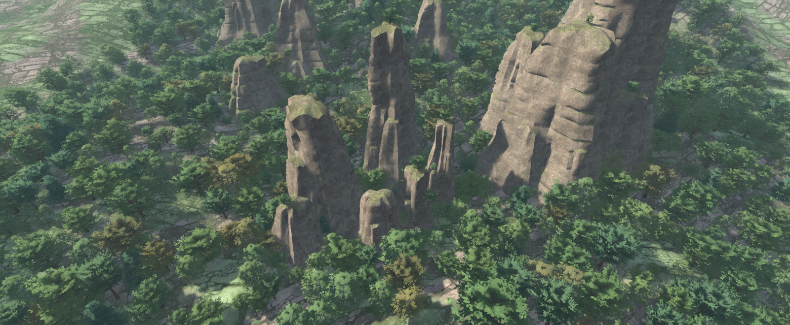

# Render Lab

Render Lab 是一个 Rust / Vulkan 1.4 实时渲染实验引擎。普通网格、簇、蒙皮角色和流水共享可见性缓冲。光照与材质可以独立组合。硬件光追既能为可见表面求遮挡和间接光，也能在独立实验中从主射线生成整幅图像。



## 运行

从包含 `Cargo.toml` 的引擎根目录运行。已验证环境为 Windows 11、Rust 1.92、Vulkan SDK 和 RTX 5070。构建时需能从 PATH 找到 `glslc`，也可通过 `GLSLC` 指定。基础渲染需要 Vulkan 1.4、`VK_EXT_descriptor_heap`、`VK_EXT_mesh_shader`、时间线信号量和支持时间戳的图形与计算队列族。交互窗口使用 Win32 surface 和交换链。光追与 DLSS 各有额外设备或 SDK 要求。[光追能力](docs/ray-tracing-rhi.md) · [DLSS 与 TAA](docs/viewport-post.md)

```powershell
cargo run --release --locked -- --list-experiments
cargo run --release --locked -- --experiment forest-karst
cargo run --release --locked -- --experiment rt
cargo run --release --locked -- --experiment clusters --command "lodview on"
cargo run --release --locked -- --scene assets/scenes/cornell-box/cornell_box_core.gltf
```

省略参数可打开默认 PBR 与卡通演示。`--scene` 接受 glTF、GLB 或引擎场景 JSON。`--benchmark` 测量窗口交换链的完成帧，`--capture` 保存 PNG，`--record` 通过 FFmpeg 导出 MP4 或 GIF。控制台支持保存、加载和显示 RDG。[命令与录制参数](docs/experiment-guide.md)

## 选择实验

| 研究问题 | 启动预设 |
| --- | --- |
| 几何细节、风动、植被体素与密度 | `clusters`、`vegetation`、`vegetation-scale`、`river-forest` |
| 直接光、间接光、阴影、光追管线 | `gi`、`shadow`、`rt`、`restir`、`ibl` |
| 森林和人物中的多跳 GI、风动阴影 | `forest-karst`、`gi12-forest`、`gi12-silver` |
| 角色、动画与纹理压缩 | `toon`、`motion`、`texture`、`gaussian` |
| 模拟效果与模块组合 | `water`、`destruction`、`mixed`、`confluence` |

独立预设各自提供观察对象或验收条件。同一场景的采样、投影和着色变体通过控制台切换。`mixed` 在固定柱廊中比较 IBL 和 ReSTIR，`confluence` 在同一帧组合树林、流水、角色和两种光照。Mega Geometry 在 `gi12-forest` 内切换。[完整实验目录与旧入口迁移](docs/experiment-catalog.md) · [资产来源与署名](assets/README.md)

## 引擎和验证

| 想了解的问题 | 文档 |
| --- | --- |
| 谁拥有场景、帧快照、依赖图和 Vulkan 对象 | [架构与改进顺序](docs/architecture.md) · [模块关系图](docs/module-map.md) |
| 模拟系统如何并行、ECS 怎样提取、场景怎样保存 | [运行时与场景](docs/runtime-and-scene.md) |
| 可见性、材质、时域历史如何连接，队列如何等待和退役 | [渲染管线](docs/render-pipeline.md) |
| 一条射线如何从几何到达 BLAS、TLAS、SBT 和命中着色 | [光追 RHI 审查](docs/ray-tracing-rhi.md) |
| 原始算法对照、运行控制与历史测量 | [实验手册](docs/experiment-guide.md) · [开发和测试规范](CONTRIBUTING.md) |
