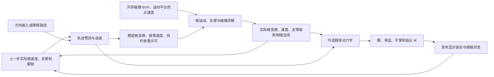

# 银狼的运动匹配、动力学与接触 IK

`motion` 用银狼演示输入驱动的运动匹配。`silver-contact` 在同一个角色上加入断槽、矮栏、低横梁、斜坡、弹簧踏板和终点按钮。`silver-contact-duo` 增加第二名银狼，给它配置不同腕部层级和显式指尖绑定。两个角色可以共享几何、动作库和同一个受力平台。[场景预设](../src/presets.rs) · [障碍场](../src/experiments/motion/silver/contact/course.rs) · [双人场景](../src/experiments/motion/silver/contact/population.rs)

## 从输入到检索

独立模式的移动驱动接收两轴模拟量。前进时横轴逐渐由侧移过渡到转向，倒退时按局部方向平移。临界阻尼弹簧根据目标改变平面速度和偏航速度。预测器在当前朝向下积分两者，在未来第 6、14、23 个采样点生成位置和面朝方向，视图叠加层把预测轨迹绘制成曲线。动作库的时间单位为秒，空间单位为米。[移动驱动](../src/movement.rs) · [轨迹积分](../src/experiments/motion/silver/locomotion.rs) · [视图叠加](../src/experiments/motion/silver/trajectory_view.rs)

在接触模式中，上一子步的 `ResolvedMotion` 向检索器提供实际位移除以子步时长得到的根速度、支撑点速度和侧碰法线。检索器从根速度减去支撑点速度，再旋入角色朝向坐标。预测从这个实测速率起步，移除指向障碍物内部的目标速度和加速度。锁定足在数据库特征中使用负的支撑相对根速度作为踝部水平速度估计，摆动足、垂直速度和踝位置保留基础动作采样。这样站在移动平台上可以维持站姿，角色推墙时也能在下一次检索中进入停止候选。运动匹配的约束只影响选姿与查询，控制器仍能提出向障碍物移动的请求，物理负责裁定最终位移。[角色子步交换](../src/movement/character.rs) · [采样与选姿](../src/experiments/motion/silver.rs)

动作库存有 39 段 30 Hz 的 Kimodo 重定向动作，共 4,680 帧。每段末尾 23 帧用于未来轨迹，剩下 3,783 个可选姿态。每个候选的 24 维特征包含三个未来时刻的平面位置和朝向，以及双踝当前的位置、速度。离线计算各维均值、尺度和权重，拟合 6 维 PCA 和 511 个节点的 KD 树。运行时用同一组参数归一化查询，通过投影包围盒下界剪枝，最终用完整归一化特征及转场代价选段。`motionsearch scan` 和 `motionsearch kd` 共享评分函数。选段跳转时根据上一基础姿态的位姿与速度偏差进行惯性化，接触 IK 的输出保留在显示姿态。[查询和索引](../src/experiments/motion/silver/search.rs) · [烘焙工具](../tools/motion_index.py) · [Kimodo 源素材与许可](../assets/README.md)

### 角色与动作资产

| 配置 | 运行时用途 |
| --- | --- |
| `clips` | 将每段源动作显式标记为 `idle`、`transition` 或 `steady`，决定起步、停止、稳态检索时的候选范围。动作库缺少标签时加载会报出片段名。 |
| `rig`、角色的 `bones` | 通过动作库通道指定骨盆、左右腿、触碰手臂，以及每个通道可选的源与目标绑定空间转换。对采样、惯性化和越障姿态统一施加 `parent * rotation * joint`。骨架可插入过渡节点并使用不同骨长。当前动作库固定为 21 个驱动通道。 |
| `fingertip_name`、`fingertip_offset`、`palm` | 在腕下解析唯一的指尖骨，用本地偏移指定蒙皮表面的触点。角色可覆盖指尖骨实体 ID 和偏移以适配另一套命名。掌根校准指定腕空间偏移、手指朝向及掌面法线，供扶栏 IK 和承重计算共用。 |
| `actions` | 每个角色均可覆盖起跳、落地源帧和冲量系数。四个掌触帧分别指定开始、压实、开始松开、结束。触发动作时快照其窗口与根轨终点，进行到一半保存、加载仍遵循同一套时序。 |
| `root_source` | 默认 `controller` 采用速度弹簧积分位移。`clip` 对局部水平位移与偏航按当前选中样本的播放份额累加。选姿跳转时继续从当前角色位置移动。在两种模式下，接触角色的平移都交给动力学确认。 |

默认数据位于角色配置文件，新场景会把骨架、接触窗口和根来源随角色保存。旧存档缺少字段时使用银狼默认配置。动作库已保存 6 帧前瞻位移与朝向，加载时从每段最后一帧反向还原逐样本根增量。测试另外用独立烘焙的 14、23 帧前瞻通道验证结果。更换源动作和骨架后，用烘焙工具重生成数据，执行 `python tools/motion_index.py --check` 核对源数据与索引摘要。[默认配置](../assets/motion/character-profile.json) · [配置与校验](../src/experiments/motion/silver/profile.rs) · [银狼重定向](../tools/bake_silver_wolf.py) · [障碍动作生成](../tools/generate_silver_traversal.py)

## 接触角色的一个子步



1. 独立银狼在 `silver-motion` 时钟上计算。接触银狼的动作、载体、动力学和 IK 在共享的 `character` 时钟上运行，默认 60 Hz，单次最多追赶 8 步。`ProposedMotion` 保存本步期望根变换、接管速度与掌撑许可。`ResolvedMotion` 保存编号相同的已解根变换、实际根速度、重力、支撑信息、侧碰法线及本步邻近表面。坐标使用角色父空间。新旧子步的编号必须连续，基础动作姿态另行存储。[子步交换类型](../src/movement/character.rs) · [调度](world-runtime.md) · [动作与接触阶段](../src/experiments/motion/silver/contact/stage.rs)
2. 自动越障用扶栏变换确定练习路线的平面原点和朝向。在动作入口冻结根轨终点和朝向，按烘焙位移曲线从实际入场点向终点插值。帧游标第一次跨过起跳标记时按角色质量与配置的冲量起跳，沿路线方向保留水平运动。角色在重力下运动，与有限移动支撑面求下降交点，结合预计落地时间调整空中相位，实测落地后对齐源片段。该场景的跳跃、翻越、钻行与转弯路线由预设装配。[动作对齐](../src/experiments/motion/silver/contact/traversal.rs) · [支撑查询](../src/physics/support.rs)
3. 共享空间索引先筛出附近碰撞体，根运动求解使用支撑面、角色胶囊和运动平台。接触处的刚体速度为 `v + ω × (p − pivot)`。同一踏板上的角色分在一组，一次预测踏板，按稳定次序归约反作用冲量，每组各提交一次。掌撑许可同时检查动作窗口、两节臂长与手腕目标是否可达，再乘以角色设置的承重比例。开关显示手 IK 时仍能独立测试这项物理承重。[碰撞快照](../src/experiments/motion/silver/contact/collision.rs) · [根动力学](../src/experiments/motion/silver/contact/dynamics.rs)
4. 可选的肢体动力学以肩、髋为固定锚点，让右臂和双腿的末端在重力、目标驱动、定长约束和附近支撑面下运动，再按设置权重混合回基础姿态。随后脚掌在支撑面局部空间设锚，骨盆修正高度，双骨 IK 解膝踝。触碰时把指尖到腕的实测偏移反算成腕部目标，解肩肘腕使指尖对齐按钮。扶栏时按腕空间掌根校准与扶栏平面定向手掌。校正按受影响子树更新 FK。这一层覆盖右臂、双腿的局部响应，全身自由根布娃娃及任意拓扑骨架的自动离线重定向仍属后续工作。[肢体约束](../src/physics/articulation.rs) · [物理姿态](../src/experiments/motion/silver/contact/physical_pose.rs) · [骨架与 IK](../src/experiments/motion/silver/contact/rig.rs)

`contact mode free` 保留原接触配置，独立移动的第一个子步按刚解出的父空间速度连续平移，包括平台携带或腾空的瞬时竖直分量。随后的子步遵循独立水平控制器。`contact mode contact` 用当前根和独立移动速度恢复求解。两种模式都支持保存后再切换。骨架、指尖、目标或支撑装置更换时重新核对依赖，清掉旧的基础姿态、脚锚与过渡。旧存档中的角色弹簧速度在加载时迁移给踏板。[模式切换与回归](../src/experiments/motion/silver/contact/modes.rs) · [存档与绑定](../src/experiments/motion/silver/contact.rs)

## 操作与验证

```shell
cargo run --release --locked -- --experiment silver-contact-duo
cargo test --release --locked --lib experiments::motion::silver
```

| 在控制台输入 | 可观察到的变化 |
| --- | --- |
| `control`、`control ENTITY`、`contact manual` | 选择实体并切换手动走路，使用 I/J/K/L 输入方向。输入 `contact auto` 恢复自动路线。 |
| `drive SIDE FORWARD`、`motionroot controller`、`motionroot clip` | 对当前角色输入连续方向，可分别对照弹簧积分与所选源片段的根运动。 |
| `contact limbs 0.5`、`contact grip 0.35`、`contact hand off` | 分别调节肢体动力学混合权重、掌撑承重比例和手部显示 IK。 |
| `contact action jump`、`contact action vault`、`contact action duck` | 单独观察跳跃、翻越和钻行动作。 |
| `contact physics`、`contact gravity 7`、`contact impulse 160` | 查看角色动量、速度和接触冲量，修改重力或起跳冲量后重放。 |
| `contact spin 45`、`tick character 120` | 改为每秒 45 度的转台，或将整条角色反馈链改为 120 Hz。 |
| `contact target X Y Z`、`contact view hand`、`contact status` | 在装置的父坐标中移动触摸点，用手部特写查看指尖误差。可用 `contact feet off` 或 `contact hand off` 分别关闭 IK。 |

[控制台实现](../src/experiments/motion/silver/contact/commands.rs) · [固定时钟与子步核验](../tests/simulation_schedule.rs)

### 场景回归

同一银狼障碍场以固定 60 Hz 运行 1,080 个子步，使用默认的控制器根运动、动力学、手脚 IK，关闭可选肢体动力学。基线取自 Git 提交 `8ad4259` 的独立源码和构建目录。回归从蒙皮顶点及接触标记取样。[场景及测量](../src/experiments/motion/silver/contact/tests.rs)

| 观测量 | 基线 | 当前 |
| --- | ---: | ---: |
| 终点最后 120 步的指尖误差 P95 | 0.0123 mm | 0.0126 mm |
| 满权重撑栏期间的掌根最大误差（各 9 次） | 0.0014 mm | 0.0013 mm |
| 足锁期间脚底到支撑锚点的最大漂移 | 0.01 mm（1,354 次） | 0.01 mm（1,395 次） |
| 跳跃脚底峰值 | 0.41 m | 0.41 m |
| 翻越时小腿网格距栏顶的最小净空 | 0.022 m | 0.056 m |
| 钻行时头部网格距横梁的最小净空 | 0.133 m | 0.126 m |
| 全程膝、踝、趾的最大单步位移 | 9.72 / 10.50 / 10.62 cm | 7.61 / 9.61 / 9.90 cm |

两版分别在 1.03 s、3.08 s 进入跳跃与翻越，钻行入口从 4.92 s 变为 4.93 s，相差一个子步。第二套骨架更改关节名、前臂到腕的长度与层级、腕部父绑定旋转（0.43 rad）及指尖绑定。在 720 步后，指尖距按钮 0.0079 mm。该骨架从同一网格和动作库派生。[第二骨架构建](../src/experiments/motion/silver/contact/population.rs) · [第二骨架回归](../src/experiments/motion/silver/contact/rig.rs)

### 绑定检查与视觉预算

独立运动更新与接触求解分别在自己的时钟运行。角色绑定缓存包括角色骨骼布局、腕部链、指尖标记和交互装置。常规编辑推进组件绑定版本，热路径只写当前播放、速度、冲量和 IK 状态。每个子步先检查来源、层级、成员与版本。只有可能改变绑定的编辑才重新核对角色，复用绑定仍匹配的求解阶段。原始层级更动或切换世界会重新建立对应绑定。[系统调度](../src/engine/schedule.rs) · [角色绑定](../src/experiments/motion/silver/contact.rs)

`schedule profile on` 开启当前时钟 tick 的分段计时，`schedule profile` 显示绑定、并行求值、提交、准备撤销、实际回滚的毫秒数。`schedule profile off` 关闭。worker 一项是主线程等待整个并行批次完成的墙钟时间。开启诊断会在需要撤销的写入处额外读取计时器，常规性能比较关闭诊断。[事务提交](../src/engine/schedule/context.rs) · [诊断命令](../src/console.rs)

`motionbudget 8` 允许每张新快照刷新最多 8 名待更新的独立银狼的显示姿态。按稳定角色 ID 轮转，同一角色的所有蒙皮同时更新。其余角色沿用上次显示的关节矩阵，根运动仍用当前帧。未显示的改动按脏节点合并，下次入选时补齐，即使之间没有新的模拟写入。当前操控角色、有接触或 IK 的角色、参加物理查询或模拟的角色、跨角色骨架始终逐帧更新。物理、游戏逻辑和权威骨骼姿态仍按原时钟求值。预算默认关闭，`motionbudget` 查看上张快照延后的角色数，`motionbudget off` 在下一张快照补齐全部姿态。低限额可能令远处角色的肢体呈阶梯式运动。[预算和轮转](../src/render/scene/pose_space.rs) · [适用角色](../src/experiments/motion/silver.rs)

### 碰撞几何和连续检测

实体用 `World::set_box_collider` 保存碰撞盒的局部中心、半宽和层掩码。碰撞盒可以是实体障碍、仅从上方承重的平台，或供手部承重的锚点。银狼的胶囊默认半径 0.18 米、全高 1.45 米，掩码随角色存档。旧关卡首次恢复时补齐平台和栏杆定义，已编辑的盒形会保留。[碰撞体定义](../src/physics/collision.rs) · [关卡恢复](../src/experiments/motion/silver/contact.rs)

转台更新后，所有参与接触解算的角色共用一份世界空间 BVH。拓扑变化时按包围盒最长轴中位数划分，移动时从叶到根重新合并前后两帧的包围盒。停止后收紧一次层级，后续子步复用静止快照。增删无关盒形时按实体生命周期、形状和父链恢复连续运动。查询结果变换到角色父空间，因此可以站在另一个层级的移动地板上。踏板的弹簧反作用由共享该踏板的角色组统一求解。[快照与查询](../src/experiments/motion/silver/contact/collision.rs) · [重绑历史](../src/experiments/motion/silver/contact/collision/history.rs)

胶囊以竖直线段和半径表示。轴对齐盒直接计算线段到盒的间距，仿射盒对各面和边求最近点，沿分离法线保守推进得到碰撞时刻。碰墙后去掉相对速度朝向墙内的分量，继续处理剩余位移。起跳或平台冲量超出原速度预测时，再按实际运动范围查询一次。墙和顶板的连续检测处理子步内平移，并采用盒的末姿态；快速旋转实体扫过的弧面仍是限制。转台承载单独使用支撑点的角速度。[胶囊扫掠](../src/physics/sweep.rs) · [支撑运动](../src/physics/support.rs)

绑定 `AngularBody` 的普通动态物件可设置三个局部主惯量、父空间角动量和外力矩。积分器在半步朝向上重新求角速度，再用旋转指数更新单位四元数；偏心冲量同时增加线动量和角动量。角色根、关节链和普通角动量刚体分别使用各自的求解器。[刚体旋转](../src/physics/angular.rs) · [关节约束](../src/physics/articulation.rs)

两个独立的 Release 基准 `profile_shared_collision_queries` 和 `profile_dynamic_collision_snapshot` 分别比较穷举与 BVH，测量 3,000 个盒形中每步移动 300 个并执行 500 次胶囊扫掠的开销。后一项分别计时整个快照固定步骤、候选组装和几何求交，使用两个 worker，预热四步后采集 96 步。[查询基准](../src/physics/collision.rs) · [动态碰撞基准](../src/experiments/motion/silver/contact/collision.rs)

### 500 名银狼的历史姿态基准

Ryzen 7 9700X、16 个 worker、release、177,042 个实体、3,000 个蒙皮实例。每帧推进 6 个 1/60 秒子步，预热 20 帧，采样 96 帧。记录两次原实现与两次新版，运行顺序为原、新、新、原。两端都使用默认的不限额显示，关闭模拟分段计时。这组历史测量对比姿态提取与预算实现。角色子步交换、碰撞快照和局部物理动画的本次同机对照见性能章节。[当前 500 人基准](performance.md#角色反馈和共享碰撞的开销)[可复现的人群负载](../src/experiments/motion/silver/contact/crowd_profile.rs)

| 工作量 | 原 P50，两次 | 新 P50，两次 | 原 P95，两次 | 新 P95，两次 |
| --- | ---: | ---: | ---: | ---: |
| 六子步模拟 | 22.90 / 22.87 ms | 21.51 / 22.52 ms | 26.50 / 29.37 ms | 31.63 / 28.77 ms |
| 随后提取一次 | 7.20 / 7.13 ms | 6.68 / 6.93 ms | 7.87 / 8.84 ms | 9.38 / 8.79 ms |

每次提取仍消费 500 个姿态块和 10,500 个脏局部矩阵，检查的调色板槽由 159,500 降到 159,000。源髋骨运动会改变几乎整套角色空间关节。两次运行的中位数下降，P95 有波动。另开诊断的一轮中，绑定、worker、提交及撤销准备分别为 P50 0.03、6.43、11.99、4.39 ms，P95 0.04、7.65、14.29、5.14 ms。成功子步没有执行回滚。各阶段分别取分位数。优先继续检查提交与撤销记录的成本。[姿态编辑对照](extraction.md) · [窗口与 GPU 测量](performance.md)

```powershell
$env:RENDER_LAB_NPCS = '500'
cargo test --release --locked --lib silver_crowd_extraction_profile -- --ignored --nocapture
$env:RENDER_LAB_SIM_PROFILE = '1'
cargo test --release --locked --lib silver_crowd_extraction_profile -- --ignored --nocapture
```

与 Unreal 对照时，可分别查看 Pose Search 如何组织姿态查询，以及 Mover 如何划分输入与模拟更新。本项目的轨迹积分、检索索引、支撑冲量和接触 IK 都可沿上面的 Rust 模块单独检查。[Epic Motion Matching](https://dev.epicgames.com/documentation/en-us/unreal-engine/motion-matching-in-unreal-engine) · [Epic Mover](https://dev.epicgames.com/documentation/unreal-engine/mover-in-unreal-engine)
