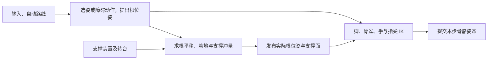

# 银狼的运动匹配、动力学与接触 IK

`motion` 用银狼演示输入驱动的运动匹配。`silver-contact` 在同一个角色上加入断槽、矮栏、低横梁、斜坡、弹簧踏板和终点按钮。`silver-contact-duo` 增加第二名银狼，给它配置不同腕部层级和显式指尖绑定。两个角色可以共享几何、动作库和同一个受力平台。[场景预设](../src/presets.rs) · [障碍场](../src/experiments/motion/silver/contact/course.rs) · [双人场景](../src/experiments/motion/silver/contact/population.rs)

## 从输入到检索

`MovementControls` 把方向交给选中的实体。在独立移动模式中，水平速度使用临界阻尼跟随目标速度，偏航速度跟随目标转速。预测器从当前速度和加速度出发，在角色朝向坐标中积分转弯与位移，求出第 6、14、23 个动作采样时刻的位置与朝向。实际运动也使用同一积分器，因此同时向前和转向会产生弧线。轨迹由视图叠加层绘制。[运动控制](../src/movement.rs) · [轨迹积分](../src/experiments/motion/silver/locomotion.rs) · [轨迹绘制](../src/experiments/motion/silver/trajectory_view.rs)

动作库包含 39 段 30 Hz 的重定向步行动作，共 4,680 帧。每段留出末尾 23 帧用于未来轨迹，得到 3,783 个候选姿态。每个候选有 24 个特征，其中 12 维描述三个未来时刻的平面轨迹和朝向，12 维描述左右足的位置与速度。离线把同一套均值、尺度和权重应用于候选，再拟合 6 维 PCA 和 511 个节点的 KD 树。运行时查询重用烘焙参数，按投影空间包围盒的距离下界剪枝，用完整归一化特征和转场代价评分。`motionsearch scan` 使用相同打分函数全量扫描，可与 `motionsearch kd` 核对。选段切换时通过惯性化衰减姿态偏差。[采样与选姿](../src/experiments/motion/silver.rs) · [索引查询](../src/experiments/motion/silver/search.rs) · [烘焙工具](../tools/motion_index.py)

Kimodo 生成与骨架重定向发生在离线工具中。运行时直接读取清单、二进制姿态和已烘焙的索引。要更换动作库，更新源动作，重定向目标骨骼，再用 `python tools/motion_index.py --check` 核对源内容和树的摘要；`python tools/motion_index.py` 可按需重建。跳跃、撑栏与钻行有另外的动作资源和接触事件。[源资产与许可](../assets/README.md) · [银狼重定向](../tools/bake_silver_wolf.py) · [障碍动作生成](../tools/generate_silver_traversal.py)

## 接触角色的一个子步



1. **基础姿态。** 独立银狼在 `silver-motion` 时钟运行，接触银狼的动作、载体、动力学和 IK 位于同一个 `character` 时钟，默认 60 Hz，单次最多追赶 8 步。动作阶段保存本步基础姿态，发布期望根变换。上一步的 IK 修正不会被反复混入下一步的动作过渡。独立角色运行中加入接触链时，会将当前根位姿和父空间速度交给新求解器。[调度与策略](world-runtime.md) · [动作和接触阶段](../src/experiments/motion/silver/contact/stage.rs)
2. **弹道与动作时间。** 起跳通知在越过指定源帧时施加一次冲量。质点按重力更新位置与动量。角色计算抛物线和有限移动顶面的下降交点，结合预测落地时间调整空中片段进度，并用运动线段与支撑面的交点确认落地。触栏手掌用接近、承重、释放三个区间逐步改变约束权重。[事件区间](../src/experiments/motion/silver/contact/events.rs) · [动作对齐](../src/experiments/motion/silver/contact/traversal.rs) · [支撑查询](../src/physics/support.rs)
3. **根运动与共享受力物体。** 动态角色根据重力、动量、支撑和接触冲量决定最终平移，接触点的刚体速度为 `v + ω × (p − pivot)`。转台直接提供有符号驱动角速度，低频更新跨过整圈也可计算切向速度。角色按踏板 ID 分组；组内共享一次踏板预测，求解各自冲量后按稳定顺序归约，一次提交该踏板的运动。不同踏板可以并行。[质点积分](../src/physics.rs) · [角色与平台动力学](../src/experiments/motion/silver/contact/dynamics.rs)
4. **脚和手精确对齐。** 脚掌锚点保存在支撑面局部空间，移动或转动平台会携带锚点。先校正骨盆高度，再用双骨 IK 解算大腿和小腿，膝盖弯曲面取自动作姿态。手部根据手腕到指尖的实际偏移反算腕部目标，再解肩、肘、腕链，使指尖对齐按钮。校正只刷新受影响子树的 FK 矩阵。超过肢体可达范围的目标会受骨长约束。[骨架绑定与解算](../src/experiments/motion/silver/contact/rig.rs) · [反馈与姿态发布](../src/experiments/motion/silver/contact/stage.rs)

存档包含动作相位、基础姿态、身体动量、足部锚点和平台状态。重新加入接触链、替换骨骼、切换目标或支撑装置时，运行时校验绑定并清除已经失效的接触或过渡状态。旧存档里随角色保存的弹簧速度在恢复时迁移到踏板。通用多刚体布娃娃、任意骨架自动重定向和联网角色预测超出当前求解器的覆盖范围。[存档恢复与热重绑](../src/experiments/motion/silver/contact.rs) · [角色回归](../src/experiments/motion/silver/contact/tests.rs)

## 操作与验证

```shell
cargo run --release --locked -- --experiment silver-contact-duo
cargo test --release --locked --lib experiments::motion::silver
```

| 在控制台输入 | 可观察到的变化 |
| --- | --- |
| `control`、`control ENTITY`、`contact manual` | 选择实体并切换手动走路，使用 I/J/K/L 输入方向。输入 `contact auto` 恢复自动路线。 |
| `contact action jump`、`contact action vault`、`contact action duck` | 单独观察跳跃、翻越和钻行动作。 |
| `contact physics`、`contact gravity 7`、`contact impulse 160` | 查看角色动量、速度和接触冲量，修改重力或起跳冲量后重放。 |
| `contact spin 45`、`tick character 120` | 改为每秒 45 度的转台，或将整条角色反馈链改为 120 Hz。 |
| `contact target X Y Z`、`contact view hand`、`contact status` | 在装置的父坐标中移动触摸点，用手部特写查看指尖误差。可用 `contact feet off` 或 `contact hand off` 分别关闭 IK。 |

[控制台实现](../src/experiments/motion/silver/contact/commands.rs) · [固定时钟与子步核验](../tests/simulation_schedule.rs)

### 绑定检查与视觉预算

独立运动更新与接触求解分别在自己的时钟运行。角色绑定缓存包括角色骨骼布局、腕部链、指尖标记和交互装置。常规编辑推进组件绑定版本，热路径只写当前播放、速度、冲量和 IK 状态。每个子步先检查来源、层级、成员与版本。只有可能改变绑定的编辑才重新核对角色，复用绑定仍匹配的求解阶段。原始层级更动或切换世界会重新建立对应绑定。[系统调度](../src/engine/schedule.rs) · [角色绑定](../src/experiments/motion/silver/contact.rs)

`schedule profile on` 开启当前时钟 tick 的分段计时，`schedule profile` 显示绑定、并行求值、提交、准备撤销、实际回滚的毫秒数。`schedule profile off` 关闭。worker 一项是主线程等待整个并行批次完成的墙钟时间。开启诊断会在需要撤销的写入处额外读取计时器，常规性能比较关闭诊断。[事务提交](../src/engine/schedule/context.rs) · [诊断命令](../src/console.rs)

`motionbudget 8` 允许每张新快照刷新最多 8 名待更新的独立银狼的显示姿态。按稳定角色 ID 轮转，同一角色的所有蒙皮同时更新。其余角色沿用上次显示的关节矩阵，根运动仍用当前帧。未显示的改动按脏节点合并，下次入选时补齐，即使之间没有新的模拟写入。当前操控角色、有接触或 IK 的角色、参加物理查询或模拟的角色、跨角色骨架始终逐帧更新。物理、游戏逻辑和权威骨骼姿态仍按原时钟求值。预算默认关闭，`motionbudget` 查看上张快照延后的角色数，`motionbudget off` 在下一张快照补齐全部姿态。低限额可能令远处角色的肢体呈阶梯式运动。[预算和轮转](../src/render/scene/pose_space.rs) · [适用角色](../src/experiments/motion/silver.rs)

### 500 名银狼的实测

Ryzen 7 9700X、16 个 worker、release、177,042 个实体、3,000 个蒙皮实例。每帧推进 6 个 1/60 秒子步，预热 20 帧，采样 96 帧。记录两次原实现与两次新版，运行顺序为原、新、新、原。两端都使用默认的不限额显示，关闭模拟分段计时。旧程序来自本轮修改前的工作区，包含此前的代码清理。[可复现的人群负载](../src/experiments/motion/silver/contact/crowd_profile.rs)

| 工作量 | 原 P50，两次 | 新 P50，两次 | 原 P95，两次 | 新 P95，两次 |
| --- | ---: | ---: | ---: | ---: |
| 六子步模拟 | 22.90 / 22.87 ms | 21.51 / 22.52 ms | 26.50 / 29.37 ms | 31.63 / 28.77 ms |
| 随后提取一次 | 7.20 / 7.13 ms | 6.68 / 6.93 ms | 7.87 / 8.84 ms | 9.38 / 8.79 ms |

每次提取仍消费 500 个姿态块和 10,500 个脏局部矩阵，检查的调色板槽由 159,500 降到 159,000。源髋骨运动会改变几乎整套角色空间关节。两次运行的中位数下降，P95 有波动。另开诊断的一轮中，绑定、worker、提交及撤销准备分别为 P50 0.03、6.43、11.99、4.39 ms，P95 0.04、7.65、14.29、5.14 ms。成功子步没有执行回滚。各阶段分别取分位数。优先继续检查提交与撤销记录的成本。[姿态编辑对照](extraction.md) · [窗口与 GPU 测量](performance.md)

```powershell
$env:RENDER_LAB_NPCS = '500'
cargo test --release --locked --lib silver_crowd_extraction_profile -- --ignored --nocapture
$env:RENDER_LAB_SIM_PROFILE = '1'
cargo test --release --locked --lib silver_crowd_extraction_profile -- --ignored --nocapture
```

与 Unreal 对照时，可分别查看 Pose Search 如何组织姿态查询，以及 Mover 如何划分输入与模拟更新。本项目的轨迹积分、检索索引、支撑冲量和接触 IK 都可沿上面的 Rust 模块单独检查。[Epic Motion Matching](https://dev.epicgames.com/documentation/en-us/unreal-engine/motion-matching-in-unreal-engine) · [Epic Mover](https://dev.epicgames.com/documentation/unreal-engine/mover-in-unreal-engine)
