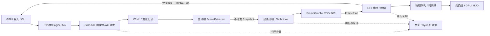
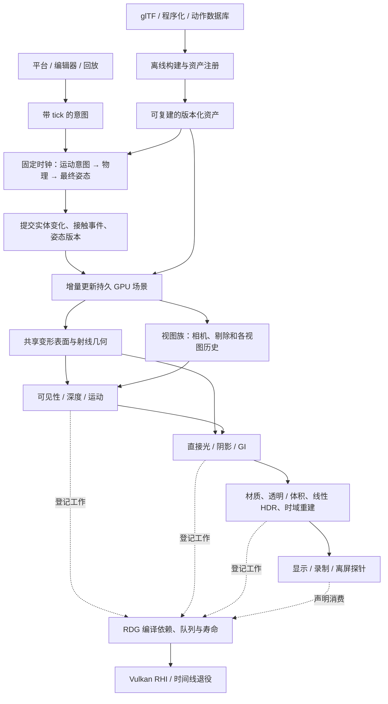

# Render Lab 架构评审与目标设计

本文的现状分析以提交 `f4405ef` 所在的评审阶段为界。第四节的五项首批改进已实作，当前默认值、保留的参考路径及测量结果见[实现与实测对照](pipeline-evolution.md)。

评审基线为 [`0df0d19`](https://github.com/re-define/render-lab/tree/0df0d19)，资料核对日期为 2026 年 11 月 25 日。目标仍是 Rust、Vulkan 1.4、单场景可预加载的实验引擎。本文沿实际调用链审阅代码，性能数字来自仓库已有测量。后半部分的接口、调度策略和验收用例均为设计提案。

**我会保留三线程流水、可见性缓冲、RDG 和现有实验，优先改变姿态与绘制工作的数据单位。** 现在 GPU 可以一次给几百个角色的同一种部件蒙皮，主线程仍逐骨检查受影响的调色板，渲染前端仍逐部件构造普通 draw。最先值得投资的是让“一个角色的一版姿态”和“一批兼容表面的可见工作”成为可直接传递的数据。这个选择既能检验性能，也能让后来加入的物理、GI 和时域重建使用同一份结果。

## 一、沿着代码看现在的一帧



| 代码中的所有者 | 一帧内的实际工作 | 当前边界 |
| --- | --- | --- |
| 世界、导入与存档 | glTF 解成由 ID 关联的资产、节点、骨架和实例。内建字段在实体行中，扩展组件可保留 Rust 类型并编码为 JSON。保存前校验，先写同目录临时文件再发布。 | 实体行存在有序映射中。ID 能随存档保留，删除最大 ID 后再次创建实体可能复用该数值。作者可编辑的数据和频繁更新的骨骼共用实体模型。已有脏记录、组件所有者索引和专用姿态写入接口。[ID 分配](../src/scene.rs#L270) · [世界与存档](../src/scene.rs#L479) · [实体存储](../src/scene/changes.rs#L98) · [导入](../src/import.rs#L50) |
| 系统调度与角色 | 系统声明前驱和读写目标，同批 worker 读同一状态，按确定顺序提交编辑。银狼在同一 60 Hz 子步内依次准备动作、按共享踏板归约物理响应、用接触做 IK，发布最终局部姿态。 | 每个固定阶段独立积累时间。单独注册的两个阶段在追赶两步时，可能按 A1、A2、B1、B2 执行。现有银狼将三个系统放在一个阶段，避免了这个问题。[调度循环](../src/engine/schedule.rs#L467) · [银狼装配](../src/experiments/motion/silver/contact.rs#L183) |
| 线程流水与帧准入 | 模拟完成后先争取快照位置，满载可跳过提取。渲染线程建立历史与计划，RHI 线程持有设备和提交顺序，worker 独立录命令。tick、快照、提交、完成有独立编号。 | 主线程同步提取。两个窗口帧槽可以重叠。提交失败可让旧历史代号失效，HUD 与有序基准分别消费完成事件。[准入与线程](../src/engine.rs#L98) · [帧记录](../src/rhi/frame.rs) |
| 场景提取 | 提取器消费每个读者自己的变化游标，更新连续子树、调色板、实例页和灯，输出可跨帧共享的只读场景。静态网格、材质槽及未变页面已有复用。 | 一份皮肤被标脏后，仍检查它的全部关节槽，写回改动的矩阵，再更新引用该皮肤的部件。灯变换进入更新路径后会重新提取灯表。基础提取还识别混合实验的隐藏标记。[增量传播](../src/render/scene/incremental.rs#L131) · [调色板](../src/render/scene/incremental.rs#L167) · [稳定槽](../src/render/scene/routes.rs#L30) |
| 实验装配与材质 | 新建、加载和切换共用模块注册，处理主技术互斥与设备能力。组合场景认领特殊表面，再连接可见性、光照和显示贡献者。像素按材质程序分箱，PBR、卡通分别着色；材质还可指定次级射线在命中 UV 处的响应。 | `Modules::build` 仍在帧内逐个检查候选普通实例属于哪个路由。材质已有显示与线性输出契约，光照端有明确的输入集合。[装配](../src/experiments/assembly.rs#L58) · [逐帧路由](../src/experiments/composition.rs#L173) · [材质分箱](../src/render/visibility.rs#L65) · [GI 命中材质](../src/scene/gi.rs) |
| 几何、可见性与射线 | 普通网格和簇写可见性 ID 与深度。森林先筛实例，再遍历层级和簇，利用 Hi-Z 复测，体素砖在三角簇后处理。角色的当前和历史姿态按源网格批量蒙皮，变形几何供光栅、运动和射线构建使用。射线遍历可选软件 BVH、KHR 管线或内联查询。森林选簇几何是另一项选择，当前实现要求 KHR 管线与 NV 簇扩展同时可用。 | 静态 BLAS 已能跨帧槽共享。普通表面仍逐部件登记 draw；每个这样的 draw 单独开始和结束动态渲染。专门的主射线实验也能独立构图。[簇剔除](../src/experiments/clusters/gpu.rs#L572) · [蒙皮批次](../src/render/geometry/skin.rs#L55) · [射线场景](../src/render/rays/scene.rs#L26) · [森林能力判定](../src/experiments/restir.rs#L130) · [普通绘制录制](../src/rhi/record.rs#L325) |
| 光照、特效与历史 | 光照组合支持 IBL、ReSTIR DI、探针及世界辐射缓存。水面、雾气进入线性场景颜色，TAA 或 DLSS 重建后色调映射、描边。运动向量使用去抖动的当前像素指向上一渲染帧的坐标差。 | TAA、降噪和 GI 分别拥有历史。主循环的相机与时间序列以单视图为单位；同一世界同时输出多个移动视图时，需要显式分开它们的历史。[帧阶段](../src/render.rs#L479) · [姿态和视图历史](../src/render/post.rs#L168) · [间接光](../src/experiments/restir/diffuse_gi.rs) |
| RDG、RHI 与显存 | RDG 按资源读写推导依赖和屏障。RHI 映射到物理队列，以时间线同步，分块并行录制。临时缓冲已有跨队列寿命验证与复用，图集已有按页增量上传。 | 图内访问以整个资源句柄为粒度；目前临时别名要求合适的首写、相同大小和放置条件。通用操作枚举直接认识 DLSS 和簇构建。管线已有进程内缓存，未命中时准备路径仍会创建 Vulkan 管线。[图编译](../src/rdg.rs#L771) · [物理队列](../src/rhi/queues.rs#L51) · [临时别名](../src/rhi/transient.rs) · [管线创建](../src/rhi/pipeline.rs#L17) |
| 平台、工具与输出 | GPUI 管理输入、控制台及 HUD；Vulkan 走交换链，优先 MAILBOX。正常窗口显示通过 GPU 传送结果。显式截图、视频与 GIF 才需要视口像素读回。 | 最终输出目前统一要求可供主机读取的缓冲。窗口的角色控制逻辑直接查找银狼组件，实时录制消费完成帧时会同步写 FFmpeg 管道。基准已有 CPU 帧标记、物理队列区间和内存统计。[最终输出](../src/render/frame_graph.rs#L60) · [角色控制](../src/ui.rs#L56) · [录制](../src/recording.rs#L113) · [时间线](../src/rhi/timeline.rs#L41) |

**性能证据决定优先级。** 在 RTX 5070、Ryzen 7 9700X、1080p、16 个 worker、20 帧预热和 96 帧采样下，300 人由 1,800 个当前蒙皮 pass 降到 6 个，整帧仍有 1,843 个逻辑 pass、66 个命令缓冲和 4 次物理提交。此前整组改动将 GPU 中位数从 53.82 降至 8.34 ms，不能把全部收益单独归给蒙皮。500 人时，窗口提取 P95 为 22.64 ms，GPU P95 为 13.76 ms，平均完成率 26.39 帧/秒。这两项 P95 可来自不同帧，流水工作也能重叠。森林的反例同样重要：733 个实例共享的树皮换色，现有系统只访问 1 个实体，已退役槽只上传 16 KiB。这条稀疏路径应作为重构回归基线。[角色数据](performance.md) · [完整分位数](crowd-frame-metrics.csv) · [森林换纹理](extraction.md)

## 二、从 Unreal 借哪些机制

截至审阅日，UE 5.8 已正式发布，5.9 为 Preview 2。下表以 Epic 公共文档、API 说明和路线公告为依据；对应到 Render Lab 的设计判断由本文提出。

| 状态与机制 | Unreal 已公开什么 | 对我们的取舍 |
| --- | --- | --- |
| UE5 的渲染线程与保留式绘制 | `FPrimitiveSceneProxy` 为渲染线程持有场景表示，mesh pass 将批次变成 `FMeshDrawCommand`。符合条件的命令可以缓存或合并，GPU Scene 让着色器通过 primitive ID 取对象数据。缓存引用的资源变化时，调用方有失效责任。[Mesh Drawing Pipeline](https://dev.epicgames.com/documentation/unreal-engine/mesh-drawing-pipeline-in-unreal-engine) | 利用现有稳定实例槽缓存绘制模板。把每帧变化的姿态、可见性和索引单列；深度规则、管线状态和绑定兼容才允许合批。 |
| UE5 的 RDG 与 Tasks | RDG 以 pass 参数描述访问，可裁除无用工作、管理纹理子资源转换、瞬态内存及异步队列栅栏。CPU Tasks 用前驱和任务 DAG，可与 TaskGraph 共用 worker。[RDG](https://dev.epicgames.com/documentation/unreal-engine/render-dependency-graph-in-unreal-engine) · [Tasks](https://dev.epicgames.com/documentation/unreal-engine/tasks-systems-in-unreal-engine) | CPU 和 GPU 共用追踪编号与依赖的表达习惯。模拟的提交顺序、Vulkan 的内存可见性分别由各自的编译器解释。 |
| UE5 的 Mass、角色和 Chaos | Mass 将相同布局的数据组织成 chunk，processor 按查询批量访问。动画预算支持按重要性分配骨架更新开销。Chaos 覆盖刚体、布娃娃、破碎等；实验性 Mover 则把运动模式与可回滚输入组织起来。[MassEntity](https://dev.epicgames.com/documentation/en-us/unreal-engine/overview-of-mass-entity-in-unreal-engine) · [动画预算](https://dev.epicgames.com/documentation/en-us/unreal-engine/animation-budget-allocator-in-unreal-engine) · [Chaos](https://dev.epicgames.com/documentation/unreal-engine/physics-in-unreal-engine) · [Mover](https://dev.epicgames.com/documentation/en-us/unreal-engine/mover-in-unreal-engine) | 先对高频姿态实行连续存储。给视觉骨骼分配预算时，对踩踏板、碰撞和抓取等影响模拟结果的动作保留固定频率。 |
| UE5 的资产与管线准备 | DDC 缓存可由源资产再生的派生数据；PSO 预缓存提前收集并准备候选管线。两者分别解决资源加工和首次使用管线的停顿。[Derived Data Cache](https://dev.epicgames.com/documentation/unreal-engine/using-derived-data-cache-in-unreal-engine?lang=en-US) · [PSO Precaching](https://dev.epicgames.com/documentation/en-us/unreal-engine/pso-precaching-for-unreal-engine) | glTF、程序化植物和离线生成动作采用同一资产版本规则。优先做本地增量烘焙和场景预热，整场预加载继续满足当前实验。 |
| 已发布能力与预览渲染方向 | Epic 在 5.8 将 MegaLights 列为可用于生产。Nanite Foliage 文档将组装件、体素与骨骼作为配套系统，功能标为 Experimental。5.9 预览将简单与复杂变形实例区分剔除，动态风可先共享模拟、遇局部外力再给植物独立模拟；同一预览还描述了多层透明合成。Epic 另公开了 GPU 驱动的 Lumen World Cache 方向。[5.8 公告](https://www.unrealengine.com/news/unreal-engine-5-8-is-now-available) · [Nanite Foliage](https://dev.epicgames.com/documentation/en-us/unreal-engine/nanite-foliage) · [5.9 预览说明](https://dev.epicgames.com/documentation/en-us/unreal-engine/unreal-engine-5-9-release-notes) · [光照路线](https://forums.unrealengine.com/t/lighting-and-rendering-updates/2853016) | 森林值得验证共享风场、局部变形和缓存预算。ReSTIR 与 MegaLights 可以比较采样目标、遮挡成本和画质，算法等价性需独立证明。世界光照缓存与逐视图降噪历史应有不同的所有者。 |
| 5.9 Preview 2 的动画与 UE6 未来路线 | 预览版 UAF 增加分层与通知并扩展 Pose Search、Warping 和 Control Rig 集成。Epic 对 UE6 公布基于 Verse 与 Scene Graph 的 gameplay 方向，11 月公告更新了早期版本的兼容计划。公开信息尚不足以推导 UE6 的具体渲染器内部布局。[预览公告](https://forums.unrealengine.com/t/preview-2-unreal-engine-5-9-preview/2852840) · [UAF 预览说明](https://dev.epicgames.com/documentation/en-us/unreal-engine/unreal-engine-5-9-release-notes) · [UE6 路线](https://www.unrealengine.com/news/the-road-to-ue-6) · [11 月路线更新](https://www.unrealengine.com/news/an-update-on-blueprints-and-the-path-to-ue6) | 对 Rust 实验引擎，值得借的是可组合的动作求值、稳定的场景格式和可重放的状态提交。数据布局及运行时语言仍按本项目的测量与需求选择。 |

## 三、如果从零设计，我会如何划分核心

**我会让世界、姿态、GPU 场景和视图历史各有一个写入者。** 外部模块通过带版本的数据交换。跨子系统边界才需要接口；模块内部继续用具体的 Rust 类型、连续数组和普通函数。线程数、插件数、crate 数都不用与子系统数量相等。



### 1. 世界、资产和持久场景分别持有什么

| 数据 | 谁能写，什么时候发布 | 读者与寿命 |
| --- | --- | --- |
| 实体、层级、组件、资产引用 | 世界在固定子步或编辑提交点修改。磁盘 ID 可稳定引用；运行期槽携带代际，删除后复用可检测过期引用。 | 模拟、编辑器和提取器各有游标。场景存档记引用、组件版本和需要继续模拟的状态。结构突变时可退回完整提取。 |
| 网格、骨架、动作库、簇 DAG、材质、碰撞形状 | 导入器或离线构建器发布不可变版本。构建键含源内容、依赖版本、算法版本、编译选项及目标设备能力集合。 | 加载器可在开场时预载全部成品。着色器与 CPU 结构布局做反射校验，按场景清单异步预热 PSO。缓存损坏可重建，旧帧使用的版本由时间线延迟释放。 |
| 角色最终姿态与身体状态 | 物理负责根运动和接触结果；动画在子步提交一次最终姿态，发布骨架 ID、根变换、姿态版本、脏关节范围。 | 玩法插槽和碰撞只取需要的关节；提取器按角色消费。多部件共享调色板，GPU 蒙皮为多个视图及射线几何供数。 |
| GPU 实例、材质、光、变形流和射线几何 | 渲染场景根据已接受的快照更新连续区间。每个帧槽绑定确切版本，资源管理器记录最后使用它的各物理队列时间线值。 | 各视图的光栅和光照读同一场景版本。未变网格常驻；视图无关的蒙皮和 BLAS 可复用。姿态、几何拓扑与材质参数有独立失效条件。 |
| 帧临时量、时域历史与世界缓存 | RDG 管帧内临时量。TAA、降噪器和屏幕探针分别按视图持有历史。世界空间 GI 缓存按场景、空间区块、光照版本更新。 | 多视图共用世界缓存；镜头切换、分辨率变化、材质改动和物体移除各使受影响的产品失效。显示、录制及探针各自声明最终消费。 |

资产导入后继续通过 entity 引用。读取旧版自包含 JSON 时，可从其中已有的网格和纹理生成派生资产；保存可选便携包携带所引用的成品，保证缺少原始 glTF 时仍能恢复。场景模拟存档另标版本和迁移规则。把不可变载荷从高频模拟记录分离，允许资产重导入时先构建新版本、校验依赖，再一次切换引用。正在提交的帧可继续读旧页。读者太慢时应定义退化方式：交互视图跳过过时快照，离线对照有序等待，不能覆盖正在被 GPU 使用的页。现有世界快照、帧代号与图集双版本给这次迁移提供了起点。[变化游标](../src/scene/changes.rs) · [双槽纹理回归](../src/rhi/present/tests.rs) · [图集](../src/render/atlas.rs)

写成 Rust 接口，角色到渲染的边界可以只传一个发布记录。下面是目标签名草图。批量写入按角色摊销，冷路径才能修改骨架拓扑。

```rust
struct PublishedPose {
    actor: EntityId,
    skeleton: AssetVersion,
    tick: SimTick,
    pose_version: u64,
    root_world: Mat4,
    joints: Arc<PosePages>,                  // 只读的骨架空间最终姿态
    changed: Vec<Range<JointIndex>>,         // 相对于上一已发布版本
}

fn apply_pose(scene: &mut RenderSceneWriter, pose: &PublishedPose);
fn build_view(scene: &RenderSceneVersion, view: &ViewState, graph: &mut FrameGraph);
```

`PublishedPose` 保留完整姿态页的引用，因此渲染跳过几个模拟 tick 后仍能取得一致结果。提取器记录自己的最后消费版本；跨过一个或多个增量时，可合并日志或重新绑定该角色的完整页。骨架或关节映射改变时重新绑定并清除无效历史。这样每个角色只发布一次，多部件和多个相机都可以读取。

### 2. CPU 执行、动画和物理怎样协作

一个固定时钟域在每次子步运行完整依赖图。以银狼为例，设备或回放提供第 N 步的移动、跳跃与触摸意图；Motion Matching 或显式片段产生基础姿态、根运动请求和动作事件；运动控制器将请求交给物理，刚体得到受约束的根位姿、支撑面速度和接触点；手脚 IK 读取这些结果，再提交姿态和可查询的骨骼插槽。若反馈会施力，当前步的物理约束必须在求解前登记；视觉 IK 完成后提出的新力进入下一子步。这样能解释每次写入为何发生，也能避免同一子步暗含循环。

同一时钟内，独立角色可并行，接触同一物体的冲量归入同一个求解组。需要通用刚体时按宽阶段、窄阶段、接触流形、约束岛、迭代求解增量实现；旋转平台的接触点速度需包含角速度项。角色控制器读取物理查询接口，编辑器能回放某个接触岛。GPU 水体与纯视觉碎片使用同一时间戳、各自的求解器；如果玩法必须当步获知水面高度，应提供该子步的权威查询，例如 CPU 侧交互高度场。容许延迟的效果可读取带模拟步号的旧 GPU 采样。现有角色平台、流水和破碎场景都可以用作独立验收。[角色固定步](../src/experiments/motion/silver/contact.rs#L183) · [当前支撑查询](../src/physics/support.rs) · [水体](../src/experiments/effects/water.rs) · [碎块](../src/experiments/effects/fracture.rs)

动作选择、重定向和 IK 可以独立替换。骨架资产描述关节语义、静止姿态、骨长与约束；重定向先得到目标骨架的基础姿态，再按脚底、手掌和指尖在世界空间的目标校正。保留全量 FK 作为数值参照。多人负载下，远处纯视觉姿态可降频并插值，屏幕运动必须使用本视图当前要渲染的姿态与上一份有效时域历史对应的姿态，两者都包括降频插值的结果。抓取、移动平台上的角色仍按物理频率更新必要关节。相同输入在相同程序版本和固定时钟下应产生可复核的事件序列，跨设备浮点逐位一致需单独验证。[当前关节绑定](../src/experiments/motion/silver/contact/rig.rs#L36) · [动作检索](../src/experiments/motion/silver/search.rs) · [精确触摸和保存重载基线](animation-physics.md)

### 3. 渲染前端以视图和表面为入口

**普通网格也走 GPU 工作列表。** 加入场景或修改材质时，CPU 生成可长期复用的绘制模板。每帧更新脏实例和姿态区间；GPU 用视锥、遮挡及屏幕误差生成可见项，按兼容管线、深度状态、资源布局和表面编码分组，再间接发起绘制。普通网格先走这条路，簇网格保留自己的层级遍历和末尾体素光栅，两者写相同的表面标识、图元标识和深度。透明以外的材质继续由可见像素分箱决定着色方式。小场景保留直接绘制，有利于判断 GPU 分类成本及逐像素对错。

这个拆分对正确性有实际要求。批次压紧后，像素 ID 必须能映回稳定实例和原始图元，再定位材质、顶点与历史姿态。并行追加产生的顺序不可充当持久 ID。共面的两个三角形若依赖原绘制顺序决定覆盖，应采用稳定平局规则、保序分组或保留原路径。带骨骼或风动的物体用保守变形包围体预剔除，再按需精化；被主相机剔除的树仍可能投影进来。溢出计数和保守补绘应当可观测，超额负载不能表现成悄无声息的缺面。[当前可见性和材质解析](../src/render/visibility.rs#L65) · [普通几何](../src/render.rs#L391) · [森林射线候选](../src/experiments/clusters/gpu/mega.rs)

**光照算法共享输入，保留各自的采样与历史。** 表面产品说明世界位置重建、几何/着色法线、UV 与材质标识。每个材质分别定义主视图着色、覆盖/透射以及 GI 命中时返回的漫反射与自发光。卡通色阶不必被解释成物理反照率。直接光可换全光源参照或 ReSTIR DI；间接光可换探针、辐射缓存或路径参考；降噪器读光照估计、深度、法线、运动与历史有效性。求交请求明确分为遮挡和最近命中，以及是否需要透明度判断和命中属性。设备与材质能满足语义时，可在 KHR 管线、内联查询与软件 BVH 之间选择遍历方式；几何另选已变形三角面、代理或设备支持的簇。能力组合在装配时验证，同一组光线可用于对照。不同算法的抽样分布、储层权重和缓存更新仍由算法自己维护。[现有材质响应](../src/scene/gi.rs) · [硬件及软件场景](../src/render/rays/scene.rs) · [ReSTIR](../src/experiments/restir/graph.rs)

森林中的同一株树可发布三类相关数据：用于主视图的已选三角簇或体素、来自同一风姿态的投影候选、供物理查询的简化碰撞体。阴影和 GI 可按投射空间或射线范围补充候选，注明代理误差。主视图、阴影和运动向量使用同一变形时间与 LOD 过渡权重，物理以自己的精度和更新频率求解。这个边界允许研究硬件簇光追或新的风模拟，不必把碰撞树、渲染 DAG 与光追 AS 强行做成同一种结构。

**多视图和半透明预留明确的位置。** 一份场景版本可以被主相机、反射、阴影视图和录制相机消费。相同姿态可共享变形结果，每个视图单独选择簇和历史。单层最近表面 ID 足以支撑不透明和经过覆盖测试的主可见性；它无法恢复同一像素内前后两层玻璃的颜色和透射。真正多层的水、薄雾或粒子应接在不透明深度与 HDR 之后，可选有序混合、OIT 或体积积分，再将合成所需的运动或反应遮罩送给重建器。现有单层水面实验可继续原路径。新增技术只需声明自己生产的结果和输入精度，不必让所有不透明材质增加一套分支。[现有水面反射](../shaders/river_reflections.comp) · [后处理入口](../src/render/post.rs) · [Epic 预览透明渲染](https://dev.epicgames.com/documentation/en-us/unreal-engine/unreal-engine-5-9-release-notes)

### 4. RDG 决定依赖，RHI 决定怎样执行

1. **登记。** 模块声明输入输出、资源子范围和可接受队列。共享接口区分深度的约定、HDR 颜色空间，以及运动向量的方向、像素单位、分辨率和抖动约定。视图外扩展只获取声明的资源。材质组、GI、图像描边依赖语义产品，底层图仍处理 buffer、image、AS 及真实访问。插件在装配时遇到缺失产品、格式不符、两个独占生产者时给出可定位的错误。
2. **编译。** 从呈现、捕获、历史发布、外部写回与诊断计数等有效输出反推活跃 pass。以图像 aspect/mip/layer、缓冲字节区间追踪冲突，合并相容屏障。先保持现有保守模式；对稳定拓扑可缓存结构计划，帧地址、实例数和姿态版本在执行前绑定。视图尺寸影响资源描述、功能集影响图结构、队列拓扑影响物理计划，三者变化应重新校验相应缓存。
3. **安排物理工作。** 从正确的单队列解起步。对有独立工作的区间比较图形、计算及复制队列映射，用历史 GPU 时间估计关键路径，算入跨队列等待、带宽竞争和延长临时资源寿命的代价。缓存策略且限制切换频率。把逻辑 pass 合并进兼容的动态渲染作用域，同时保留 pass 计时。时间线信号量负责跨队列依赖；一个屏障或提交边界的删除必须仍满足布局迁移、内存可见性以及队列族所有权要求。[现有调度](../src/rdg.rs#L771) · [提交边界](../src/rhi/queues.rs#L51)
4. **分配和退役。** 瞬态资源由跨队列的最后使用区间决定能否别名，进一步复用图像前核对格式、用途、对齐和绑定约束。持久资产用版本化句柄与预算，上传/读回用独立暂存区。软件、KHR 与 NV 后端各管自己的加速结构和 scratch；不可变 BLAS 跨槽复用，变形数据按版本更新。设备丢失时区分可从资产重建的资源、需清空的历史及必须报告失败的外部工作。[现有分配器](../src/rhi/allocator.rs) · [AS 缓存](../src/rhi/ray.rs) · [故障后的历史失效](../src/engine.rs#L378)
5. **呈现和扩展。** 窗口输出可直接以兼容的显示图像或 GPU 复制作为末端；截图才添加拷贝到主机的消费。厂商 SDK 通过受限的外部命令编码器声明队列、访问、线程亲和性和副作用。RHI 仍对资源和时间线负责，应用不能在图外偷偷提交。这让新的重建器可以与 TAA、DLSS 并列，也保留完整的同步验证能力。[现有最终输出契约](../src/render/frame_graph.rs#L60) · [NGX](../src/rhi/ngx.rs)

### 5. 工具、交互和未来子系统

| 子系统 | 接入方式与边界 |
| --- | --- |
| 平台输入、摄像机与编辑器 | 平台层归一化键鼠、设备焦点和时间戳。视口处理相机意图，受控实体接收玩法意图。控制台、GPUI、离线回放都调用同一命令；实验注册自己的命令与调试视图。删除实验时基础 UI 和场景提取仍能编译。 |
| HUD、视频与离线实验 | 默认 HUD 继续由 GPUI 最后叠加。独立指定录制场景色、最终显示色，或显式含 HUD 的合成结果。编码器消费有界读回队列，实时录制声明丢帧或重采样策略，离线录制允许施加背压。窗口仅用呈现消费时应显示零 CPU 像素读回。 |
| 性能诊断和质量预算 | 同一帧可追到输入 tick、模拟子步、快照、渲染队列、提交与退役。记录 CPU worker 实耗、等待来源、GPU 各队列时段、VRAM 峰值、上传量以及实际覆盖。必须能关掉异步计算、强制全量提取或选择参考着色，方便分离正确性与性能问题。 |
| 水体、破碎、粒子与音频 | 特效模块选择模拟时钟，发布可渲染表面、粒子列表或稀疏场；实体交互使用固定步查询及事件。将来接音频可订阅足音/接触事件，以实体、子步和序号去重，在自己的音频时钟消费。避免通过 GPU 或扬声器输出反向修改玩法状态。 |
| AI、导航、网络与大世界 | AI/导航按需读取版本化碰撞或导航表示，输出与玩家相同的运动意图。网络可消费确认的实体变化，复制与渲染按各自的重要性裁剪。存档保持稳定 ID 和 schema 迁移。远端复制、导航和分区流送都可独立加入；当前单场景默认一次载入资产就足够。 |

一个新研究模块的最小接入量可以很小。例如替换降噪器，只需声明光照、深度、法线、运动和历史输入，注册输出及失效条件，在同一机位比较参考光照误差、拖影和 GPU 时间。新动作匹配器只需输出同一骨架的基础姿态和根运动请求，就能直接用现有踏板、IK 与渲染进行对照。这两个例子分别检验 GPU 和 CPU 扩展边界。

关于 UE6 的表述以 Epic 在 2026 年 11 月 20 日修订的路线为准。本轮针对移动、模块时钟和实体能力的决策及源码见[世界运行时架构](world-runtime.md)。

## 四、在这个仓库里的实施顺序

以下保留评审时约定的实验顺序与验收口径，便于和实际结果逐项对照。

| 顺序 | 首个可交付改动 | 成功条件与对照 |
| --- | --- | --- |
| 1. 角色姿态与增量提取 | 给银狼增加每角色姿态版本和脏骨区间，提供旧实体姿态适配器。比较“仅变化范围”和“整份姿态批处理”两种路径，高变化密度允许切回整块；按灯 ID 更新光源记录。 | 100/300/500 人固定输入，核对世界矩阵、调色板、触点、屏幕 ID/运动及存档重载。采集实际访问关节、发布页、上传字节、提取 P95 和完成间隔。森林只动相机、单树、共享树皮的成本也应保持。 |
| 2. 普通绘制队列 | 先只合并银狼兼容材质和深度状态的普通部件，生成持久模板和每视图间接绘制参数。 | 在冻结的 300 人存档逐像素核对 ID、深度和运动，保留共面覆盖、零权重蒙皮、遮挡和屏幕外投影测试；再测前端 P95、实际 draw/作用域、GPU 时间及显存。在小场景比较分类成本。 |
| 3. 固定时钟与插件边界 | 将动作、接触和 IK 分别注册到同一时钟域，输入改走指定角色意图；加入第二种骨架及旋转平台。 | 比较一个 1/30 秒与两个 1/60 秒、1 与多 worker 的同刻状态。检查掌根/指尖误差、角速度传递、冲量、事件次数、旧存档重载和补步上限。 |
| 4. 图编译和后端 | 先实现显式外部副作用与活跃 pass 裁剪，再迁移单项 mip/区间访问；从森林 Hi-Z、BLAS 构建与主视图比较两种队列映射。最后才尝试结构计划缓存或图像别名。 | 在同一路径比较单队列/异步的 GPU 关键路径和 P95、总等待、瞬态与 AS 峰值。覆盖多槽、缩放、SDK、突发重建与 Vulkan 同步验证。有重叠却让整帧变慢时保留较快策略。 |
| 5. 资产、视图与输出 | 对簇资产或动作库先做一次版本化烘焙，添加 PSO 冷/热启动记录。增加第二个离屏相机，与主视口共享世界、独立历史，再接可选编码消费。 | 修改单个源资产只重建依赖它的产品。切换镜头、暂停、录制、修改曝光或设备恢复时检查历史和颜色。测首用管线停顿、启动时间、VRAM、录制对交互 P95 的影响。 |

取舍的依据是能否用同一份输入替换一个算法，并解释每项时间和画面变化。当前最划算的第一步，是在 **500 人银狼**场景缩短姿态发布与提取，同时在**岩柱森林**与**混合场景**守住现有稀疏更新、可见性和跨模块渲染结果。只要这两条链路成立，后续替换 GI、物理求解器或时域重建器就有可长期复用的基础。
