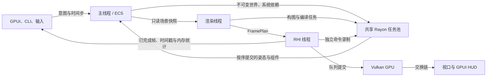

# 运行架构与模块

## 一帧的所有权

主线程接收输入，运行模拟，再提取相机、几何、材质、灯光和实验组件。模拟与提取是两个独立计时区间。主线程尝试把不可变快照送入有界通道；通道满时本次模拟已经完成，本次快照可被跳过。渲染线程关联时域历史，把构图和编译放入共享池执行，再把计划交给 RHI。RHI 拥有设备、交换链、帧槽和提交顺序。窗口路径可以保留多个在途帧，完成邮箱供界面显示最近结果。默认池大小随可用逻辑处理器调整，可通过 `RENDER_LAB_WORKERS` 指定。[主循环](../src/engine.rs) · [窗口](../src/ui.rs)

## 世界、系统和存档

几何、纹理、骨架、材质、光和可绘制实例以实体 ID 关联。层级保存父 ID 和局部矩阵；实例引用共享网格及材质；skin 保存关节 ID 与逆绑定矩阵。实验状态以命名空间键装入 ECS，运行期可用原生 Rust 类型，存档编码成 JSON。glTF 导入先生成这些实体和引用，运行期使用统一的场景结构。恢复候选世界时验证引用，恢复组件，重新装配系统和材质，再替换当前世界。[实体与资产](../src/scene.rs) · [组件存储](../src/scene/components.rs) · [glTF](../src/import.rs)

调度器按显式前驱和数据冲突编排阶段。局部变换可限定到具体实体。一个系统产生的改动暂存于任务上下文，批次成功后按顺序提交。固定阶段有自己的余数和每帧最大子步数。单个系统也可把互相独立的角色分发给工作线程；所有子任务读相同快照，按输入顺序汇总结果。要读取本子步刚刚产出的状态，须安排在后继阶段。[调度与回滚](../src/engine/schedule.rs) · [任务上下文](../src/engine/schedule/context.rs)

## 模块接口

| 模块 | 输入、输出与责任 |
| --- | --- |
| `scene`、`import` | 持有可保存的世界、资产和层级；检查引用有效性；记录渲染读者需要的变动。 |
| `engine`、`physics` | 编排应用线程与模拟子步。质点以 SI 单位保存位置、质量和线动量，碰撞提供冲量，场景提供支撑几何。 |
| `render::scene`、`geometry`、`tables` | 把 ECS 变成不可变快照，准备实例索引、局部或已变形的几何、材质和 GPU 表；共享姿态数据服务可见性和射线。 |
| `render::frame_graph`、`rdg` | 前端加入 pass、表达资源及其历史，编译器推导顺序、屏障和逻辑队列要求。 |
| `rhi` | 将计划映射到真实 Vulkan 队列与资源，管理命令缓冲、描述符、分配、时间线和呈现。 |
| `experiments` | 注册场景恢复、主技术、可叠加的材质和光照贡献。独立研究路径也可提供专用 Technique。 |
| `console`、`ui`、`recording` | CLI 与窗口共用命令；GPUI 处理控制台、输入和 HUD；编码器消费明确要求读回的场景帧。 |

`confluence` 可打开或关闭森林、水、角色、环境光与多光源层。装配器负责恢复和切换，光照注册表检查同一通道的生产者，避免两个技术同时提供主直接光。[装配器](../src/experiments/assembly.rs) · [组合实验](../src/experiments/composition.rs) · [光照注册](../src/experiments/light_stack.rs)
