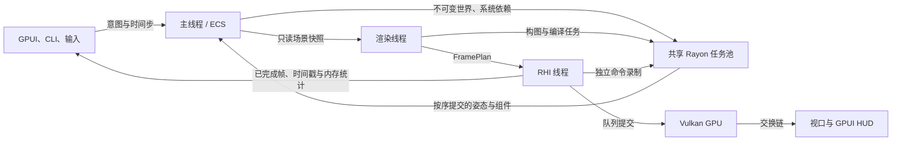

# 运行架构与模块

代码评审、与 Unreal 的对照及分阶段迁移见[架构评审与目标设计](architecture-review.md)。

实体的移动权、物理参与、模块 Tick、预计算边界与投影网格见[世界运行时架构图](world-runtime.md)。

## 共享世界的两台相机

`Engine::tick_with_view` 在一次模拟和一次提取后分出主视图和可选离屏视图。两者共享不可变的实例、几何和材质，分别构图、剔除、跟踪上一相机与重投影历史。RHI 在同一 Vulkan 设备上复用资产、静态 BLAS、管线和录制池，为两台相机分开保存历史缓冲和历史对应的队列信号。主视图支持窗口呈现，离屏视图在渲染完成后读回。单设备顺序提交两个视图，次视图会占用 GPU 时间。每张图的 `snapshot_id` 对应同一次模拟，`submission_id` 标识各自的提交，`secondary_view` 标明所属视图。运行命令和验收口径见[实现与实测对照](pipeline-evolution.md)。

## 一帧的所有权

主线程在每次 tick 中先接收输入并推进模拟。模拟结束后，主线程预留主线程到渲染线程之间的一个等待位置，再提取不可变快照。位置被占用时，本次模拟照常完成，跳过提取，最新世界状态留待下一次投递。渲染线程取走快照时归还位置；提取失败也会归还。渲染线程关联时域历史，在共享池中构图和编译。RHI 独占设备、交换链与提交顺序，按帧槽复用资源。等候计划期间轮询 GPU 时间线，两个帧槽都被占用时才为复用等待最早一帧。默认任务池按可用逻辑处理器取 2–16 个 worker，可用 `RENDER_LAB_WORKERS` 设置。[主循环](../src/engine.rs) · [退役](../src/rhi/mod.rs) · [物理队列时间线](../src/rhi/queues.rs)

| 帧标识 | 何时变化 |
| --- | --- |
| `tick_id` | 每次成功推进主线程模拟后递增。一个 tick 可含多个固定子步。 |
| `snapshot_id` | 提取成功且交给渲染流水线时递增。跳过提取的 tick 计入 `skipped_render_ticks`。 |
| `submission_id` | RHI 成功提交该帧的 GPU 队列工作后递增。 |
| `Frame.sequence` | 离屏帧退役，或窗口帧带有实际交换链提交并退役时递增。 |

HUD 读取最新完成帧。窗口基准使用有序完成队列；读取落后时，通过限制新快照进入来约束内存。基准输出的 `frame_times` 将每帧的四个编号与统一 CPU 时钟（微秒）关联，包含快照就绪、前端开始、计划就绪、RHI 开始、acquire 开始、队列提交开始、呈现请求返回及完成时间。GPU 时间戳保留设备时钟下的相对区间，显示器扫描输出需要独立测量。[窗口基准](../src/ui/benchmark.rs) · [帧报告](../src/rhi/frame.rs)

RHI 出错时递增历史代号。RHI 拒绝已排队、仍引用旧代号的计划，渲染线程在下一帧重建时域历史。回归测试在正常帧之间注入一次超出设备尺寸的提交，核对后续姿态历史、编号和 CPU 时间戳。[故障恢复测试](../src/engine.rs)

## 世界、系统和存档

几何、纹理、骨架、材质、光和可绘制实例以实体 ID 关联。层级保存父 ID 和局部矩阵；实例引用共享网格及材质；skin 保存关节 ID 与逆绑定矩阵。实验状态以命名空间键装入 ECS，运行期可用原生 Rust 类型，存档编码成 JSON。glTF 导入先生成这些实体和引用，运行期使用统一的场景结构。恢复候选世界时验证引用，恢复组件，重新装配系统和材质，再替换当前世界。[实体与资产](../src/scene.rs) · [组件存储](../src/scene/components.rs) · [glTF](../src/import.rs)

调度器按显式前驱和数据冲突编排阶段。局部变换的访问可以限定到实体 ID，组件按类型声明读写。系统内部可将独立角色分发给工作线程，所有子任务读同一子步快照，按输入顺序合并改动。需要共享一个可写物体时，由物理阶段对各角色的请求统一归约。后继阶段可以读取本子步已经提交的结果。[调度与回滚](../src/engine/schedule.rs) · [任务上下文](../src/engine/schedule/context.rs)

固定阶段独立累计时间余数并限制每帧子步数。按组件装配的阶段可在子步边界检查成员、层级与自定义绑定条件。绑定发生变化时先构造替代系统并验证其读写声明及前驱，再替换实体和资源绑定，保留原有时钟和依赖图。银狼实验用这条路径处理角色加入、退出及既有角色的骨骼或装置替换。变换值由专用姿态接口写入，层级或原始实体行的编辑会保守地触发重新绑定。[固定阶段绑定](../src/engine/schedule.rs) · [世界变化记录](../src/scene/changes.rs) · [角色实例](animation-physics.md)

## 模块接口

| 模块 | 输入、输出与责任 |
| --- | --- |
| `scene`、`import` | 持有可保存的世界、资产和层级；检查引用有效性；记录渲染读者需要的变动。 |
| `engine` | 管理三线程流水线、具名模拟时钟、系统读写依赖、按实体的任务批次与子步回滚。 |
| `movement` | 接收实体移动意图和动画根运动提议，按运动策略选择最终根变换，提供普通物体的线性运动系统。 |
| `physics` | 质点以 SI 单位保存位置、质量和线动量，碰撞提供冲量，场景提供支撑几何。 |
| `render::scene`、`geometry`、`tables` | 把 ECS 变成不可变快照，准备实例索引、局部或已变形的几何、材质和 GPU 表；共享姿态数据服务可见性和射线。 |
| `render::frame_graph`、`rdg` | 前端加入 pass、表达资源及其历史，编译器推导顺序、屏障和逻辑队列要求。 |
| `rhi` | 将计划映射到真实 Vulkan 队列与资源，管理命令缓冲、描述符、分配、时间线和呈现。 |
| `experiments` | 注册场景恢复、主技术、可叠加的材质和光照贡献。独立研究路径也可提供专用 Technique。 |
| `console`、`ui`、`recording` | CLI 与窗口共用命令；GPUI 处理控制台、输入和 HUD；编码器消费明确要求读回的场景帧。 |

`confluence` 可打开或关闭森林、水、角色、环境光与多光源层。装配器负责恢复和切换，光照注册表检查同一通道的生产者，避免两个技术同时提供主直接光。[装配器](../src/experiments/assembly.rs) · [组合实验](../src/experiments/composition.rs) · [光照注册](../src/experiments/light_stack.rs)

## 模拟模块的更新频率

新模块在调度器声明时钟。调用 `Schedule::add_frame_system` 声明独立的逐帧模块，或调用 `add_fixed_system` 加入固定域。同域的生产者与消费者在每个子步按依赖顺序执行。相邻独立逐帧模块在读写集合不冲突时可并行，固定域内继续按实体范围分配批次。不同固定域分别补步；需要消费本子步结果的系统应共用一个域。[时钟调度](../src/engine/schedule/clocks.rs) · [依赖与回滚](../src/engine/schedule.rs)

| 时钟或更新来源 | 默认何时运行 | 可调方式 |
| --- | --- | --- |
| `character` | 银狼接触实验的动画、动力学、转台与 IK 以 60 Hz 运行，每 tick 最多补 8 步 | `tick character 120` 同时改动反馈链上各阶段 |
| `movement` | 普通刚体的运动学更新和动态积分默认 60 Hz，每 tick 最多补 8 步 | `tick movement 120` |
| `wind`、`effects` | 风时间和特效播放时间随模拟 tick 推进 | `tick wind 15` 让风每秒更新 15 次 |
| `motion`、`silver-motion` | 各自的独立动作匹配实验随模拟 tick 推进 | `tick silver-motion 30` 改为固定 30 Hz |
| 设备输入、GPUI | 收到平台事件时处理 | 输入保留到模拟消费 |
| 相机、场景提取、渲染、RHI | 从视口事件、入队快照、构图、GPU 提交到退役 | 同一 tick 可以产生两路视图，每个快照只提取一次 |

`tick` 列出已注册的模块、实际频率、成功子步数、待处理与超限丢弃的时间。`tick wind default` 恢复模块默认值。改频保留待处理的秒数，并按新步长和补步上限裁剪；切回逐帧模式时将遗留固定余量计入丢弃时间。跨模块关联的固定域始终使用正步长。GPU 水面仍在每张实际渲染的图中计算，使用特效模块发布的最新模拟时间。

控制台 `save` 调用 `Engine::save_scene`，一次保存已提交的世界和具名时钟的配置、余量及计数。读取半步存档后，每条时钟从原来的子步位置继续。在旧文件缺少时钟字段时，各模块采用自己的默认设置。运行时修改不存在或停用的域会返回错误。切换组合场景的图层会保留存续时钟，并暂存停用模块的时钟状态，重新启用后恢复。只序列化独立的 `World` 值会保存其已经附带的时钟数据；实时模拟存档应通过引擎调用。[存档与恢复](../src/scene/components.rs) · [场景装配](../src/experiments/assembly.rs)
