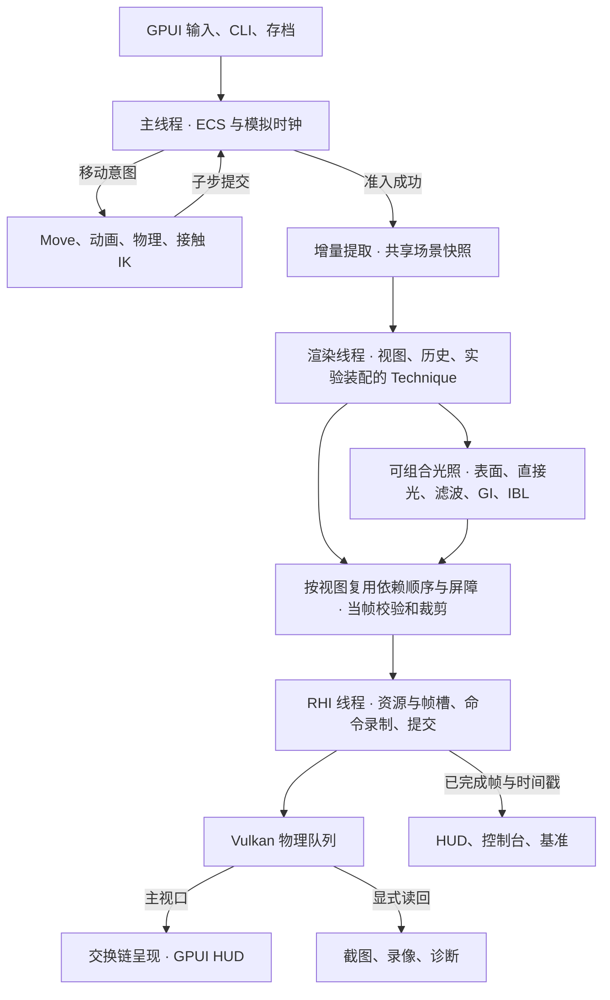

# 引擎架构与一帧的数据流

Render Lab 用一个可保存的 ECS 世界驱动多个渲染实验。主线程提交世界状态，渲染线程把快照编译成 GPU 计划，RHI 线程把计划提交到 Vulkan。动画、物理、构图和命令录制共用 Rayon 工作线程。工作线程的默认数量取可用逻辑处理器数并限制在 2–16 之间，`RENDER_LAB_WORKERS` 可以显式指定。一个 worker 可以先运行模拟任务，再录制另一个在途帧的命令。[主线程入口](../src/engine.rs) · [后台流水线](../src/engine/pipeline.rs)

## 一次 tick 何时变成一帧

1. **推进世界。** 调度器按输入时间推进各模块时钟。固定域在每个子步内执行有依赖的阶段，独立任务读同一份状态，按确定次序合并写入。角色运动与接触求解共享时钟，风和独立特效可以分频。模拟成功后 `tick_id` 递增。[世界与时钟](world-runtime.md) · [调度器](../src/engine/schedule.rs)
2. **准入与提取。** 主线程先预留一个等待快照的位置。位置被占用，或有序读取者积压了完成结果时，本次结束于模拟，增加跳过渲染的计数。准入成功后，提取器根据变更记录更新实例、姿态、灯与共享资产，生成只读快照并分配 `snapshot_id`。角色根位姿与局部姿态分别发布，普通叶节点的增删可以更新已有布局。渲染线程取走快照即归还这个位置。[提取与资产](extraction.md) · [帧准入](../src/engine.rs)
3. **按视图构图。** 主视图和可选的第二相机共享这一次提取，分别推进时域序列、生成视图工作和编译 RDG。每个视图保留自己的调度模板。光照实验声明所需的表面、直接光、间接光或环境数据，装配时检查生产者和依赖。窗口输出导出交换链所需资源，录像另外声明像素读回。次视图有自己的相机、尺寸和 TAA 历史；同一个 `snapshot_id` 可以产生两次不同的 GPU 提交。[构图与输出](../src/render/frame_graph.rs) · [双相机逐像素对照](../tests/offscreen_views.rs)
4. **提交与退役。** RHI 把 RDG 的逻辑队列映射到实际队列，使用帧槽管理暂存资源和录制上下文。窗口可以有两帧在途。离屏执行前先收回尚在途的窗口帧。提交成功后取得 `submission_id`，退役时生成耗时、内存与结果报告。正常窗口通过交换链直接显示，支持 MAILBOX 时优先选择它，其次为 FIFO。[Vulkan 后端](../src/rhi/mod.rs) · [交换链](../src/rhi/present.rs)
5. **消费结果。** 主视图与次视图各有完成队列，交互界面取最新结果，基准可以要求有序读取。后端报错时推进时域历史代号，旧代号的计划会被跳过，后续视图从新的历史开始。停止引擎时先关闭快照入口，渲染线程退出后关闭计划入口，RHI 收回在途帧。[结果路由与线程退出](../src/engine/pipeline.rs) · [性能口径](performance.md)

## 模块边界

| 模块 | 持有的数据和对外责任 |
| --- | --- |
| [scene](../src/scene.rs) 与 [import](../src/import.rs) | 世界持有稳定 ID、父子关系、局部矩阵、组件与共享资产。导入器将 glTF 转换成同一套实体引用；场景存档使用 JSON。 |
| [movement](../src/movement.rs) 与 [physics](../src/physics.rs) | Move 接收目标或根运动提议，按实体策略确定最终位姿的写入者。物理维护质量、动量和支撑，角色实验将实际支撑反馈给动画。 |
| [experiments](../src/experiments/assembly.rs) | 模块声明系统、根运动提供者、材质或主渲染技术。建场和读档走同一套装配规则。候选世界完成恢复、能力检查、时钟和实体绑定后才替换活动场景。 |
| [render](../src/render.rs) | 提取器发布与模拟解耦的数据。常规光栅使用可见性缓冲，材质选择着色程序。照明、光追、后处理由实验技术构图；专用光追实验可单独提供主技术。 |
| [rdg](../src/rdg.rs) | 接收 pass、资源、历史和外部效果声明，检查读写，裁剪对输出无贡献的工作，编译队列依赖和资源屏障。 |
| [rhi](../src/rhi/mod.rs) | 持有设备、内存、描述符、管线缓存和加速结构；记录与提交命令，管理可复用资源的生命周期。KHR 光追管线、内联查询与 NV 簇加速能力分别报告给前端。 |
| [ui](../src/ui.rs)、[console](../src/console.rs) 与 [recording](../src/recording.rs) | GPUI 负责输入、控制台、RDG 面板和覆盖在视口上方的 HUD。窗口与 CLI 共用命令；录像编码消费显式请求的读回帧。 |

## 实验怎样组合

同一个世界可以包含普通网格、簇植被、流水和蒙皮角色。几何模块各自提交可见工作，材质定义像素的主着色方式和 GI 命中响应。ReSTIR、环境光等贡献通过注册表参与装配；相互冲突的主技术或提供者在准备阶段报错。运行 `confluence` 后可在控制台用 `feature water off`、`feature restir off` 等命令检查图层开关。独立主技术可以使用自己的构图路径，适合需要单独对照求交或解码算法的实验。[组合实验及切换](../src/experiments/composition.rs) · [光照注册](../src/experiments/light_stack.rs) · [实验目录](experiment-catalog.md)

新增实验时，先确定要保存的实体与资产、哪个模块写模拟状态、哪个视图消费结果，再登记预设与模块。涉及 GPU 的工作在 RDG 中声明输入、输出、队列和历史。使用同一份场景验证新建、存档恢复和运行时切换，测量时分别报告 CPU 模拟、提取、GPU 跨度和窗口完成间隔。[开发规范](../CONTRIBUTING.md) · [动画与物理](animation-physics.md) · [渲染实现](rendering.md)
