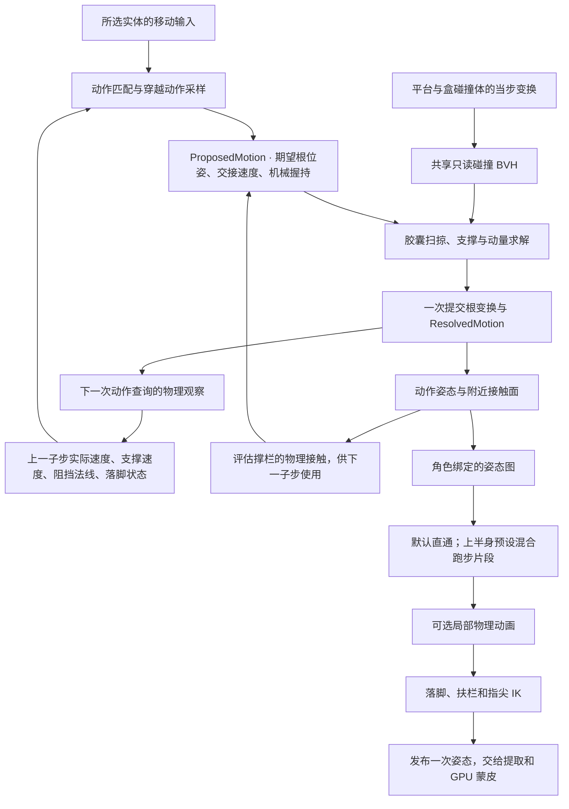

# 角色的一个物理子步

`silver-contact` 默认按 60 Hz 推进角色。输入发给当前选择的实体，动作匹配产生期望位姿，物理求解器拥有动态角色的根变换，姿态阶段读取已经发生的运动。跳跃、撑栏和精确触摸沿用这条路径。普通物体也能在同一世界注册独立的 Move 驱动。[角色时钟与系统绑定](../../src/experiments/motion/silver/contact.rs) · [按实体路由输入](../../src/movement.rs)

上图展开了两份内置资产的执行顺序。自定义图可以改变混合与 IK 的先后，每个角色在工作线程上顺序解释自己的图，多个角色可同时求值。图和动作库跨角色共享，角色的播放相位、脚锁及末端状态随场景存档。[图编译与逐骨骼混合](../algorithms/pose-graphs.md)

## Move、动画与物理交换什么

| 数据 | 写入者与时机 | 消费者 |
| --- | --- | --- |
| `ProposedMotion` | 每子步采样完成时写入序号、期望根变换、切换驱动时的继承速度、可选支撑实体和承重比例。 | 求解器核对序号，按实体运动策略选择实际根位姿。 |
| `ResolvedMotion` | 同一子步求解后写入根位姿、实际位移除以时间得到的速度、支撑实体与速度、阻挡法线、重力和本步可用表面。 | 姿态修正在本子步读取；下一子步的运动查询使用与角色当前根匹配的反馈。 |
| 关节局部姿态 | 手脚约束执行后，按已经绑定的骨架布局一次发布。 | 提取器更新变动的蒙皮调色板，GPU 蒙皮共享这份姿态。 |

速度、重力、法线和目标变换都以角色父节点为坐标系。碰撞索引在世界空间组织，查询后将候选转换回角色坐标。角色站在移动平台时，动画查询使用实际速度减去脚下支撑点的速度。角色顶到墙时，阻挡法线限制继续朝墙内的预测；沿墙方向仍可用。移除接触驱动后，角色继承实际速度；恢复驱动时，物理体从当前位姿和速度继续。序号与控制状态随场景保存，候选接触面在加载后的第一个物理子步重新查询。[交换类型](../../src/movement/character.rs) · [动作匹配](../../src/experiments/motion/silver.rs) · [模式交接](../../src/experiments/motion/silver/contact/modes.rs)

支撑反作用、局部骨链积分和手掌 IK 的约束顺序见[支撑冲量、物理骨链与末端约束](../algorithms/physical-animation.md)。

## 修改动画或物理时从哪里入手

| 想改变的行为 | 输入、职责与输出 |
| --- | --- |
| 角色建场与动作库读取 | 建场绑定骨架和初始动作。动作库读取器校验采样、重建片段根增量并装载搜索索引。[骨架绑定](../../src/experiments/motion/silver/setup.rs) · [动作库](../../src/experiments/motion/silver/bank.rs) |
| 输入预测与姿态播放 | 预测器将控制输入和物理观察变为未来轨迹及检索特征。播放模块选择样本、应用惯性化，输出基础局部姿态与期望根变换。[预测](../../src/experiments/motion/silver/prediction.rs) · [播放](../../src/experiments/motion/silver/playback.rs) |
| 姿态图 | 资产描述片段和节点连线。编译器验证依赖和遮罩，把资产变成可共享的求值指令。[资产](../../src/animation.rs) · [编译与指令](../../src/animation/program.rs) |
| 角色与平台 | 接触模块从候选盒体生成支撑面和胶囊扫掠结果。单角色求解器计算实际根运动、接触冲量和对平台的增量。调度层按共用平台分组，汇总所有角色的增量后只提交一次。[接触几何](../../src/experiments/motion/silver/contact/dynamics/contacts.rs) · [根求解](../../src/experiments/motion/silver/contact/dynamics/root.rs) · [平台运动](../../src/experiments/motion/silver/contact/dynamics/platform.rs) · [成组提交](../../src/experiments/motion/silver/contact/dynamics.rs) |
| 物理骨链 | 通用求解器只处理目标位置、重力、接触面及约束参数。银狼适配层绑定三条链，读取求解位置并按权重写回骨架。[驱动与限位](../../src/physics/articulation/drive.rs) · [银狼骨链绑定](../../src/experiments/motion/silver/contact/physical_pose.rs) |
| 普通刚体 | 控制模块产生期望平移，积分系统按运动策略计算实际根位姿。外部冲量独立修改线动量与角动量，下一次固定更新用新动量积分。[控制](../../src/movement/linear/control.rs) · [积分](../../src/movement/linear/integrate.rs) · [冲量](../../src/physics/impulse.rs) |
