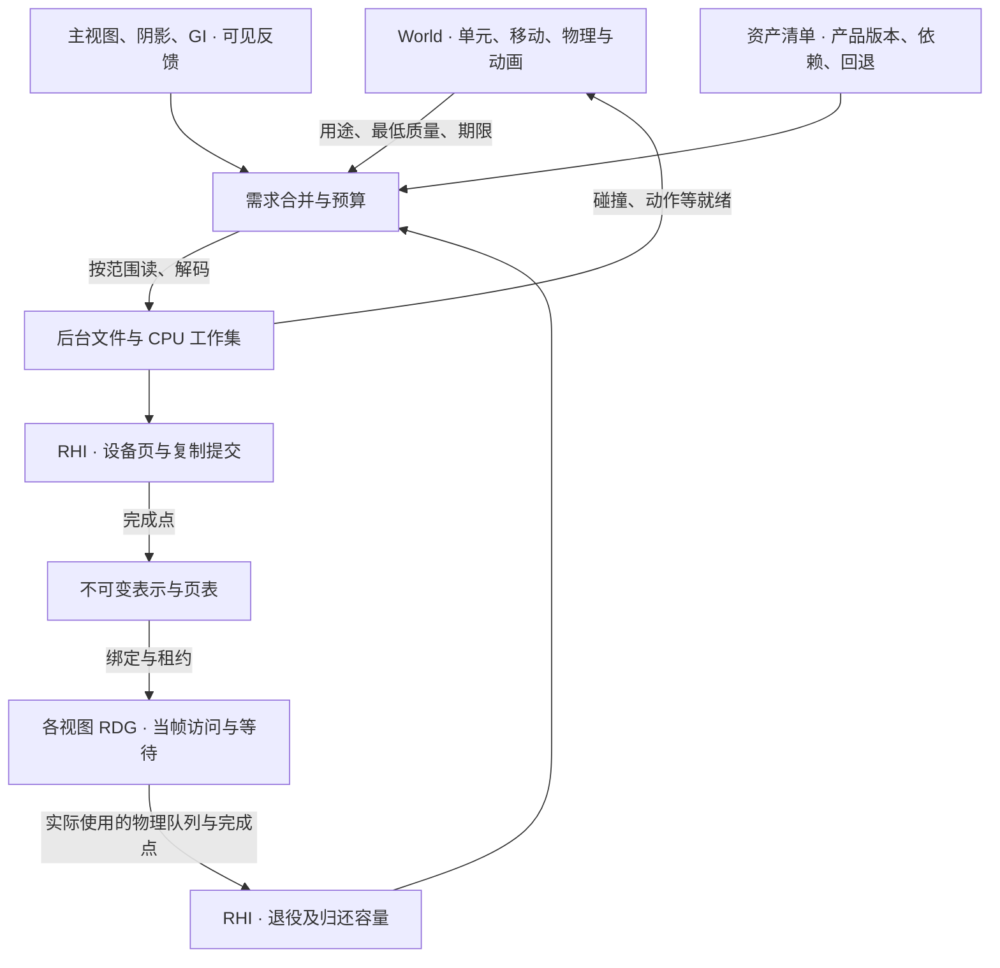

# 实体的 CPU/GPU 资源与流式加载设计

**设计基线为 `cfa4087`。** 建议保留现有的世界分区、64 KiB 设备页、不可变帧地址表和时间线退役。优先改动的是谁决定资源必须在场、谁可以降低精度，以及哪个时刻可以安全复用内存。第 1 节记录现状，第 2–8 节是可分期实施和验证的设计。当前运行参数与复现方法见[运行时资源](runtime-resources.md)和[森林流式实验](../algorithms/forest-streaming.md)。

## 1. 现有实现在哪些地方限制扩展

| 源码中的行为 | 直接后果 | 首要改动 |
| --- | --- | --- |
| 世界分区按资产字符串合并最低等级，`ReadyLevels` 为每个键记录一个 `u8`。森林东区用前四块高清树皮均已驻留来报告等级 1。 | 查询能回答“橡树到了几级”，无法分别回答“实体可以碰撞吗”“主视图能画粗树冠吗”“树皮够清楚吗”。东区的示例树会等树皮。 | 单元只声明激活所需的用途。高清材质通过独立的可降级需求请求。[分区](../../src/scene/partition.rs) · [森林装配](../../src/experiments/vegetation/streaming.rs) |
| 森林技术在 `build` 中按当前快照创建或释放自己的 `Streamer`；`bind_view` 在主视图派发时推进帧号，消费反馈并安排工作。已有跨包预算和多视图反馈合并。 | 同一实验的两区能共享页；引入独立的碰撞、声音或阴影消费者时，资源进度仍容易依赖某一视图是否构图。 | 让世界和视图提交需求，独立推进读盘与完成处理，构图只消费本轮可用表示。[页管理器](../../src/streaming.rs) · [反馈合并](../../src/streaming/feedback.rs) |
| 场景允许资产实体用 `Arc` 持有整份网格、纹理、轨迹或植被；实例通过 ID 绑定。提取器已有实例生命期、变换版本和共享调色板。 | 多棵树引用一份网格已能共享。只要大资产整体仍被持有，单独回收细网格、CPU 纹素或不参与求解的动作片段就需要更小的所有权单位。 | 保留 ECS 的稳定身份，把可独立丢弃的载荷拆成有版本的表示。[实体与实例](../../src/scene.rs) · [提取与快照](../../src/render/scene.rs) · [CPU 派生产品](../../src/assets.rs) |
| 文件 worker 已经按包合批；Windows 原生分支为不同文件保存 reader，打开原生 reader 时创建 D3D12 设备与 DirectStorage 队列。 | 大量小包可能重复支付初始化和设备对象成本。现有 24 棵共享橡树的回放不足以量化这个开销。 | 让设备和队列按适配器复用，文件只持句柄；先测多包开启耗时、句柄数与暂存高水位。[文件 worker](../../src/streaming/disk.rs) · [原生桥接](../../src/rhi/storage_bridge.cpp) |

已有实验给出了取舍的量级。RTX 5070、960×540、24 棵橡树，沿同一条路径交叉回放四轮，每轮 260 帧。冷页保留 75 帧时，每轮重读从 8,250,672 B 降至 1,872,384 B，两种策略的页池块峰值都是 8 MiB。按策略合并样本，GPU P99 从 4.330 ms 变为 4.191 ms，世界 tick 至离屏完成的 P99 却从 24.231 ms 变为 26.421 ms。现有数据支持减少折返重读；是否改善卡顿，需要同时测世界装配、排队、传输与用户第一次看到正确细节的时刻。该回放只覆盖静态树冠三角簇和树皮。[测量口径](performance.md) · [逐帧数据](measurements/forest-stream.csv)

## 2. 谁拥有哪一份数据

以一棵树为例，世界拥有这棵树的位置和生长状态，资产库保存“这种橡树”的数据，渲染端保存“这棵树在本帧如何画”。砍掉一棵树、卸载一个分区、显存紧张时驱逐高清树皮，分别作用于这三种不同的生命周期。

| 数据及粒度 | 所有者与读者 | 保留、共享和释放规则 |
| --- | --- | --- |
| 实体的权威 CPU 状态 | World 持有稳定实体 ID、父子关系、移动策略和组件。Move、动画、物理按子步声明读写。 | 变换、速度、动量、播放游标和需要续接的约束状态随实体保存。移动跨区时转移归属；卸载有状态对象时先取得一致检查点，写入失败保留可重试副本。 |
| 烘焙资产及目录 | 资产库按资产身份和版本持有清单。网格、材质、骨架、动作库、碰撞形状、预计算包围盒、阴影代理、体素砖、声音都可登记。 | 清单记录依赖、文件范围、解码尺寸、格式、校验和及最低表示。根数据仅在有相关消费者时固定；磁盘细节在有需求时读。一个树种只存一份共享树皮和碰撞形状。 |
| 共享 CPU 工作集 | 各工作线程短期持有解码网格、动作搜索索引、碰撞数据等只读产品。后台缓存按产品键合并构建。 | 沿用 `Arc/Weak`；租用计入实际字节，弱索引允许载荷释放。把整库解码改为常驻索引加按需片段，只有新任务取得有效版本才能发布结果。同步缓存构建移出世界 tick。[当前共享缓存](../../src/assets.rs) |
| 实例的 CPU 工作集 | 模拟系统拥有可写姿态、接触缓存等；提取器拥有增量索引并发布只读快照。 | 活动子步或快照用完后释放相应引用。按变更与读者选取数据；离屏但正在交互的手部关节仍由 CPU 更新。保存影响续接的状态，可重建缓存按需恢复。[场景提取](extraction.md) |
| 共享 GPU 资产 | 每台设备的驻留服务持有纹理 tile、簇组、静态顶点、绑定姿态和静态 BLAS。RHI 持有 Vulkan 对象。 | 相同设备、版本及表示共享物理存储。静态 BLAS 可跨实例、跨帧槽复用；实例位姿进入实例记录及 TLAS。驱逐只改变后来发布的映射。[现有光追与帧槽](render-graph.md) |
| 实例 GPU 数据与视图历史 | 渲染端持有实例槽、前后帧变换和姿态；动态 BLAS 随变形输入版本更新。TAA、降噪历史属于各视图。 | 大缓冲分段存放实例记录，按脏区上传。保留仍被在途帧读取的版本。几何拓扑或骨骼布局改变时重映射历史，无法对应的像素使历史失效。[蒙皮与运动历史](../../src/render/geometry/skin.rs) |
| 暂存与临时 GPU 内存 | I/O worker 持有读盘、解码和上传缓冲；RHI 管理复制来源与 AS scratch；RDG 描述当帧 pass 的临时资源。 | CPU 解码输入在最后一个 CPU 读者退出后释放，上传来源在复制完成后释放。RDG 仅在物理队列上的访问有先后关系、配置兼容时复用瞬态内存。历史、外部可寻址页和在途 AS 单独跟踪。[RHI 分配器](../../src/rhi/allocator.rs) · [内存统计](../../src/rhi/memory.rs) |

**为四种身份分别指定键。** 存档里的实体 ID 标识场景对象，运行时补上世界世代与实例生命期，防止旧任务写到重用的槽。资产 ID 标识作者绑定的“橡树”或“银狼骨架”；清单版本引用内容哈希、烘焙版本和目标格式。逻辑单元键由产品版本、用途、子资源位置和级别组成。物理映射再附设备世代、分配槽及槽世代。存档只写实体、逻辑资产引用和重放所需的版本策略，加载时重新解析指针、设备地址、描述符和队列值。现有存档中的资产实体 ID 可通过导入适配器映射，旧的内嵌资产也可先当作单个常驻表示读取。[既有实体格式](../../src/scene.rs) · [分区存档](../../src/scene/partition/archive.rs)

## 3. 世界声明用途，设备按预算兑现

保留两份图。**跨帧资产依赖图**记录“树冠簇组替换哪些父组”“足底 IK 需要哪条骨链和碰撞形状”，维护依赖引用、版本及回退。**当帧 RDG** 只接收已经选定的资源、复制工作、访问方式和等待点，负责屏障、队列与别名。这样换用软件 BVH 或硬件光追只需声明新的表示需求；渲染 pass 不承担磁盘调度，流式服务也无需理解着色器如何绘制。

建议从三个窄接口开始。以下是协议草案，名称用于说明边界。

| 接口 | 输入与输出 | 调用时机 |
| --- | --- | --- |
| 登记、更新、撤销需求 | 消费者键和世代、资产版本、用途、最低可用表示、期望精度、优先级、期限 → 可更新的需求句柄 | 单元进入、模拟用途改变、某个视图有新反馈时提交增量。撤销只移除该消费者；相同产品的同一文件范围合并在途读取。 |
| 查询用途就绪状态 | 需求句柄和世代 → 等待、可使用的回退、目标已就绪或有原因的失败，并带表示版本 | 主线程仅在子步边界提交依赖就绪的激活组；无窗口运行也可完成 CPU 碰撞与动画加载。视觉消费者每帧独立选取已完成的精度。 |
| 冻结绑定、提交或撤销 | 设备、视图、选定表示 → 不可变绑定和租约；提交补充实际使用的各队列完成点 | 构图取得租约，跳帧或取消计划显式归还，成功提交转交 RHI 退役。设备重建时作废旧设备绑定，重新上传必要根表示。 |

**用途决定就绪条件。** 物理要求经验证的保守碰撞形状；角色站立时支撑和必要骨链是硬依赖。视觉可先用粗树冠和根纹理；阴影可请求屏幕外投影体的独立代理；声音可只解码可播放的起始块。仅在同一用途和表示序列内部取更高精度，独立用途取依赖集合的并集。即使多个用途共用一份载荷，驻留服务也应分别记录谁需要它。引入或删除引用时增量更新反向依赖，避免每 tick 扫描所有实体。

激活硬依赖需要取得可持有的使用权。例如物理系统确认地面碰撞形状就绪后，激活组同时接管该形状的引用，直到退出支撑关系或在子步边界换成另一个有效形状。这样预算线程无法在“查询成功”和“角色落脚”之间驱逐地面。控制记录可按产品键分片，每个 worker 批量提交变更；物理热循环读取子步开始时固定的碰撞视图，着色热循环读取帧开始时固定的表。预算协调只发生在接纳、调整和退役时。

**时间与线程。** 世界继续使用一只时钟及各系统的 tick 频率。在主线程子步边界接收完成消息，worker 只产出带版本的只读结果。资产请求的超时、I/O 延迟和带宽预算使用单调实时时钟，GPU 退役依据设备时间线。渲染准入跳过一帧或窗口最小化时仍应收割 I/O 和退役事件；有 GPU 硬需求时允许单独提交有预算的复制，无 GPU 消费者时只推进 CPU 工作。要求确定性重放时，记录硬依赖实际被世界接纳的 tick，或在指定 tick 前预装硬依赖，避免让磁盘完成顺序改变同一输入的模拟结果。[现有世界时钟](world-runtime.md) · [渲染准入](../../src/engine/pipeline.rs)

## 4. 从文件页到安全释放

1. **烘焙。** 清单给每个产品写明最低合法表示、兼容布局、依赖、各级的磁盘字节和解码后字节。几何以能完整替换粗簇的组发布，允许跨 64 KiB 物理页；纹理以 mip/tile 发布并保留支持过滤的边界；骨骼表示携带关节映射和祖先闭包。加载清单时校验范围、布局和依赖，拒绝无法到达回退根的版本。[当前包格式](../../src/streaming/package.rs) · [森林构建](../../src/experiments/vegetation/streaming/cook.rs)
2. **选择并预留。** 先满足碰撞、支撑和可绘制根的硬需求，再按可见误差、期限、等待时长和预计传输成本安排细节。只在预留了足以发布整组的空间或存在可完成的分期计划后接纳细级。相机速度可触发有限前瞻，限制预取字节及深度；瞬移取消过期预取，优先保住新位置的根。世界装配、解码、上传和 GPU 驻留分别限额。
3. **读取。** 文件服务按包和相邻范围合批，单个在途范围允许多个消费者订阅。普通路径走后台文件读取和 Vulkan 暂存复制；可选 Windows DirectStorage 路径复用同一适配器的设备、队列与外部暂存池，文件切换只换文件句柄。失败时保留有效根，允许有预算的普通读取；用后端计数验证实际选用路径和复制字节。[当前读盘实现](../../src/streaming/disk.rs) · [原生上传桥接](../../src/rhi/storage_bridge.cpp)
4. **复制与发布。** transfer 上传到新页，RHI 记录实际物理队列和完成点。同队列保持必要的可见性屏障，跨队列交给 RDG 合并时间线等待；跨队列族且资源使用独占共享时处理 queue-family ownership transfer。校验成功且整组复制完成后，在下一张帧表一次发布新表示。无法细化时继续画上一个合法切分，粗细替换的全部父组和子组随同一张表生效。[当前页表选择](../../src/streaming.rs) · [队列](../../src/rhi/queues.rs) · [几何切分](../../shaders/forest_stream_cut.comp)
5. **撤销与退役。** 最后一个需求撤销后，新帧先选择回退或移除实例。尚未提交的计划继续持租约；已提交的 graphics、compute、transfer 使用分别保存最后时间线点。同一物理队列取最大值，彼此无顺序的队列分别检查。所有计划租约均已交回且每条相关队列均完成后，才归还页、描述符或实例槽。空块可归还设备，仍有有效页的块保留。后台到达的旧结果只释放自己的配额与载荷，不能重新激活已卸载的实体。[现有帧租约](../../src/streaming.rs) · [设备回收](../../src/rhi/streaming.rs)

物理内存按用途分池。不可变细节采用现有固定页；小型实例与调色板记录在按对齐分段的大缓冲中更新；临时上传、AS scratch 和专用图像分别满足对齐、内存类型和用法约束。新纹理后端可沿用逻辑 tile 接口，再按设备比较图集与 Vulkan 稀疏图像的成本。整理碎片时先复制到新槽，后续帧再切换间接表；含 GPU 裸地址、AS 引用的资源需重建相应依赖或固定位置，旧存储按原读者退役。

**失败也有确定的结果。** 取消未派发请求立即退配额，已派发请求完成后只交付给仍有效的订阅者；短读可退避重试，校验或格式错误隔离到具体文件版本，热重载失败继续用已发布的旧版。设备丢失递增设备世代，重新协商能力与根预算；CPU 世界、状态检查点及独立 CPU 工作集仍有效。若连硬依赖的最小集合都放不下，应报告受阻的实体、用途、所需字节与预算，延后该激活组，避免主线程反复同步等待。

## 5. 怎样控制内存与卡顿

| 预算 | 发工作前预留什么 | 到达高水位后的动作与观测 |
| --- | --- | --- |
| 世界与 CPU | 每 tick 的实体装配行数和主线程时间；CPU 常驻产品、在途压缩输入、解码输出分别按字节预留。 | 给有父子依赖的对象组单独计成本。大组在后台准备、分步装配，在约定边界原子发布；记录最长单批、主线程 P95/P99、CPU 载荷及进程工作集。 |
| 存储与传输 | 每个调度周期的 I/O 请求数、读字节数、在途字节数，以及每次设备提交的复制字节数。 | 超预算延后低优先级工作；小的固定额度给等待过久的请求以防饥饿。记录准备、排队、真正读取和复制时间，区分操作系统热缓存和引擎重读。 |
| GPU 设备 | 各管理器共享设备准入，先为根、细节、上传来源和仍在退役的实存预留空间；设备压力变化时重新计算可用信用。 | 先停预测，再降非关键细节，优先释放可变空块。高低水位留间隔以抑制反复升降。预算骤降时报告在途的暂时超额；退役完成前不能把同一批字节再次分配。 |

**按实体查账时区分独占与共享。** 一棵树可以报告“我的实例记录和风姿态”“我引用的共享橡树产品”“哪些视图或单元固定了它”。设备总账以物理分配 ID 去重。分别列出逻辑有效字节、绑定页、页池已承诺块、块内闲置、待退役、上传暂存和专用分配。绑定页是块的子集，待退役是当前分配的一种状态；DirectStorage 与 Vulkan 导入同一份外部内存时只计一次物理分配。输出释放最后一个引用预计能归还多少字节，并区分可复用槽位与可归还给驱动的整块。这样才能回答“删掉一千棵树实际省了多少显存”。[当前内存计数](../../src/rhi/memory.rs)

**把首次可用拆到可定位的阶段。** 用同一请求 ID 串起 GPU 产生需求的帧、CPU 收到反馈、预算接纳、I/O 完成、复制完成、绑定发布、第一帧实际采样该表示。CPU 用单调时钟，GPU 分队列用查询时间戳和时间线序号，通过提交 ID 关联；未校准的 CPU/GPU 时钟各算各自的耗时。像素或可见簇计数验证实际使用，窗口呈现延迟另报。现有 `first_use_p95_ms` 计的是 CPU 观察需求至首次绑定，样本窗口为最近 512 次完成；新增指标要同时报告仍在等待、被取消和回退的数量，避免慢请求从分位数中消失。[现有指标定义](../../src/streaming/policy.rs)

## 6. 两个场景怎样检验这套边界

**森林，两区、两类几何消费者。** 西区与东区各登记一个橡树原型需求。就绪的根树冠和低清树皮可以先显示；若场景启用可交互树干，角色物理单独请求粗碰撞。主视图反馈让可见树皮和簇组细化，太阳阴影对视锥外的投影体独立请求代理。两边需要同一高清范围时合并成一次在途读。离开西区只删西区的实例记录和订阅，东区与阴影仍使用的页继续驻留。相机折返可复用冷页；退出全部消费者后等待旧图退役，再观察实际流式分配回到启用前的基线。先在 `forest-stream` 复现静态两区，再接入完整岩柱森林的风、体素与阴影；两条回放独立报告。[森林实验](../algorithms/forest-streaming.md) · [现有森林回放](../../examples/forest_stream.rs)

**银狼，跨区运动、足底 IK 和在途蒙皮。** 把角色根、必要骨链、碰撞体及需要一起启停的组件声明为一个激活组，资产库共享骨架布局、网格权重、动作索引与碰撞形状。角色接近台阶时，物理与 IK 提前请求支撑体和脚部祖先链；即使相机看向别处，也能继续子步求解。高清纹理、非关键骨链和动作细节可以迟到；动作页缺失时使用已驻留的有效片段，在可续接的姿态切换点再采纳新候选。骨骼降级必须保留有效的权重重映射和挂点。跨区只改变归属，保持稳定 ID、速度、播放相位与约束状态。渲染快照冻结本次显示与上一次实际显示的姿态版本；蒙皮、运动向量和动态光追显式绑定对应版本。旧帧在途期间销毁角色或调整骨架时，重用槽的新角色不能继承旧历史。[移动实体边界](../../src/scene/partition/mobile.rs) · [角色子步](character-motion.md) · [已有 GPU 蒙皮](../../src/render/geometry/skin.rs)

跨区依赖应区分“必须一起激活”的角色内部对象和“可能离开”的外部目标。前者按组提交；后者存稳定句柄，在子步边界按用途选择短期保留支撑、解除抓取或重新寻找接触。烘焙时检查硬依赖循环，将确需同生共灭的一组折叠为单元，并报告最小工作集；防止一个跨区挂点意外固定整片森林。实验自定义产品通过登记构建版本、依赖、大小、最低表示和释放回调接入，现有高斯载荷、动作库和毛发引导束各自保留自己的解码与求值算法。

## 7. 分期迁移与验收

| 顺序 | 最小可交付改动 | 合入条件 |
| --- | --- | --- |
| 1．先确立身份与观测 | 沿用现有森林传输，补产品键、消费者、世代、阶段事件和按物理分配去重的账本。 | 同一页能追到请求者、在途提交及最后释放原因；24 棵树共享同一产品时设备总账只计一次。原回放的读取字节和最终释放断言仍成立。 |
| 2．拆用途并独立推进 | 将世界的单一等级扩展为分用途就绪，旧存档的等级经适配保持原有激活语义。先迁移森林，提供可脱离主视图派发的 CPU 进度入口。 | 无渲染帧时碰撞能就绪；人为延迟高清树皮，树以粗级先出现；两区重叠期间移除一个区，另一消费者不掉级。取消、同 ID 重入与过期回报均有回归。 |
| 3．接入跨消费者预算与回收 | 设备侧预留、冷页驱逐和 CPU 解码限额共用调度记录；原生 I/O 按适配器复用；覆盖已构图未提交和跨队列的租约。 | 两包并发和折返时，相同在途范围只读一次。模拟慢盘、容量骤降、乱序完成、设备重建、取消计划；有效根始终可用或显式报告硬依赖受阻，退役后相关分配回到基线。 |
| 4．用独立子系统验证扩展性 | 迁移岩柱森林的阴影/体素消费者，再迁移银狼的骨链、动作和接触组。用相同协议接入一种纯 CPU 产品。 | 固定种子和输入，对照同机位图像、屏幕外投影、足底误差、碰撞结果、运动历史。角色跨区、存档重载和多读者释放均通过。百人以上共享资产时报告独占和共享增长曲线。 |

性能验收使用相同提交基线、设备、分辨率、相机和输入轨迹；发布版构建隔离 target 目录。森林沿用冷入、推近、折返、双区共存和瞬移的交叉回放，另测多包、显存紧张及窗口呈现；银狼分别测单人和固定人数的人群。逐轮报告重读字节、首次实际使用 P95、低精度持续帧数、未满足的硬需求、世界 tick/提取 P95、GPU 跨度与端到端 P99、CPU/GPU 分项峰值。预先选定目标帧预算与可接受波动，用多轮对照估计噪声；吞吐提升若伴随尾延迟恶化，应定位到阶段后再决定是否启用策略。[现有交叉回放及基线](performance.md) · [角色提取指标](extraction.md)

## 8. 外部设计依据

Epic 的 UE 5.9 文档分别描述了按流式源管理世界单元，以及由 GPU 反馈可见纹理 tile、再由 CPU 安排加载。这里采用两种决策粒度，进一步把碰撞、动画和屏幕外阴影列为独立消费者。Render Lab 的用途协议、资源世代和上述迁移顺序是针对本仓库提出的设计。[Epic World Partition](https://dev.epicgames.com/documentation/en-us/unreal-engine/world-partition-in-unreal-engine) · [Epic Streaming Virtual Texturing](https://dev.epicgames.com/documentation/en-us/unreal-engine/streaming-virtual-texturing-in-unreal-engine)

设备侧可参考 Khronos 的 timeline semaphore 样例理解不同队列间的执行顺序，Windows 后端可参考微软的 DirectStorage 开发指南检查批量请求与队列复用。实际设备的队列映射、导入能力以及额外复制次数仍应由 RHI 记录并验证。[Khronos 时间线信号量](https://docs.vulkan.org/samples/latest/samples/extensions/timeline_semaphore/README.html) · [Microsoft DirectStorage 开发指南](https://github.com/microsoft/DirectStorage/blob/main/Docs/DeveloperGuidance.md)
