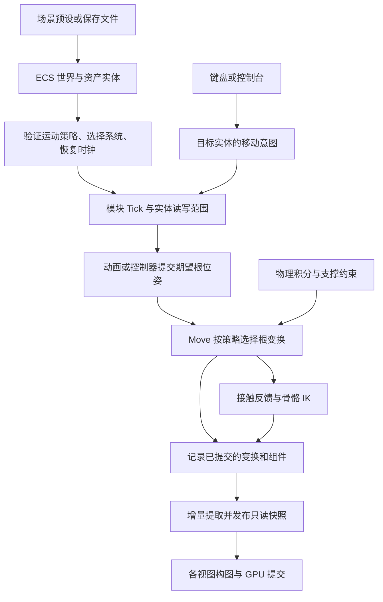

# 世界、运动与模块时钟

`World` 持有稳定实体 ID、父子关系、局部变换、资产引用与可保存的组件。主线程把输入交给选中实体的控制器，推进模拟，再按变化记录提取渲染快照。添加物理、动画或实验模块时，要分别声明由哪个时钟更新、读写哪些数据、谁拥有根变换的最终写入权。[世界类型](../../src/scene.rs) · [系统装配](../../src/experiments/assembly.rs) · [引擎全图](README.md)



## 场景怎样开始工作

每种实验用组件键登记系统、主渲染技术、材质程序和恢复函数。引擎打开场景时解码组件，把没有专用求解器的普通动态实体接到线性物理系统，然后依据设备能力装配渲染技术。显式互斥的主渲染技术以及多个独立模块同时认领同一实体根变换，都会在装配时报告。银狼动作模块声明可以把根运动委派给已挂接的角色接触求解器。[注册表](../../src/experiments/assembly.rs) · [运动策略与委派](../../src/scene/motion_policy.rs)

`load` 在候选世界中校验、恢复和绑定，成功后再替换活动世界。重新配置当前世界时也会先保存时钟状态。系统使用的 Rust 类型实例可以从存档中的 JSON 解码，模拟热路径读取已解码组件。编辑器或实验代码可以直接保存场景数据；要让正在运行的模拟从同一个子步位置恢复，使用 `Engine::save_scene` 或控制台 `save`。[装配入口](../../src/experiments/mod.rs) · [组件与序列化](../../src/scene/components.rs)

## 运行时更换光照与实体

在 `confluence` 中输入 `feature ibl off` 或 `feature restir on`，控制台会校验提供者和设备，首次启用时准备资源，成功后才更新组合配置实体。渲染线程从自己的只读快照决定启用哪些提供者。已经排队的帧仍看到当时的组合。重复输入相同状态直接返回。光照切换保留模拟时钟、角色状态、相机和运动向量所需的前帧几何，新的最终颜色进入独立的 TAA 历史，重新启用 ReSTIR 时也会重置其历史。森林、人物或流水开关会改变几何和模拟系统，仍用候选世界做完整校验和装配。[组合命令和对照测试](../../src/experiments/composition.rs) · [光照提供者](../../src/experiments/light_stack.rs) · [前帧几何与颜色历史](../../src/render/post.rs)

没有额外实验组件的普通网格叶节点、无子节点的灯可以挂在已有实体下，增删时日志只记录受影响的 ID。提取器为新叶记录父行和变换，父级移动时会更新附加子树。灯表维护所有已登记灯的数量，因此关闭最后一盏灯仍保留场景的光照选择。普通网格保留幸存实例的 GPU 变换槽，空槽可在新快照中复用。同一 ID 再次出生时有独立生命周期，禁止使用旧物体的运动历史。[结构变化日志](../../src/scene/changes.rs) · [叶节点提取与回归](../../src/render/scene/leaf_edits.rs)

追加或删除末尾绘制项时，提取器只修改末页、普通实例索引和材质引用计数，复用簇绑定与基础槽位表。删除绘制列表中部的实例会改变几何和蒙皮的有序索引，因此要重排渲染侧列表，代价随渲染实例数增长。增删挂有实验组件的实体、簇网格实例、共享资产实体或成套骨架，或不能安全识别父子关系时，从当前世界全量重建拓扑。落后超过日志窗口的读者也会重新核对。各读者单独持有游标，GPU 槽、矩阵页和旧光照配置随快照独立保留。[渲染槽](../../src/render/scene/routes.rs) · [父子变换](../../src/render/scene/transforms.rs)

组合场景有 636 个实体。实际打开该场景并依次切换图层后，IBL 关、开的命令分别用时 4.4、6.9 µs，紧接着的提取分别用时 8.4、7.3 µs。两次都检查了配置实体和订阅组合配置的角色轨迹输出，实例改写数为零。关闭状态读档后首次重新启用 ReSTIR 用时 1.77 ms，包含光照提供者的延迟装配。这组数据是单次操作延迟。

在 480 × 300、固定镜头和模拟时刻下，关闭 ReSTIR、流水与抗锯齿，实际提交 IBL 开、关、再开的帧。关闭时共 1,182 个像素的 RGB 改变，其中 1,138 个受光像素变黑。重新启用后这 1,138 个像素全部恢复到每个通道相差最多 2 级，全图有 7 个像素与首次开启时存在逐字节差异。树木与地表采用各自材质，图中主要变化落在银狼身上。指定环境变量 `RENDER_LAB_COMPARISON_DIR` 后，下方的 GPU 测试会保存三张 PNG。

### 500 个角色中的结构编辑耗时

Release，500 名银狼、177,042 个实体、3,000 个蒙皮实例。固定场景并保留前一张快照，每种操作预热两次，再单独采集 20 次，报告主线程提取 P95。对照在同一二进制中令结构写入失效游标，使保有缓存的同一提取器执行全量核对。计时覆盖提取，不含 ECS 写入、模拟、构图或 GPU。

| 操作 | 暖全量对照 | 实际路径 | 实际访问实体数 | 实例行变化 |
| --- | ---: | ---: | ---: | --- |
| 加一盏灯 | 178.68 ms | 1.8 µs | 1 | 0 |
| 移除这盏灯 | 184.47 ms | 1.5 µs | 1 | 0 |
| 追加一个普通网格 | 197.49 ms | 4.2 µs | 1 | 写入 1 |
| 移除该网格 | 220.64 ms | 2.7 µs | 1 | 退役 1 |
| 加回整条角色车道 | 298.03 ms | 231.99 ms | 177,042 | 写入 6 |
| 移除整条角色车道 | 298.07 ms | 231.34 ms | 176,688 | 退役 6 |

一条角色车道包含 354 行，涉及运动策略、皮肤、骨骼和碰撞物。最后两行执行相同的全量算法，两次计时的差距反映运行波动。普通实例中间删除的重排成本没有包含在尾部操作的数字里。[基准实现](../../src/experiments/motion/silver/contact/structural_profile.rs)

```shell
cargo test --release --locked --lib profile_structural_extraction -- --ignored --nocapture
cargo test --release --locked --lib switches_contributors_independently -- --ignored --nocapture
cargo test --release --locked --lib ibl_hot_switch_changes_submitted_frames_at_fixed_time -- --ignored --nocapture
```

## 运动权和物理参与

| 场景策略 | 当前子步怎样产生根变换 |
| --- | --- |
| 静止，物理关闭或只查询 | 保留已有局部根位姿。骨骼仍可播放。绑定了支撑形状的固定平台可参加接触查询。 |
| 可移动，物理关闭或只查询 | 运动学控制器可提交期望局部变换。运动平台可以在移动的同时提供支撑。 |
| 可移动，参与模拟 | 根平移使用本步求解的位置。普通物体通过质量、动量和加速度积分，角色另有碰撞与支撑规则。绑定 `AngularBody` 的普通模拟物体使用角动量求出的根朝向，其余根沿用提议朝向。 |

`RootMotionRequest` 表达父坐标系中的目标变换，单位为米。实体的 `MotionPolicy` 决定最终写入权，共享网格的实体仍可分别运动。`LinearBody` 保存质量、动量、期望速度和加速度，`AngularBody` 可选配主惯量、角动量和力矩。平移与旋转在一个子步内合成一次根写入。已有显式策略的线性体在可移动的运动学模式与模拟模式间切换时，用质量换算速度和动量；暂停于静止策略会保留先前的命令。角运动积分要求根变换可分解。接触约束的适用范围见[动画与物理](../algorithms/animation-physics.md)。[Move 根合成](../../src/movement.rs) · [线性积分与权属校验](../../src/movement/linear.rs) · [角动力学](../../src/physics/angular.rs)

### 输入驱动与角色切换

每种控制组件可以注册一个输入驱动。装配时检查同一实体的驱动冲突，执行时按目标实体分派。银狼驱动消费角色局部轴，绑定线性控制器的普通物体沿父空间 X/Z 运动。控制台用 `control ID` 切换目标，`drive SIDE FORWARD` 提交范围为 −1 到 +1 的连续轴，键盘继续发送整值。普通线性体用 `object ID drive SPEED` 开启控制，速度单位为 m/s，`object ID drive off` 则解除输入绑定。给模拟物体施加输入时更新水平动量，同时保留竖直动量。银狼障碍课程默认由自动行走驱动，使用 `contact manual` 后可用键盘或连续轴操控，`contact auto` 恢复课程引导。切换目标先停止原目标的操控输入。显式选择的目标、线性控制器和身体状态随场景保存。删除显式选中实体后停止控制，这个状态随场景保存。复用旧 ID 的新实体须重新选择。[分派](../../src/movement.rs) · [控制台](../../src/console.rs) · [混合驱动测试](../../src/experiments/assembly.rs)

在有接触绑定的银狼上执行 `contact mode free` 可暂停其接触求解并保留绑定，`contact mode contact` 会恢复原来的运动策略与夹具。离开接触模式的首个自由子步按上次实际父空间速度推进，包括平台携带和离地速度；恢复接触时用当前根位置和最近一次自由子步的速度初始化求解器。两种状态都可保存。单独调控显示姿态的 `motionbudget` 不改变物理时钟。[模式切换与回放测试](../../src/experiments/motion/silver/contact/modes.rs)

渲染用途单独绑定。普通刚体实例的 `geometry_assets` 可引用一个共享资产实体，保存源网格、保守的网格局部 AABB、投影网格。剔除用实例变换后的边界，阴影可以使用简化代理，GI 命中从视觉几何读取材质和 UV。风动或蒙皮对象沿其姿态或簇边界剔除。[派生几何的校验](../../src/scene/geometry_assets.rs) · [渲染端消费方式](../algorithms/visibility-lighting.md)

## Tick 怎样决定先后和并行

整个场景使用一条世界模拟时间线，单位为秒。交互窗口把两次界面回调的墙钟差限制在 0.1 秒以内，暂停时交给模拟的增量为零。离屏录制使用指定帧率的步长。`World::time_seconds()` 和 `SystemContext::time_seconds()` 在系统执行期间给出本次更新的截止时刻，系统收到的 `dt` 是本次更新覆盖的区间。在调度器返回后，世界时间等于本次已接收的总时间边界。渲染准入失败时模拟仍可推进。[窗口时间输入](../../src/ui.rs) · [主线程准入](../../src/engine.rs)

每个固定更新组持有步长、剩余时间和最多补几步的限制。调度器每次选全世界最早到期的组。同一时刻按已验证的阶段顺序运行；同组内用依赖图排出工作批次。例如，在同一帧收到 1/30 秒、两个组从零同时启用时，60 Hz 组先在 1/60 秒运行，到 1/30 秒时两个组再按既定次序运行。跨频率的读取看到最近一次已提交的生产者状态。需要同子步交换的角色意图、根动力学和姿态反馈放在同一固定组。[多频率顺序回归](../../tests/simulation_schedule.rs)

补步超限会跳过最早的整步，同时保留不足一步的余量，因此卡顿之后仍沿原有频率的相位推进。存档保存世界时间、具名组的频率、步数、欠时、丢弃时长和失败后尚待运行的逐帧更新。恢复失败的 tick 时先完成已接收的区间，再接收下一段时间。旧存档缺少世界绝对时间时，从零设定新原点，同时载入已有的组状态。播放片段的局部游标仍由角色保存，两个同场角色可以在不同世界时刻开始播放。[分频与恢复](../../src/engine/schedule/clocks.rs)

同一固定域的系统共享步长和补步上限。系统声明前驱、组件与资源的读写，以及读写局部变换的具体实体 ID。独立任务在工作线程中读同一份世界状态，工作完成后按约定顺序提交；同一实体的读写冲突或显式前驱会把任务排到相邻批次。绑定成员变更时重新计算受影响的范围。子步中途失败会撤销该子步先前提交的修改，保留已完成子步与尚待模拟的时间。相邻逐帧模块在没有冲突时也可并行。[调度器](../../src/engine/schedule.rs) · [执行计划](../../src/engine/schedule/plan.rs) · [并行、重绑和回滚测试](../../tests/simulation_schedule.rs)

| 更新组 | 默认更新方式 | 可以观察的结果 |
| --- | --- | --- |
| `movement` | 固定 60 Hz，每次最多 8 步 | 同一普通物体在不同显示帧率下得到相同累计位移 |
| `hair` | 固定 120 Hz，每次最多 16 步 | CPU 记录控制输入并更新头模；入图的视图再用 GPU 推进引导束到目标子步。[毛发时钟](../../src/experiments/hair.rs) |
| `character` | 固定 60 Hz，每次最多 8 步 | 银狼基础姿态、平台、角色动力学和 IK 消费同一子步的数据 |
| `silver-motion`、`motion` | 各自按模拟 tick 更新 | 分别驱动独立银狼和参考匹配器，可单独设固定频率 |
| `wind`、`effects` | 各自按模拟 tick 更新 | 独立调节风或特效播放的时间更新频率 |

控制台输入 `tick` 可查看当前世界秒数、各组的频率、成功步数、余量和超限丢弃时间。输入 `tick character 120` 调整整个角色反馈链，`tick wind default` 恢复风模块默认值。UI 和输入由平台事件驱动，渲染线程消费已准入的快照，RHI 线程消费提交计划。[时钟实现](../../src/engine/schedule/clocks.rs) · [时钟存档字段](../../src/scene/tick.rs)

## 复现实验

```shell
cargo run --release --locked -- --experiment movement
```

左侧物体固定，中间物体按目标速度运动，右侧物体按重力下落。输入 `object` 列出具有显式运动策略的 ID。对于默认场景左侧的实体 3，依次输入以下命令可改变其策略与速度，再检验存档重载后的策略和时钟。[实验装配](../../src/experiments/movement_lab.rs) · [对象命令](../../src/console/object.rs)

```text
object 3 movable off
object 3 velocity 0.25 0 0
tick movement 30
save target/movement.scene.json
load target/movement.scene.json
object 3
tick
```

Epic 在 2026 年 11 月公开的 UE6 路线以 Verse 和 Scene Graph 组织玩法。已发布的 UEFN Scene Graph 将组件加入场景、开始模拟、结束模拟和移出场景分开。本项目借鉴实体能力组合与显式模拟边界，具体实现使用 Rust ECS、按实体绑定的调度和进程内子步回滚。多人网络预测与跨机器状态回放仍需额外的复制及重模拟协议。[Epic 的 UE6 路线更新](https://www.unrealengine.com/news/an-update-on-blueprints-and-the-path-to-ue6) · [UEFN 组件生命周期](https://dev.epicgames.com/documentation/en-us/fortnite/verse-api/versedotorg/scenegraph/component)
