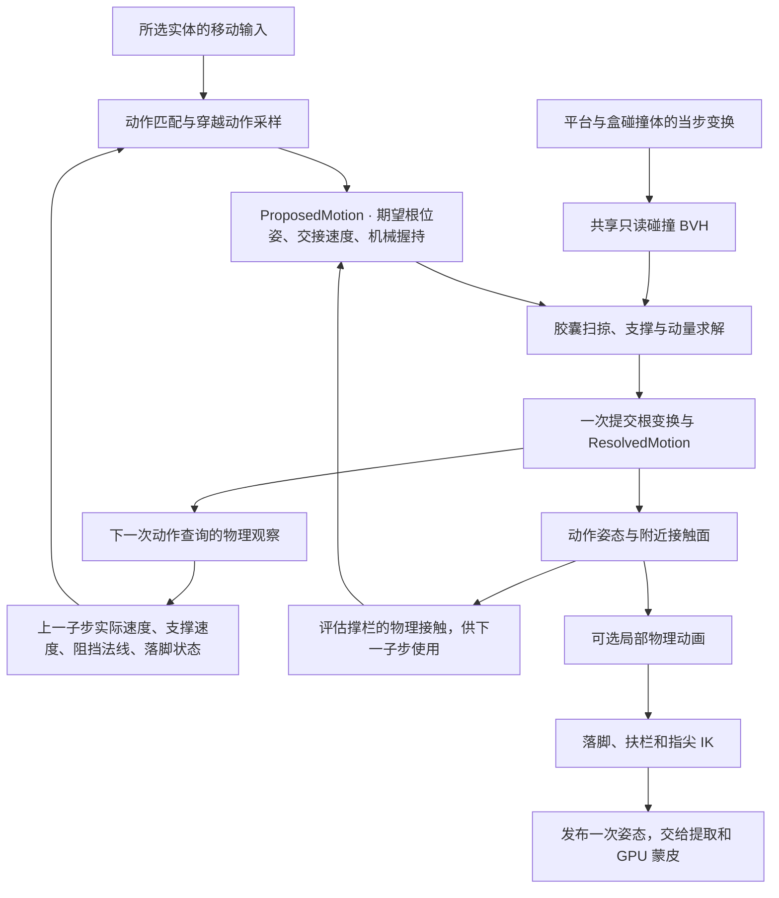

# 角色的一个物理子步

`silver-contact` 默认按 60 Hz 推进角色。输入发给当前选择的实体，动作匹配产生期望位姿，物理求解器拥有动态角色的根变换，姿态阶段读取已经发生的运动。跳跃、撑栏和精确触摸沿用这条路径。普通物体也能在同一世界注册独立的 Move 驱动。[角色时钟与系统绑定](../src/experiments/motion/silver/contact.rs) · [按实体路由输入](../src/movement.rs)



## Move、动画与物理交换什么

| 数据 | 写入者与时机 | 消费者 |
| --- | --- | --- |
| `ProposedMotion` | 每子步采样完成时写入序号、期望根变换、切换驱动时的继承速度、可选支撑实体和承重比例。 | 求解器核对序号，按实体运动策略选择实际根位姿。 |
| `ResolvedMotion` | 同一子步求解后写入根位姿、实际位移除以时间得到的速度、支撑实体与速度、阻挡法线、重力和本步可用表面。 | 姿态修正在本子步读取；下一子步的运动查询使用与角色当前根匹配的反馈。 |
| 关节局部姿态 | 手脚约束执行后，按已经绑定的骨架布局一次发布。 | 提取器更新变动的蒙皮调色板，GPU 蒙皮共享这份姿态。 |

速度、重力、法线和目标变换都以角色父节点为坐标系。碰撞索引在世界空间组织，查询后将候选转换回角色坐标。角色站在移动平台时，动画查询使用实际速度减去脚下支撑点的速度。角色顶到墙时，阻挡法线限制继续朝墙内的预测；沿墙方向仍可用。移除接触驱动后，角色继承实际速度；恢复驱动时，物理体从当前位姿和速度继续。序号与控制状态随场景保存，候选接触面在加载后的第一个物理子步重新查询。[交换类型](../src/movement/character.rs) · [动作匹配](../src/experiments/motion/silver.rs) · [模式交接](../src/experiments/motion/silver/contact/modes.rs)

## 支撑、握持与局部物理动画

撑栏时先在动作事件窗口内用动画姿态检查手是否能到达栏杆，得到下一步可用的承重比例。求解器再检查支撑实体、碰撞层和角色是否离地，计算该步向上的冲量。手部 IK 单独负责把手掌贴上栏杆。实验可固定机械承重开关，只切换手部 IK，逐步比较腕部姿态、根高度和手部冲量。[撑栏接触](../src/experiments/motion/silver/contact/traversal.rs) · [角色求解器](../src/experiments/motion/silver/contact/dynamics.rs) · [成对回放测试](../src/experiments/motion/silver/contact/exchange_tests.rs)

`contact limbs on` 打开局部物理动画，`contact limbs 0.5` 混合一半，`contact limbs off` 返回默认姿态。右臂和两条腿各有一条两段骨链。肩或大腿根跟随动作，其余两个节点受重力、阻尼、骨长约束和带柔度的姿态目标驱动，并与查询到的可行走表面接触。每个内部时间步最多 1/120 秒，用八轮迭代求解。最终把模拟方向转回骨骼局部旋转，再施加精确手脚 IK。局部状态可存档续算。目前骨链之间独立，角色质心由胶囊控制器求解，全身倒地、骨骼互撞、关节角限位和骨链对平台的反作用力都超出本实现范围。[骨链积分](../src/physics/articulation.rs) · [姿态混合](../src/experiments/motion/silver/contact/physical_pose.rs) · [XPBD 约束方法](https://matthias-research.github.io/pages/publications/XPBD.pdf)

同一机位分别录制 `contact limbs off` 与 `contact limbs on` 的翻栏，保持手脚 IK 和机械撑栏设置一致。画面左侧为默认动画，右侧为三条骨链全部混合。两组各为 30 fps、63 帧。[翻栏并排录像](../captures/silver-physical-limbs.mp4)

## 如何检查效果

```powershell
cargo run --release --locked -- --experiment silver-contact
```

| 窗口控制台命令 | 观察内容 |
| --- | --- |
| `contact action vault`，`contact hand off` | 保留机械撑栏，观察手腕脱离视觉目标时的根轨迹。 |
| `contact hand on`，`contact grip off`，再运行 `contact action vault` | 保留手掌对齐，观察缺少向上支撑冲量的表现。 |
| `contact limbs on`，`contact feet off`，`contact hand off` | 关闭末端覆盖，观察重力和姿态驱动产生的骨骼运动。 |
| `motionroot controller` 或 `motionroot clip` | 切换所选角色的平面根运动来源。 |
| `contact mode free` 或 `contact mode contact` | 切换独立移动与物理接触，沿用已选角色与运动状态。 |
| `schedule profile on`，随后 `schedule profile` | 查看调度、提交、撤销准备与写入计数。姿态字节数只统计矩阵载荷。 |

共享盒碰撞索引和扫掠在物理层实现。角色使用直立胶囊，支撑/实体盒/交互锚点可以独立配置。扫掠连续处理相对平移；快速旋转的侧壁按子步采样朝向。任意三角网格碰撞与连续旋转体求交尚待实现。旋转平台的支撑点单独使用角速度计算。与角色耦合的弹簧板目前要求共用父坐标系。[盒碰撞体和索引](../src/physics/collision.rs) · [胶囊扫掠](../src/physics/sweep.rs) · [每子步的碰撞快照](../src/experiments/motion/silver/contact/collision.rs)

运动墙即使与远处碰撞体的增删发生在同一子步，仍需要保留前一帧的位置才能捕获横穿角色的碰撞。热重绑按实体代次、父链和形状匹配样本。换父、复用 ID 或编辑形状会让对应历史失效。运动停止后，索引收窄上一子步的扫掠包围盒，再复用静态快照。[历史重映射与热重绑测试](../src/experiments/motion/silver/contact/collision/history.rs)
