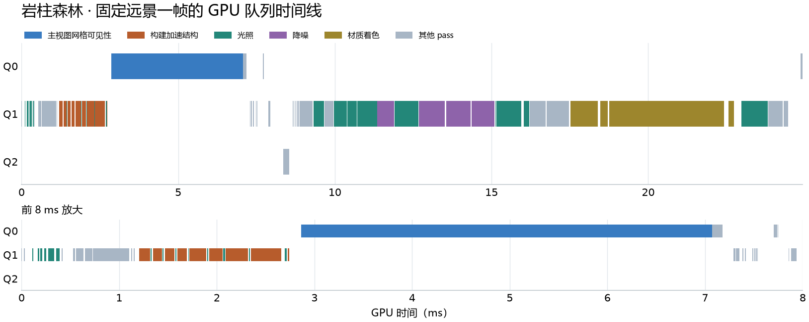

# 岩柱森林的光追、静态 BLAS 与物理队列

## 测量条件

2026-11-24 在 RTX 5070、NVIDIA 驱动 621.14 上回放含 2,280 棵树的 `forest-karst`。使用 Release、1920×1080 原生 TAA、风动、ReSTIR 直接光、两跳漫反射 GI、SVGF 和自适应投影代理。每次启动一个隐藏的 Win32 窗口，以两个在途帧槽向 MAILBOX 交换链呈现，关闭验证层和像素读回。相机逐帧推进，风场按 1/60 秒推进。每次回放 420 帧，覆盖静止、推近、返回、拉远和远处静止。每组独立启动两次，第二轮倒序，合计 3,360 帧。主视图簇数、细代理与粗代理三角数逐帧一致。[相机与测量代码](../examples/forest_shadows/zoom.rs) · [逐帧 CSV，gzip](../captures/forest-karst/architecture/frames.csv.gz)

每次舍去开头 48 帧，剩余 372 帧用于帧时和吞吐统计，每组共 744 帧。GPU 帧时取同一帧最早到最晚 GPU 时间戳的跨度，P95 取升序第 `ceil(0.95 × N)` 项。完成帧率取 1000 除以相邻引擎完成帧间隔的算术均值，包含 CPU 和队列交接开销。显示器扫描输出和 GPUI 工作台的帧率需另测。

## 同路径对照

| 三角 BLAS / 射线后端 / 物理队列 | GPU P50 | GPU P95 | 推近 GPU P95 | 固定远景 GPU P95 | 完成帧率 | AS 峰值 | scratch 峰值 |
| --- | ---: | ---: | ---: | ---: | ---: | ---: | ---: |
| 每槽独立 / RT 管线 / 3 | 23.16 ms | 26.31 ms | 27.22 ms | 25.80 ms | 35.30 FPS | 309.30 MiB | 20.57 MiB |
| 跨槽共享 / RT 管线 / 3 | 23.51 ms | 26.13 ms | 26.33 ms | 26.15 ms | 34.94 FPS | 289.95 MiB | 18.00 MiB |
| 跨槽共享 / RT 管线 / 1 | 22.71 ms | 25.34 ms | 25.52 ms | 25.35 ms | 35.86 FPS | 289.95 MiB | 18.00 MiB |
| 跨槽共享 / compute 内联 / 3 | 24.84 ms | 27.35 ms | 27.91 ms | 27.55 ms | 33.46 FPS | 289.95 MiB | 18.00 MiB |

基线二进制在加入相同队列计时后、启用跨槽缓存前构建。AS 和构建临时缓冲（scratch）按设备本地分配用途分别取峰值，包含预热与所有帧槽。驱动内部内存及森林的材质、历史纹理等均在这两列的统计范围之外。推近有 144 个有效样本，固定远景有 96 个。[显存按用途统计](render-pipeline.md)

**共享静态几何。** 三队列管线的两次回放得到相同构建次数。每次从冷启动算起，完整构建从 917 次降到 865 次；舍去预热为 895 次降到 845 次，其中推近段为 443 次降到 419 次。有效帧里的增量更新均为 3,565 次，固定远景平均每帧仍需 9 次更新。岩柱和地形走跨槽复用，风动几何和各槽 TLAS 继续按数据变化更新。AS 峰值节省 19.35 MiB，scratch 峰值节省 2.57 MiB。推近段 GPU P95 下降 0.89 ms，固定远景则上升 0.35 ms，整条路径的完成帧率相近。[静态缓存与构建](../src/rhi/ray.rs)

**后端选择。** 同为三队列和静态共享时，独立管线与 compute 内联的直接光阴影 pass P95 分别为 1.12 ms 和 1.10 ms，GI 探针追踪分别为 1.16 ms 和 2.53 ms。两者使用同一套普通三角几何与 TLAS，直接光同样追踪遮挡，GI 同样执行最近命中与后续遮挡查询。当前自动策略在 GI 开启且管线可用时选管线，普通代理仅直接光时优先用可用的内联查询。独立的内联阴影 pass 便于对照两套实现。NV 选簇投影单独验证簇能力，继续使用支持簇的管线。[路径选择与能力矩阵](ray-tracing-rhi.md)

## 固定远景的一帧

图取自三队列静态共享的第一次回放，第 400 帧。GPU 跨度为 24.93 ms，共 123 个 pass。Q1 在 1.20–2.72 ms 执行 BLAS 相关 pass，随后构建 TLAS 至 2.74 ms。Q0 的四段主视图网格可见性在 2.86–7.07 ms，最长一段为 4.18 ms。Q1 在 12.68–15.09 ms 执行三轮 à-trous 空间降噪，在 18.75–22.42 ms 为可见叶片着色，后者占用 3.67 ms。[此帧的 Perfetto 时间线](../captures/forest-karst/architecture/distant-frame.trace.json)

对每个在途帧，分别合并所有 BLAS 区间、四段主视图网格区间，再求交。三队列共享配置的两次回放共 840 帧，这两类工作在同帧的最大重叠为 0.00 ms。把物理队列限到一条后，全路径 GPU P95 从 26.13 ms 降到 25.34 ms，完成帧率从 34.94 增至 35.86 FPS。该结果只覆盖此设备和森林配置。时间线显示实际发出的信号、等待和 pass 时间戳，依赖链按最晚结束的前驱回溯；驱动内部的等待耗时和跨帧硬件利用率需要其他测量手段。[时间线导出](../src/rhi/timeline.rs) · [队列与同步](render-pipeline.md)

## 复跑与查看

从引擎根目录执行以下命令。每个输出目录包含完整的 `zoom.csv` 和第 120、400 帧的时间线。比较不同配置时分开运行，每组重新启动进程。

~~~powershell
$env:RENDER_LAB_GPU_QUEUES = "3"
cargo run --release --locked --example forest_shadows -- target/forest-pipeline-3q zoom 1 --size 1920x1080 --rays hardware --gi multi
cargo run --release --locked --example forest_shadows -- target/forest-inline-3q zoom 1 --size 1920x1080 --rays inline --gi multi
$env:RENDER_LAB_GPU_QUEUES = "1"
cargo run --release --locked --example forest_shadows -- target/forest-pipeline-1q zoom 1 --size 1920x1080 --rays hardware --gi multi
Remove-Item Env:RENDER_LAB_GPU_QUEUES
~~~

在运行中的实验控制台输入 `restir rays status` 查看能力与当前选择，输入 `timeline frame.json` 导出最近完成帧。在 Perfetto 中打开 JSON，选择对应的 GPU 队列及 pass，可以查阅前驱、同步对象的值和资源屏障。缺少跨队列公共时间基准的设备保留各 pass 耗时，导出跨队列图时会说明限制。[Perfetto 的外部跟踪格式](https://perfetto.dev/docs/getting-started/other-formats)
