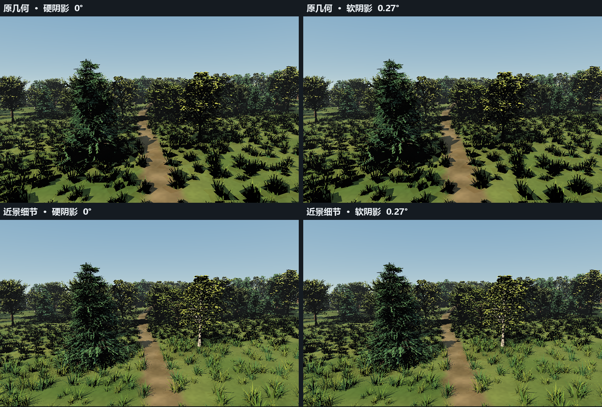
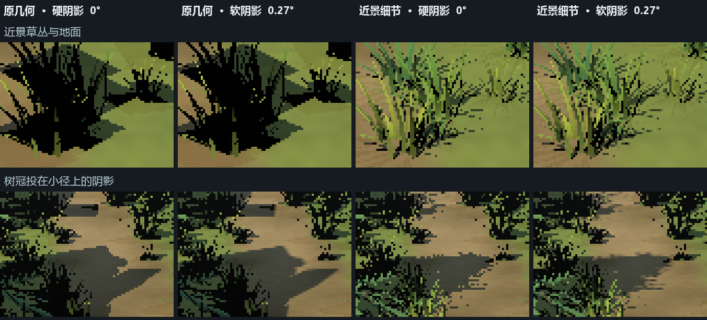

# 森林的草叶、树冠与太阳半影

在 `gi12-forest` 的 `overview` 机位固定相机，只观察直接光。左上是修改前可执行文件的硬阴影，右上在原几何上单独加入太阳角半径，下排使用新的近景投影几何。四张图保持相同的太阳方向、强度、冷色补光、EV 0、风场时刻及主视图 LOD。上排的软阴影是为了分离变量而补拍的对照。

局部图每个原像素放大四倍，第一行裁切 `x=449..531, y=410..469`，第二行裁切 `x=343..425, y=294..353`。近景细节改变了整簇草的自遮挡和落在地上的轮廓。枝叶之间的缺口让小径露出更多亮点。0.27° 角半径下，贴近地面的影子仍然锐利，较高树冠在小径上留下较宽的半影。

这些参考图逐灯求直接光，太阳软阴影使用 16 个圆盘样本，禁用 SVGF。实时路径由 ReSTIR 选灯，每个有效像素最多发一条阴影射线，随后用共享运动向量做 SVGF 时空滤波。[实时 ReSTIR + SVGF 的四组原画面对照](../captures/forest-shadows/realtime.png)

## 投影几何与光源

- CPU 按摄像机到实例世界包围球表面的距离划分投影精度。包围球包含风动位移上界。草在 22 个世界单位内、树木在 32 个世界单位内进入细节区，离开各自阈值 2 个单位后再退回代理。选择包含屏幕外的投影物。
- 近景草使用最细层草叶三角形。树木从三角簇 DAG 按局部简化误差 0.045 取一组覆盖完整的簇，保留树枝和离散的叶片。GPU 用原顶点 UV、四骨骼权重和主视图同一风姿态生成用于求交的三角形。远处的草使用草簇代理，树冠按叶团使用分离的体积代理。距离切换采用滞回，越过阈值时仍会发生一次几何替换。
- 软件 BVH 复用相同的 GPU 变形表面。近景原型的三角形与分批后的实例按空间中位数划分，使相邻 BVH 叶子的包围盒紧凑。遍历首先排除补齐满二叉树产生的空包围盒。阴影测试使用软件三角形求交。这个实验中的草叶与树叶以几何定义轮廓。
- 平行光实例保存角半径，单位为度。森林暖色太阳默认 0.27°，冷色补光为 0°。0° 时沿光轴查询一次。正角半径时在光源张成的立体角内采样，根据实际样本方向计算余弦和遮挡。改变角半径或手动切换投影精度会更新 ReSTIR 与 GI 缓存的历史键。[投影 LOD](../src/experiments/clusters/gpu/proxy/detail.rs) · [GPU 变形](../shaders/plant_proxy.comp) · [可见性积分](../shaders/restir_visibility.glsl)

## GPU 测量

NVIDIA GeForce RTX 5070，Release，800 × 500，无窗口回读。此机位有 4,018 个植被投影实例，包括同一棵树拆分的树皮和树冠部件。原几何共 127,952 个代理三角形。自适应模式下，677 个近景实例使用 171,064 个三角形，另有 3,341 个实例保留 120,736 个代理三角形，合计 291,800 个。

每轮每配置重建实验和历史。按固定 1/60 秒步长推进，先运行 12 次模拟和 48 个渲染预热帧，在第 49 帧以零时间步长截图，然后测量 64 个风动帧。第二轮反转配置顺序。表内每格汇总 128 帧，单位 ms。整帧取设备时间戳首尾跨度，包括回读路径的 GPU 操作。阴影查询列只取最终选灯后的可见性 pass，中间几何列合计投影变形、三角形收集、叶节点包围及 BVH refit。并行队列上的各 pass 用时不宜逐项相加估算帧时间。

| 投影几何／太阳角半径 | 实时整帧 P50 / P95 | 实时阴影查询 P50 | 实时几何与 BVH P50 | 参考整帧 P50 / P95 | 参考阴影查询 P50 |
| --- | ---: | ---: | ---: | ---: | ---: |
| 原代理，0° | 5.94 / 6.19 | 0.72 | 0.22 | 5.74 / 6.05 | 1.25 |
| 原代理，0.27° | 6.32 / 6.71 | 1.02 | 0.23 | 21.15 / 22.83 | 16.00 |
| 近景精细，0° | 8.02 / 8.52 | 2.25 | 0.37 | 9.02 / 9.59 | 3.98 |
| 近景精细，0.27° | 8.82 / 9.41 | 3.05 | 0.37 | 67.26 / 87.52 | 59.52 |

时间比较在同一版本内切换原几何和新几何，所有配置使用相同的 BVH 遍历修正。修改前可执行文件与原几何硬阴影复拍的 400,000 个像素中，11 个像素的显示亮度相差超过 2 个灰阶。在相同 0° 角半径下，换投影几何后这个比例达到 19.02%。保持新几何，仅改变太阳角半径时为 1.51%。显示亮度按 PNG 的 RGB 码值用 0.2126、0.7152、0.0722 加权计算。[逐帧实时数据](../captures/forest-shadows/realtime.csv) · [逐帧参考数据](../captures/forest-shadows/reference.csv)

## 初次软件对照时的硬件接入方案

后续硬件实现、逐三角形核验及实测结果见[Mega Geometry 森林阴影](forest-mega.md)。

本次画面和计时使用计算着色器遍历软件 BVH。RTX 5070（驱动 621.14）实查公开 `VK_NV_cluster_acceleration_structure` revision 4，`clusterAccelerationStructure = true`，每个 CLAS 的顶点和三角形上限均为 256。当前 Mesh Shader 每簇上限分别为 64、64。初次软件对照时，引擎的硬件 RT 预览使用常规 BLAS/TLAS。

一种接法是让 GPU 的 DAG 层级选择把实例 ID、簇 ID、表示方式和过渡权重同时提供给光栅和光追。可见部分共用同一组 LOD 选择，同时沿太阳圆盘方向扩展投影物范围，把主相机视锥外或通过 Hi-Z 剔除但仍能投影到接收面的簇补齐。现有 `GPU instance frustum` 和簇剔除着色器都剔除视锥外数据，因此需要在二者之前分出投影物范围。光追还需处理过渡权重，光栅的叶簇在像素着色阶段按屏幕坐标互补抖动，父子簇同时作为不透明几何会加重遮挡。[选簇](../shaders/cluster_cull.comp) · [过渡覆盖](../shaders/visibility.frag)

静态三角簇缓存 CLAS。风动簇可复用拓扑模板，用当前姿态的顶点实例化 CLAS；相同拓扑但不同风姿态需要各自对应的求交位置。远景体素簇可按当前 Mesh Shader 相同的规则输出暴露面的三角形。每个实例的选中 CLAS 组成 Cluster BLAS，再与普通网格的 BLAS 一起挂入场景 TLAS。ReSTIR 可以继续负责选灯与太阳方向采样，由启用 CLAS 的硬件 RT 管线完成遮挡。上述方案记录了当时的设计候选。后续实现在世界坐标中聚合一个森林 Cluster BLAS，实测构建和遍历开销见上方链接。[NVIDIA 连续 LOD 样例](https://github.com/nvpro-samples/vk_lod_clusters) · [NVIDIA 动画簇样例](https://github.com/nvpro-samples/vk_animated_clusters) · [Vulkan 扩展设计](https://docs.vulkan.org/features/latest/features/proposals/VK_NV_cluster_acceleration_structure.html)

## 复现

从引擎根目录执行以下命令。两种模式都会保存各自的四张 PNG 和逐帧 CSV。

~~~powershell
cargo run --release --locked --example forest_shadows -- captures/forest-shadows reference 64 2
cargo run --release --locked --example forest_shadows -- captures/forest-shadows realtime 64 2
~~~

交互窗口可用 `vegetation shadows coarse` 和 `vegetation shadows adaptive` 切换几何，用 `light list` 查询太阳的实体 ID，再用 `light angular-radius ID 0` 或 `light angular-radius ID 0.27` 切换半影。输入 `restir gi direct` 使用本次计时的直接光模式。采样、降噪和相机设置的完整调用保存在[对照实验入口](../examples/forest_shadows.rs)。
