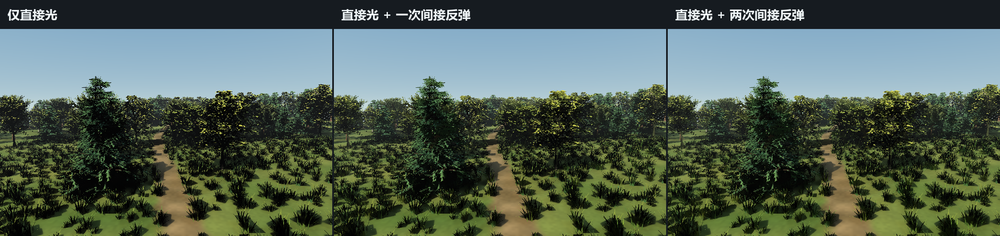
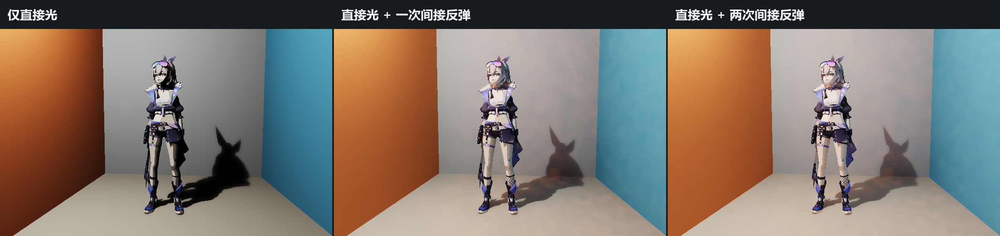

# 森林与银狼的 GI 命中着色实验

森林与银狼用 ReSTIR DI 计算可见表面的直接光。GI 光线从可见表面出发，可命中屏幕外的表面。单跳模式在第一次命中处计算出射光，多跳模式再从那里抽样追踪一次漫反射。引擎实现了 AMD GI-1.2 的漫反射多跳缓存思路，使用固定分辨率屏幕探针、世界缓存与 RDG。AMD Capsaicin 还实现了方向性探针图集、自适应探针布置、哈希网格多级过滤和光泽反射。[AMD GI-1.2 的多跳估计器](https://gpuopen.com/learn/gi-1-2-multibounce-indirect-rendering/)

`forest-karst` 默认使用两跳间接光和 KHR 硬件遍历。控制台的 `restir rays toggle` 在软硬件间切换，也可直接指定 `restir rays hardware` 或 `restir rays software`。普通代理还支持 `restir rays inline`，compute shader 对相同 TLAS 执行最近命中与遮挡查询，共用 UV、材质和两跳缓存逻辑。选择同时作用于探针的两次最近命中、命中点到光源的遮挡和直接光阴影。命中后的反射率、自发光与缓存处理共享同一份着色代码。`gi12-forest` 启用 `vegetation shadows mega` 后可把选中的 CLAS 加入同一 TLAS，按簇恢复 UV、法线和材质。下文的早期图像与基准采自软件路径。[岩柱森林硬件与软件逐帧对照](procedural-vegetation.md#岩柱森林的多跳光追) · [Mega Geometry](forest-mega.md)

## 画面对比

每组从左到右分别开启直接光、一次间接反弹和两次间接反弹。每张图以 800 × 500 渲染，保持相同光源、曝光、相机和模拟步长，各自从空历史预热 48 帧，保存第 49 个渲染帧。曝光为 EV 0。几何、风和银狼的待机动作在三组中遵循相同的时间序列。

森林取自风动植被实验。地面、树皮和树叶分别使用自己的可见材质，直接光取自原场景的太阳和冷色补光。天空背景沿用原有显示，GI 射线未命中时返回零。观察前景大树下方和小径两侧，间接光在这些位置更清晰。这组历史对照图使用叶团代理，代理 UV 取自静止姿态下的柱面坐标。当前版本的近景使用带原始 UV 的枝叶三角形，远景沿用代理。[同机位的投影几何与太阳角半径对照](forest-shadows.md)

银狼使用原 glTF、Motion Matching 待机姿态和 GPU 蒙皮流。摄影棚使用一盏点光、暖色左侧反光板和冷色右侧反光板。地面和背板均参与反弹。可从角色脚边到背板上的投影观察间接光填充，从背板左右两侧观察反光板带来的色偏。[正差值放大五倍的对照](../captures/gi12/increment-x5.png)

下表统计整张 PNG 的显示亮度码值，范围 0–255。对编码后的 RGB 使用 0.2126、0.7152、0.0722 加权。最后一列统计加入第二次反弹后，亮度增加超过 2 个码值的像素比例。

| 场景 | 直接光均值 | 单跳均值 | 多跳均值 | 第二跳增亮超过 2 的像素 |
| --- | ---: | ---: | ---: | ---: |
| 森林 | 96.42 | 99.68 | 100.50 | 11.1% |
| 银狼 | 111.11 | 137.27 | 143.78 | 96.5% |

复拍一次直接光作为基线。银狼的 400,000 个 RGB 像素逐像素相同。森林有 90 个像素的显示亮度相差超过 2 个码值，占 0.023%，全图平均绝对差为 0.0047 个码值。

## 材质如何定义一次命中

每个材质的 gi_hit 保存 GI 专用的模型、反射色、纹理、自发光和双面设置。旧场景采用默认漫反射，基础色乘非金属比例作为线性反射率。无光照模型可以把绘制过的纹理作为发光面。程序模型可组合常量、采样、亮度、加法、乘法和混合，指定两个输出节点分别控制漫反射和发光。材质编辑会刷新驻留表并使关联缓存历史失效。场景文件能保存这些参数和程序。[材质定义与校验](../src/scene/gi.rs) · [GPU 表编译](../src/render/atlas/gi.rs)

下例是银狼脸部使用的命中程序。它从原贴图取亮度，在两种线性肤色之间混合，向 GI 返回该反射色和零发光。角色在主视图中继续走 Toon 着色。

~~~json
{
  "gi_hit": {
    "model": {
      "program": {
        "nodes": [
          {"texture": "inherit"},
          {"luminance": 0},
          {"constant": [0.14, 0.055, 0.045]},
          {"constant": [0.95, 0.75, 0.66]},
          {"mix": [2, 3, 1]},
          {"constant": [0, 0, 0]}
        ],
        "diffuse": 4,
        "emission": 5
      }
    }
  }
}
~~~

一个程序最多使用 16 个节点，输入只允许引用前面的节点。可单独指定 GI 纹理资产。光线求交得到三角形 ID 与重心坐标，以三个顶点的 UV 插值，在纹理图集中按重复寻址双线性采样。四个纹素先从 sRGB 解码到线性 RGB。软件静态 BVH 和变形 BVH 读取打包三角形，硬件路径按 TLAS 实例 ID 找到原顶点与索引流。两者返回同一份命中属性，材质程序只运行一套。目前光追几何保留一套 UV，采样基础 mip。glTF 导入优先采用基础色的 UV 通道，其次采用发光纹理的通道。使用另一套 UV 的发光贴图需重新映射后才能参与这个实验。[命中求值](../shaders/gi_hit.glsl) · [glTF 导入](../src/import.rs)

## 每帧的计算

1. 从 Visibility Buffer 重建位置、法线及实例 ID。原有的 ReSTIR DI、阴影可见性和 SVGF 生成可见像素的直接光。
2. 每个 8 × 8 像素区域选最接近中心的有效表面，发出 8 条分层余弦加权射线。所选射线后端返回最近表面，着色阶段执行它的 GI 材质程序。命中位置、量化世界法线和材质槽组成世界缓存键。
3. 首次命中和二次命中共用场景光表、ReSTIR 的目标函数与 reservoir 归一化，各自独立累计直接光。候选灯数最多 8。灯数超过预算时，在命中点重新评估该缓存单元上帧选出的灯，并对最终选中的灯查询遮挡。相机可见表面另有自己的逐像素时空重采样。
4. 多跳模式对有漫反射的首次命中以 50% 概率再追一条余弦加权射线。第二次命中处的直接出射光乘第一次命中的漫反射率，再除以延续概率。第一层缓存把这个间接估计量留给下一帧，与直接光分开累计。第二次射线未命中、或采样未延续时，按零贡献计入平均。
5. 按已验证的共享运动向量复用上一帧探针，再依据接收像素与附近探针的位置和法线过滤，输出全分辨率间接漫反射。当前缓存有 131,072 个槽位，单元宽 0.16 个世界单位。离散化和有限采样会造成局部偏差。镜头切换、材质变更和光表变更会更新历史键。直接光模式跳过六个 GI pass。[RDG 组织](../src/experiments/restir/diffuse_gi.rs) · [追踪](../shaders/gi12_trace.comp) · [探针积分](../shaders/gi12_probe.comp)

## 复现

在引擎根目录构建 Release，运行任一场景，控制台输入下列三个命令之一。也可以用下面的脚本从冷缓存重新生成六张原图。

~~~powershell
cargo build --release --locked --bin render-lab
New-Item -ItemType Directory -Force captures/gi12 | Out-Null
foreach ($scene in 'forest','silver') {
    foreach ($mode in 'direct','single','multi') {
        .\target\release\render-lab.exe --experiment "gi12-$scene" --command "restir gi $mode" --warmup 48 --capture "captures/gi12/$scene-$mode.png"
    }
}
~~~

GPU 回归用一个没有解析光源的微型场景验证重心 UV、sRGB 采样、材质表达式和第二跳延迟传播。可单独运行以下测试。

~~~powershell
cargo test --locked --lib barycentric_texture_sampling_and_delayed_second_bounce -- --ignored
~~~
