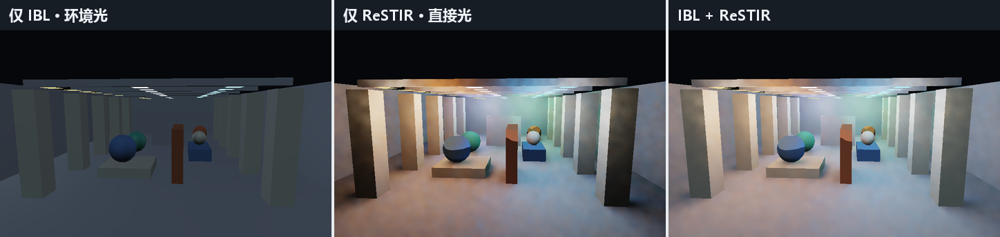
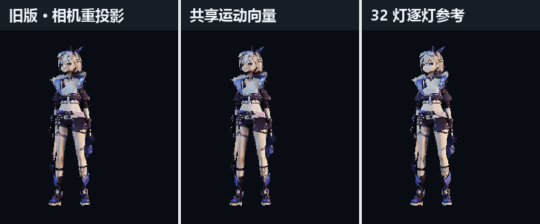

# 光照组合与银狼重投影对照

## 混合光照

同一间柱廊使用 PBR 和 Toon 材质。示例先固定混合场景的相机，再分别移除直接光、环境光的 ECS 设置，或同时保留两者，交给同一个场景加载入口。左图使用 IBL，中图使用 ReSTIR，右图同时使用两者。三次使用相同的材质、网格、曝光设置和 800×500 分辨率，读取第九帧。

原始混合场景使用 16,384 盏程序化灯。独立的命令行回归采用 `--experiment mixed --warmup 8 --capture`。旧版、只改光照组合的版本和最终版本三个 PNG 解码后的 400,000 个 RGB 像素完全一致。分离光源的两次运行都保留了 PBR 与 Toon 的可见像素，测试同时检查了两种独立输出与组合结果的差异。[组合入口](../src/experiments/light_stack.rs) · [集成测试](../tests/framework.rs)

## 银狼横移

在 RTX 5070 上用 Release 通过真实 GPU 管线逐帧回读。角色来自银狼 glTF，骨骼由 Motion Matching 推进。固定镜头，400×320，以 30 Hz 模拟 32 帧。使用 32 个确定位置的点光源、每像素 4 个初始候选、ReSTIR 时空复用和 SVGF。关闭 TAA，隔离光照历史的效果。逐灯参考在相同姿态计算全部 32 盏灯的可见性和贡献，关闭降噪。

| 测量 | 旧版相机重投影 | 共享表面运动 |
| --- | ---: | ---: |
| 32 帧人物前景 RGB8 平均绝对误差 | 14.60 | 13.26 |
| 第 17 帧人物前景 RGB8 平均绝对误差 | 14.24 | 12.23 |

从原始 PNG 提取参考图中与纯色背景不同的像素，对这些像素的 RGB 三通道计算绝对误差，按像素汇总所有帧。全序列误差下降 9.17%。第一帧没有历史，两种输出逐像素相同。两个版本的逐灯参考也在全部 32 帧逐像素相同。GIF 使用相同裁剪并减速播放，数据来自完整分辨率 PNG。[逐帧误差 CSV](../captures/silver-restir-error.csv) · [第 17 帧 PNG](../captures/silver-restir-frame.png)

第 17 帧命中的动作是 `strafe-right_41`。在 9,150 个可着色前景像素中，8,884 个找到了符合条件的历史表面。1,659 个受跟踪像素的屏幕位移至少一像素，其中 1,627 个通过历史校验。计数表示找到了可用的历史像素，储样的权重和 SVGF 的辐亮度截断仍由各自算法决定。`restir history-stats on` 开启这项 GPU 统计，默认关闭。

## 实现与验证

最终可见性和深度确定后，只要时域光照或后处理提出请求，帧图便生成一次表面运动。开启 TAA 时，光照历史采样补偿前后帧的抖动差。重投影 pass 在上一帧的临近像素中校验实例与几何表示标签、预期深度和表面法线，生成统一的上一帧像素索引。ReSTIR 候选复用和 SVGF 的历史矩都读取这份索引。相机切镜或尺寸、算法等相关状态变化会使相应历史失效。历史缓存由 80 字节头加每像素 80 字节改为 16 字节头加每像素 64 字节；另有本帧共享的 24 字节运动样本和 4 字节查找索引。后处理和照明可共用运动样本。[重投影 shader](../shaders/restir_reproject.comp) · [RDG 声明](../src/experiments/restir/graph.rs)

图依赖测试覆盖单独启用 ReSTIR、单独启用 SVGF、两者配合 TAA、切镜以及仅用空间滤波。独立 GPU 用例构造已知屏幕位移和抖动差，检查输出的上一帧像素编号，并检查冷历史、越界、无有效对应、法线翻转与深度不符的拒绝结果。

窗口 benchmark 按每个 pass 的稳定阶段标识累计 GPU 时间。在 RTX 5070、Release、816×559、MAILBOX、预热 60 帧并采集 120 帧的混合场景中，光照、降噪和运动阶段的 GPU 时间之和的中位数分别为 1.237、0.983 和 0.059 ms。不同队列允许重叠，各阶段时间分别统计。

## 复现

从引擎根目录运行。前两个命令输出完整银狼 PNG 序列，后三个命令分别输出三种混合场景配置的第九帧。示例使用与 CLI 相同的 ECS、调度、场景提取和 Vulkan 后端。[对照示例源码](../examples/lighting_comparison.rs)

~~~powershell
cargo run --release --locked --example lighting_comparison -- target/comparison/silver reuse
cargo run --release --locked --example lighting_comparison -- target/comparison/reference reference
cargo run --release --locked --example lighting_comparison -- target/comparison/ibl ibl
cargo run --release --locked --example lighting_comparison -- target/comparison/direct direct
cargo run --release --locked --example lighting_comparison -- target/comparison/combined combined
~~~
