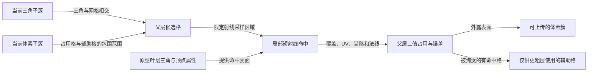
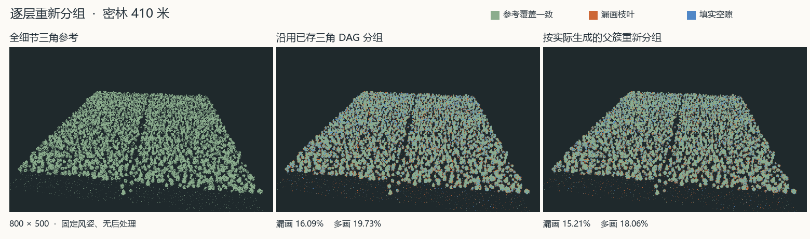
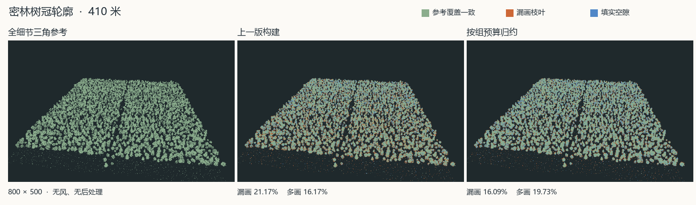
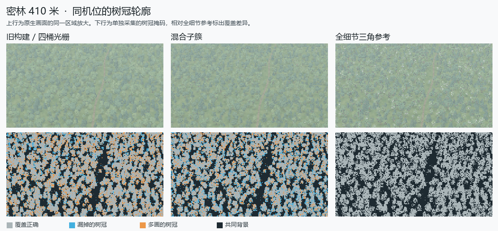
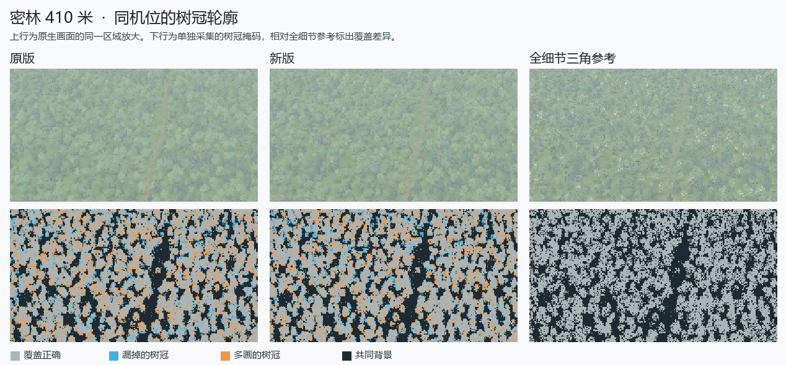
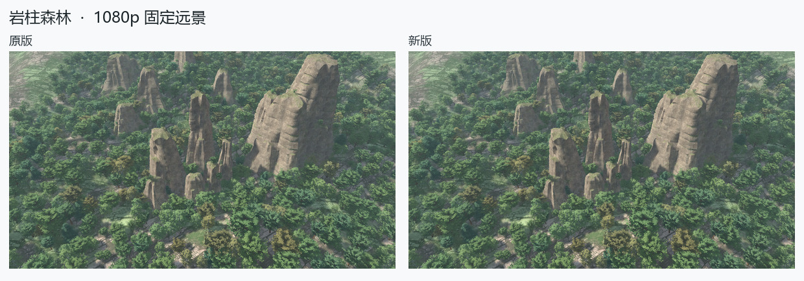

# Nanite 与 Render Lab 的植被体素构建和光栅化

构建决定一组枝叶在某个细节层级用三角形还是用稀疏体素表示。光栅化发生在每帧，决定选中的几何覆盖哪些屏幕像素，以及每个像素由哪个表面着色。构建时穿过一个格子的多条采样射线，与渲染时从一个像素中心出发的视线，有不同的输入和输出。

本次对照采用 Epic 官方 UE 5.9 源码 `43894ac6`，源码链接需要对应 Epic GitHub 仓库的访问权限。Render Lab 使用同一株植物原型的静息坐标建簇，屏幕上的每个实例根据当前姿态和相机选择切面。下文的旧基线 `c06f78d`、随后测试的四桶版本、按投影面积筛选的单父簇版本，按组预算切分父簇的版本，以及当前逐层重组的版本分别标注。

## Nanite 如何构建体素簇

1. **从子簇生成父层候选。** 对启用体素保形的资产，全三角子组在归约时比较三角简化误差和体素误差。已有体素子簇的组继续尝试体素归约。离散叶片在简化时容易消失，稀疏体素则可以保住整团枝叶的体积和轮廓。体素误差更低时，父层采用体素簇。细层三角仍可供近景选择。每个体素簇最多包含 128 个砖，每砖覆盖 4×4×4 个格。[Epic，Nanite Voxels](https://dev.epicgames.com/documentation/en-us/unreal-engine/nanite-foliage#rasterization-process)
2. **判定哪些格应保留。** 对聚合体，从多个方向随机发射穿过候选格的射线，用命中几何的比例估计覆盖，再在构建时把覆盖转成二值占用。一个只擦过格角的叶片和填满格子的叶团因此得到不同的保留机会。UE 5.7.4 还提供 6-可分离体素化，重点是让连续表面封住沿坐标轴穿越的路径。它可修补粗树干的孔洞，也可能把本来稀疏的树冠填得过实。[Epic 对占用、孔洞与 Separable 的说明](https://forums.unrealengine.com/t/nanite-voxelization-holes-in-the-mesh/2723578/3)
3. **保存材质和朝向。** 一个保留格可容纳多片朝向不同的叶面。Nanite 保存法线分布供着色使用，骨骼动画继续驱动植被。5.7.4 的技术答复还指出，该版启用体素的网格要求根为单个体素簇，树干与叶冠要采用不同策略时可拆成不同网格。这项限制有明确的版本范围。[Epic 着色和蒙皮说明](https://dev.epicgames.com/documentation/en-us/unreal-engine/nanite-foliage#shading-process) · [Epic 对根簇的答复](https://forums.unrealengine.com/t/nanite-voxelization-holes-in-the-mesh/2723578/5)

**父簇的输入与预算。** `FClusterDAG` 汇总子簇的顶点数、表面积、包围体和最大误差。全三角输入先合并、简化，得到三角候选误差。组中一旦含有体素子簇，构建器会继续尝试把整组聚合成更粗的体素父簇。目标格数约为子簇顶点数的 3/4，砖预算由预计父簇数乘以 128 得到。初始格长由组表面积和格数预算估计，并受子簇最大误差约束。超出容量时，格长增大 10% 再试，接受后按砖的空间位置切分父簇。[UE 组归约与误差](https://github.com/EpicGames/UnrealEngine/blob/43894ac6e1cbf13b42e2a52d264e45cc51af558e/Engine/Source/Developer/NaniteBuilder/Private/ClusterDAG.cpp#L1387-L1590)

**候选格和命中表面有两个来源。** `FCluster::Voxelize` 遍历当前直接子簇。三角子簇把相交格加入同一张稀疏表，体素子簇把已占用格及特定被淘汰格的空间范围投到父网格。随后射线查询构建器的原始几何场景，在命中处重建属性和法线分布。这样，子层曾淘汰的细节有机会在父层重新采到。多射线二值化路径还会按覆盖率削减占用、利用法线分布向邻格分摊覆盖。这里的辅助格只供继续构建。[UE 叶层射线场景](https://github.com/EpicGames/UnrealEngine/blob/43894ac6e1cbf13b42e2a52d264e45cc51af558e/Engine/Source/Developer/NaniteBuilder/Private/ClusterDAG.cpp#L210-L224) · [UE 两类子簇产生候选格](https://github.com/EpicGames/UnrealEngine/blob/43894ac6e1cbf13b42e2a52d264e45cc51af558e/Engine/Source/Developer/NaniteBuilder/Private/Cluster.cpp#L1684-L1768) · [UE 覆盖与辅助格](https://github.com/EpicGames/UnrealEngine/blob/43894ac6e1cbf13b42e2a52d264e45cc51af558e/Engine/Source/Developer/NaniteBuilder/Private/Cluster.cpp#L1972-L2097)

**一组可以生成多少父簇。** UE 对不含曲线的组统计输入三角数与输入体素砖数，除以两倍单簇容量并向上取整，以此预留父簇数。砖数不超过单簇容量时直接发射一个父簇。超过时，对砖原点沿三个轴排序并扫描分割位置，用两侧的砖数和包围盒对角线平方计算成本，只接受能满足分区数约束的切法。所有兄弟父簇取得同一生成组、LOD 包围球和误差，各自拥有独立的几何包围。下一层在大规模输入上会分别组织三角簇和体素簇，体素分组先把同一生成组的兄弟放在一起。层内只剩少量簇或某类型只剩一簇时，源码有混合归约路径。[父簇数量](https://github.com/EpicGames/UnrealEngine/blob/43894ac6e1cbf13b42e2a52d264e45cc51af558e/Engine/Source/Developer/NaniteBuilder/Private/ClusterDAG.cpp#L732-L751) · [输入分组](https://github.com/EpicGames/UnrealEngine/blob/43894ac6e1cbf13b42e2a52d264e45cc51af558e/Engine/Source/Developer/NaniteBuilder/Private/ClusterDAG.cpp#L1161-L1216) · [兄弟归组](https://github.com/EpicGames/UnrealEngine/blob/43894ac6e1cbf13b42e2a52d264e45cc51af558e/Engine/Source/Developer/NaniteBuilder/Private/ClusterDAG.cpp#L889-L938) · [空间划分成本](https://github.com/EpicGames/UnrealEngine/blob/43894ac6e1cbf13b42e2a52d264e45cc51af558e/Engine/Source/Developer/NaniteBuilder/Private/BVHCluster.h#L66-L140) · [兄弟 LOD 数据](https://github.com/EpicGames/UnrealEngine/blob/43894ac6e1cbf13b42e2a52d264e45cc51af558e/Engine/Source/Developer/NaniteBuilder/Private/ClusterDAG.cpp#L1591-L1603)

**稀疏砖可以跨过对齐边界。** UE 以对齐的 4³ 范围和材质生成种子，按材质与空间顺序处理。对每个种子，先找范围内剩余占用格的逐轴最小坐标，再从这个新原点收取 4³ 内的同材质格。已收取的格从工作表移除。砖可以向相邻种子借用占用格，体素中心仍在原型的同一张网格上。[UE 装砖源码](https://github.com/EpicGames/UnrealEngine/blob/43894ac6e1cbf13b42e2a52d264e45cc51af558e/Engine/Source/Developer/NaniteBuilder/Private/Cluster.cpp#L2201-L2283)

## Nanite 如何光栅化体素簇

1. **选择本视图要画的簇。** GPU 在层级中按投影细节选簇并剔除不可见项。体素与三角簇进入各自的光栅列表，体素使用专门的 shader 变体。Epic 描述的体素簇按深度分桶、近桶先画，让远处的砖有机会在已有深度处提前结束。[Epic，Nanite Rasterization Process](https://dev.epicgames.com/documentation/en-us/unreal-engine/nanite-foliage#rasterization-process)
2. **由砖找像素，再由像素找格。** Karis 的 HPG 原型先把可见砖投向屏幕，仅对砖投影覆盖的像素生成测试。再把该像素的视线变换到砖局部空间，与包围盒求交，沿视线用 DDA 从一个网格边界走到下一个。对 4³ 砖，一个 64 位字即可测试沿途哪些格有表面，这样可以跳过空格，并避免为每个格的六个面逐一提交图元。演讲还比较过多层砖和直接投影小砖两种原型。[Karis，Journey to Nanite，Voxel prototype](https://highperformancegraphics.net/slides22/Journey_to_Nanite.pdf)
3. **调度顺序与深度桶。** `CalcSortKey` 将体素与曲线归到靠后的光栅类别，让较早绘制的几何先写深度。排序作用于本轮光栅。在两轮遮挡剔除模式，主轮完成光栅后构建当前 HZB，再对延后的簇执行补绘光栅。体素软件组分配一个 *depth block*，一个 block 包含 **256 个深度桶**。启用相应排列时，簇中心的视向深度经过对数映射得到桶号。GPU 对桶计数做前缀和，散布光栅任务。256 个有序范围并不意味着 CPU 或 RDG 顺序提交 256 次绘制。该功能受扩展簇布局和 `r.Nanite.DepthBucketing` 等条件控制。[排序键](https://github.com/EpicGames/UnrealEngine/blob/43894ac6e1cbf13b42e2a52d264e45cc51af558e/Engine/Source/Runtime/Renderer/Private/Nanite/NaniteCullRaster.cpp#L2309-L2345) · [启用条件](https://github.com/EpicGames/UnrealEngine/blob/43894ac6e1cbf13b42e2a52d264e45cc51af558e/Engine/Source/Runtime/Renderer/Private/Nanite/NaniteCullRaster.cpp#L4946-L4950) · [体素块数](https://github.com/EpicGames/UnrealEngine/blob/43894ac6e1cbf13b42e2a52d264e45cc51af558e/Engine/Source/Runtime/Renderer/Private/Nanite/NaniteCullRaster.cpp#L5958-L5969) · [每块桶数](https://github.com/EpicGames/UnrealEngine/blob/43894ac6e1cbf13b42e2a52d264e45cc51af558e/Engine/Shaders/Shared/NaniteDefinitions.h#L16-L17) · [对数映射](https://github.com/EpicGames/UnrealEngine/blob/43894ac6e1cbf13b42e2a52d264e45cc51af558e/Engine/Shaders/Private/Nanite/NaniteClusterCulling.usf#L298-L311) · [桶内偏移](https://github.com/EpicGames/UnrealEngine/blob/43894ac6e1cbf13b42e2a52d264e45cc51af558e/Engine/Shaders/Private/Nanite/NaniteRasterBinning.usf#L446-L463) · [两轮光栅边界](https://github.com/EpicGames/UnrealEngine/blob/43894ac6e1cbf13b42e2a52d264e45cc51af558e/Engine/Source/Runtime/Renderer/Private/Nanite/NaniteCullRaster.cpp#L7090-L7169)
4. **砖内步进。** `ClusterTraceBricks` 投影并裁剪砖的屏幕范围，重分配像素任务，先测保守深度。通过的像素沿砖局部视线执行 DDA，用占用位寻找命中格，再用格内射线段中点求深度，参与可见性竞争。[UE 砖像素深度](https://github.com/EpicGames/UnrealEngine/blob/43894ac6e1cbf13b42e2a52d264e45cc51af558e/Engine/Shaders/Private/Nanite/NaniteRasterizer.usf#L1220-L1306) · [UE 提前深度测试及任务队列](https://github.com/EpicGames/UnrealEngine/blob/43894ac6e1cbf13b42e2a52d264e45cc51af558e/Engine/Shaders/Private/Nanite/NaniteRasterizer.usf#L1727-L1769)
5. **对胜出的像素着色。** Epic 文档描述的 GBuffer 路径从体素的法线分布中为每个像素随机选一个方向。《巫师 4》技术演示则在着色时直接使用分布，以降低噪声。确定可见性与决定叶片如何受光是两个阶段。[Epic，Shading Process](https://dev.epicgames.com/documentation/en-us/unreal-engine/nanite-foliage#shading-process)

## Render Lab 如何构建体素簇

输入是植物原型的模型空间三角、UV、法线、骨骼权重和已有 cluster DAG。树冠原型启用体素替代，树皮保留三角。CPU 在准备原型时构建一次，实例共用结果，GPU 每帧根据实例变换和骨骼姿态把砖放到场景中。

1. 从存档组引用的叶层 meshlet 开始，读入原始三角及其属性，建立原型的射线查询表。每层以实际生成的三角簇和体素兄弟作为输入重新分组。不同组可并行简化，按稳定组序分配面 ID 后并行比较体素候选。生成的 DAG 随原型打包并缓存，存档和纯三角参考仍可复用已有的三角层级。[逐层构建](../src/experiments/clusters/bvh/voxels/levels.rs) · [分组](../src/experiments/clusters/bvh/voxels/grouping.rs)
2. 用三角形与格子的保守相交测试生成三角候选，把子层占用格和构建辅助格的包围盒映射到同一张父网格。对父网格每个候选格从六个面分层发出 48 条有限长度的射线，从原始叶层几何的最近命中取得 UV、法线及骨骼权重。覆盖归约淘汰的有命中格可供更粗一层再次采样，辅助格无需上传 GPU。[格子、短射线与混合输入回归](../src/experiments/clusters/bvh/voxels/sampling.rs)
3. 全三角输入以三角简化误差为切换门槛，已有体素输入的组按同一份格数与父簇预算继续归约。找到第一个合格格长就接受，写入该格长作为组的体素误差。所有兄弟共享这一 LOD 切换条件。[组归约](../src/experiments/clusters/bvh/voxels.rs) · [DAG 打包](../src/experiments/clusters/bvh.rs)
4. 在整组网格中按主导骨骼收取可平移的稀疏砖，并用整组邻接关系计算每个格的外露面。随后划分父簇，每簇独立编码砖和命中页。跨父簇接壤的同骨骼格不会生成内部面，使用不同骨骼的相邻格保留风动时可能暴露的面。主可见性、材质、运动和硬件光追沿用相同的表面编号。[砖布局与兄弟切分](../src/experiments/clusters/bvh/voxels/bricks.rs)

**下一层的分组顺序。** 总数按实际物理簇计。32 个以内放入同一归约组。大层的三角簇按重合位置的连接关系与空间位置分区，目标 16 个、上限 32 个。简化前锁定跨组重合顶点，使用 meshoptimizer 的二次误差简化，考虑法线和 UV，重新生成每簇最多 64 顶点、64 三角的父簇。产生多个体素父簇时，同一生成组的兄弟作为整体进入 Morton 排序。每组在前后各 16 个邻组中寻找合并后包围球半径最小的伙伴。双方互选、至少一方小于 8 簇且合计不超过 32 簇时才合并。大层仅余一个三角或一个体素物理簇时，也有加入另一类分组的路径。UE 的三角分区对共享外边计权，并区分兄弟关系。本引擎的三角分区使用 meshoptimizer 的连接与空间权重。[UE 三角分组](https://github.com/EpicGames/UnrealEngine/blob/43894ac6e1cbf13b42e2a52d264e45cc51af558e/Engine/Source/Developer/NaniteBuilder/Private/ClusterDAG.cpp#L753-L840) · [UE 体素兄弟与邻域配对](https://github.com/EpicGames/UnrealEngine/blob/43894ac6e1cbf13b42e2a52d264e45cc51af558e/Engine/Source/Developer/NaniteBuilder/Private/ClusterDAG.cpp#L889-L1055)

用于空间分组的几何球与用于切换的 LOD 球分别传播。每个兄弟用自身几何做可见性判定，误差和 LOD 球继承自同一个生成组。个别组本轮没有可接受的父表示、而其它组仍有进展时，下一轮继续带上该组的原几何。整层无法继续归约时将剩余组作为根，以保留完整切面。

下面的数据流发生在原型构建时。下一层只读取完成的子组，格子的材质始终可以追溯到一次对原始叶层几何的命中。

### 本引擎的判据

| 判据 | 本版计算 |
| --- | --- |
| 进入体素归约 | 对全三角输入，三角候选误差取当前组重新简化时的模型空间误差、子层误差下限和三向轮廓探针误差中的最大值。40×40 正交探针比较细面与粗三角，估算误差为 `0.33 × 探针像素边长 × sqrt(异或像素总数 / 3)`。已有体素子簇的组直接尝试体素归约。 |
| 格长和误差 | 初始格长由面积与目标格数估计，同时取原型基准半格长和子层误差为下限。一次覆盖归约得到一套二值占用。容量不足时把格长放大 10%，首个合格格长即为体素误差。全三角组以三角误差为搜索上界，混合组设有限的空间上界处理无命中或无法编码的区域。 |
| 组预算 | 目标占用格数为直接子三角簇独立顶点数与直接子体素格数之和的 3/4。父簇上限是 `ceil((三角数 + 砖数) / 256)`。已有子组出现多次只计一次。 |
| 簇预算 | 每个父簇最多 128 块砖，最多 256 个可见性命中页。分页按实际外露格、外露三角数和打包顺序检查。完全封闭的格占用构建网格，分配的 GPU 命中页数为零。 |
| 父簇切分 | 对各轴按砖原点排序，比较空间分割成本并排除超出可用父簇数的分割。各兄弟共用生成组和误差，每个兄弟独立生成风动保守包围球，独立接受剔除。 |

覆盖归约按各格命中率之和决定保留数量，逐次移除覆盖最低的格，并按法线在邻居方向的投影把覆盖分摊到仍存活的 26 邻格。非空组至少保留一个格。引擎用三个带权方向近似法线分布，保留格使用自身射线命中的 UV 和骨骼。UE 多射线路径还会混合邻格法线分布，并按覆盖权重选取来源表面属性。[覆盖归约](../src/experiments/clusters/bvh/voxels/coverage.rs) · [UE 属性传播](https://github.com/EpicGames/UnrealEngine/blob/43894ac6e1cbf13b42e2a52d264e45cc51af558e/Engine/Source/Developer/NaniteBuilder/Private/Cluster.cpp#L2031-L2082)

48 条射线分布在立方体六个面，每面八条，按 4×2 分层。方向采样对应穿过表面的各向同性通量。每个格在 16 个可复现模板中选择一个。射线只统计本格内的最近交点，重叠三角不会把同一射线记多次。在命中射线中按稳定散列选一条，重心插值 UV，对三个顶点上相同骨骼的权重求和后选主导骨骼。这样能避免把相邻 UV 岛的颜色混到贴图中间。对应回归为 `duplicated_surfaces_do_not_gain_opacity_or_mix_attributes`。

## Render Lab 如何光栅化体素簇

1. **从场景选到这一帧的主列表。** GPU 先对实例做视锥剔除，再遍历全局 BVH 工作列表并按屏幕误差选择簇。BVH 提供空间包围，DAG 描述可替换的粗细关系。主轮用历史 Hi-Z 检查候选簇，把暂时遮挡的簇放进延后列表，把可见三角和可见体素分别输出。每个体素任务引用一个实例、一个簇和该簇最多八块连续的砖。[帧流程](../src/experiments/clusters/gpu.rs) · [簇遮挡与任务生成](../shaders/occlusion.comp)
2. **先画全部不透明三角。** 主轮留下可见砖任务。普通网格和主轮三角写入深度后，以三角深度建立中间 Hi-Z。补绘轮复测延后簇，将恢复砖追加到同一份列表，并画完恢复三角。本帧用三角专用中间 Hi-Z 做复测，体素留在整段不透明几何光栅的末尾。中间层的遮挡信息更保守，可能增加补绘量。[帧流程](../src/experiments/clusters/gpu.rs)
3. **把砖分解成候选像素。** 一个计算工作组有 32 个线程。先按实例和当前骨骼矩阵投影每个砖的实际占用包围盒，裁剪近面和视口，得到矩形与保守最近深度。组内对最多八个矩形的像素数做前缀和。各线程按步长 32 遍历合并后的像素序列，从而让较大砖的任务也能分给整个组。每项先判断 LOD 过渡掩码，再比较砖最近深度和像素已有深度。[投影](../shaders/brick_project.glsl) · [像素调度](../shaders/brick_raster.comp)
4. **用 DDA 确定可用于材质和光追的表面。** 对通过检查的像素生成像素中心视线，在砖局部空间与紧凑占用范围求交。每次越过最近的网格面进入相邻格，以 `x + 4y + 16z` 查占用位。对位序更低的占用位做 `popcount`，即可定位该格紧排的属性记录。着色器只接受实际外露的进入面或离开面，按面内同一条对角线确定两个三角中的一个，并生成“命中页 + 页内三角”编号。这个编号与硬件 CLAS 的外露面展开一致。[砖内 DDA 与命中编号](../shaders/brick_trace.glsl)
5. **最后光栅体素。** 所有三角写完后，每像素用最终三角深度初始化 64 位竞争缓冲。GPU 直接消费两轮共用的砖列表，列表按间接调度上限分页，各页与距离无关。DDA 命中通过一次原子操作竞争深度和句柄，等深时由句柄裁决。一次解析发布可见实例、图元和深度，随后构建包含体素的下一帧历史 Hi-Z。[间接光栅](../src/experiments/clusters/gpu/bricks.rs) · [最终解析](../shaders/brick_resolve.comp)
6. **解析材质与运动。** 材质用胜出的图元 ID 找到体素外露面和记录的 UV。着色法线在三个带权方向中按像素、表面和实例的稳定散列选择，再变换到当前姿态。运动向量可用同一外露面在前后两帧的骨骼和实例变换重建位置。[属性读取](../shaders/plant_geometry.glsl) · [可见表面重建](../shaders/surface.glsl)

**Mesh shader 回退。** 计算路径要求可用的 64 位缓冲原子和可编码的命中范围。回退路径也投影同一批砖。投影最多覆盖四个像素时，mesh shader 直接在像素中心求交，为命中样本生成微三角，较大投影用两个三角覆盖矩形，由片元着色器调用同一个 `hitBrick`。两条路径共用砖内步进和图元编号。[Mesh shader](../shaders/brick.mesh) · [片元着色器](../shaders/brick.frag)

`vegetation raster compute` 和自动选用的计算后端均直接消费末尾体素列表。`linear` 是旧存档和命令的兼容别名。`vegetation raster compare` 将同一份列表交给 compute 与 mesh，比较覆盖、图元和深度。

## 构建和光栅的差异对照

| 决策点 | Nanite | Render Lab 实验工作树 | 对结果的影响 |
| --- | --- | --- | --- |
| 父簇的输入与边界 | 两类子簇一起生成候选，可按砖的位置划分多个父簇 | 当前层实际父簇按类型和邻域组建下一层，小层允许混合，体素兄弟保持在同组 | 两者都传播生成组的 LOD 球与误差。三角连接权重、简化器和 GPU 命中页容量存在差别 |
| 占用与误差 | Epic 公开了射线覆盖二值化，以及体素与三角简化误差的比较 | 每格 48 条确定性射线，全三角候选受粗三角误差限制，合格体素使用首个可编码格长 | 命中率决定占用，格长和组预算共同决定何时接受 |
| 光栅调度 | 每轮将体素归入靠后类别，可按每块 256 桶排列任务 | 主、补两轮收集到同一份列表，全部不透明三角完成后直接光栅体素 | 省去距离排序、重复任务缓冲与主轮体素光栅，中间 Hi-Z 的遮挡能力随之改变 |
| 命中与着色 | 所查 UE 5.9 着色器取格内线段中点深度，公开 GBuffer 路径对法线分布逐像素取样 | 取外露面交点，按面内对角线产生稳定的三角编号，以三个带权方向近似法线分布 | 主可见性、运动向量和硬件 CLAS 能引用同一图元，法线角分布及深度可与 UE 有差异 |

三个带权方向是本项目的离散近似。SGGX 可以用方向投影面积拟合各向异性分布，并对可见法线作方向采样。本项目的轮廓 IoU、层数与帧时间均来自下述森林实验，文中没有跨引擎的同资产性能测量。[Heitz 等，SGGX microflake distribution](https://research.nvidia.com/labs/rtr/publication/heitz2015sggx/)

## 逐层重组的验证

云杉原型的 46,020 个叶层三角各出现一次。新 DAG 有 213 组，收敛到一个根。17 组生成体素父簇，其中 5 组归约已有体素，2 组同时有直接三角和体素输入。对每个组收集沿细化链接可到达的叶层 meshlet，49 组的叶层集合在原存档 DAG 中没有对应组。第一个全三角层的分界恰好与旧版一致，差异在父簇重新进入分组后出现。另将原叶簇反序、交错放进七个存档根组，再加入一个未引用的叶簇。用单 worker 重建，树、组、簇、顶点和索引五份 GPU 数据与原存档并行重建结果逐字节相同。[原型与存档回归](../src/experiments/clusters/bvh.rs)

以 2,665 棵树的密林、800×500、1.45 像素误差，沿 110 到 410 米的同一条相机路径检查 121 帧。轮廓对照固定风姿，关闭后处理，逐帧与同机位全细节三角比较。漏画和多画以参考覆盖面积为分母。表面层数取独立硬件遮挡查询的三角与真实砖表面样本之和，除以前景像素数。最后两列为 410 米机位的三次稳定采样中位数。

| 构建 | 平均 IoU | 平均漏画 | 平均多画 | 410 米 IoU | 410 米表面层数 | 410 米 DDA 次数 |
| --- | ---: | ---: | ---: | ---: | ---: | ---: |
| 上一版，沿用三角 DAG | 0.7383 | 12.64% | 18.35% | 0.7008 | 1.778 | 359,398 |
| 逐层重新分组 | 0.7378 | 13.45% | 17.32% | 0.7182 | 1.762 | 495,293 |

410 米处，砖候选像素从 1,463,173 减至 661,978，但被 LOD 过渡掩码筛掉的从 1,003,926 减至 54,736，实际进入砖内步进的次数上升。全路径的平均多画减少、平均漏画增加。图中橙色表示相对全细节参考漏画，蓝色表示多画。

RTX 5070、驱动 621.14、Release，2,280 棵树的岩柱森林，1920×1080 交换链直接呈现，MAILBOX。开启风、TAA、ReSTIR DI、两跳 GI 和硬件光追。旧、新、新、旧各跑同一条 420 帧推拉路径，每次剔除 48 帧预热，每版合计 744 个样本。计时关闭验证层。

| 构建 | 砖阶段 P50 | 整帧 GPU P50 | 整帧 GPU P95 |
| --- | ---: | ---: | ---: |
| 上一版 | 0.336 ms | 23.22 ms | 26.04 ms |
| 逐层重新分组 | 0.325 ms | 22.94 ms | 25.75 ms |

126 项测试通过，包含跨组接缝、单线程与并行构建一致性、Vulkan 同步验证、风动簇光追和独立 NGX 集成测试。格式检查和严格 Clippy 检查通过。

[逐帧轮廓、光栅计数、硬件表面层数与窗口耗时](../captures/forest-karst/voxel-research/regrouped-levels.zip)

## 历史对照：按组预算切分父簇

云杉树冠从 11 个体素替代增至 41 个。41 个组中有 20 个继续归约已有体素，8 个同时包含直接三角和体素子簇。这个云杉所有被选组都装进了单个父簇。独立回归用 768 个分离三角通过与资产相同的归约入口，验证组能选出多个父簇。另用首尾相连的 130 块砖切成两个父簇，解码每个可见性记录，校验共用的 LOD 组、局部命中页、占用无重叠，以及切分界面没有新增三角。12³ 实心网格还验证了内部格的命中页计费。[真实原型](../src/experiments/clusters/bvh.rs) · [切分和编码回归](../src/experiments/clusters/bvh/voxels/bricks.rs)

密林有 2,665 棵树，800×500，几何误差均为 1.45 像素。相机从 110 米连续拉至 410 米，固定风姿、关闭后处理。每帧用同机位全细节三角作为树冠参考，统计 121 帧 IoU、漏画和多画的平均值。漏画、多画以参考覆盖面积为分母。表面层数另用硬件遮挡查询重放全场景三角和砖的真实表面，以前景像素数归一化。DDA 是通过深度与过渡带检查后实际走入砖的像素射线次数。最后两列取 410 米机位三次稳定采样的中位数。

| 构建配置 | 平均 IoU | 平均漏画 | 平均多画 | 410 米 IoU | 410 米表面层数 | 410 米 DDA 次数 |
| --- | ---: | ---: | ---: | ---: | ---: | ---: |
| 上一版，单父簇与投影约束 | 0.7373 | 16.21% | 13.71% | 0.6786 | 1.685 | 208,780 |
| 仅改装砖与父簇容量，保留旧候选评分 | 0.7400 | 15.22% | 14.65% | 0.6830 | 1.702 | 242,577 |
| 首个可行格长，加上一版的投影约束 | 0.7357 | 14.75% | 15.90% | 0.6926 | 1.749 | 342,251 |
| 当前默认，首个可编码格长 | 0.7383 | 12.64% | 18.35% | 0.7008 | 1.778 | 359,398 |

默认选用按预算接受首个可编码格长的版本，贴近所查 UE 的归约顺序，远景枝叶更完整。代价是更多像素填进参考树冠的空隙，平均 IoU 变化小，砖内求交增加。额外施加上一版投影约束会降低表面层数，同时重新增加漏画。

RTX 5070、驱动 621.14、Release，岩柱森林 2,280 棵树，同一条推近和拉远路径。1920×1080，直接交换链 MAILBOX，风、TAA、ReSTIR DI、硬件光追与两跳 GI 开启。窗口按旧、新、新、旧顺序各跑 420 帧，各次去除 48 帧预热，每种构建合计 744 个 GPU 帧跨度。两版共用不按距离分桶、两轮三角结束后统一绘制体素的光栅路径，计时关闭验证层。

| 构建 | 砖阶段 P50 | 整帧 GPU P50 | 整帧 GPU P95 |
| --- | ---: | ---: | ---: |
| 上一版 | 0.267 ms | 23.18 ms | 26.05 ms |
| 当前默认 | 0.334 ms | 23.21 ms | 25.68 ms |

两次回放中砖阶段耗时增加，两版整帧中位数相近。123 项测试通过，包含 Vulkan 同步验证、光栅与风动 CLAS 回归，以及独立运行的 NGX 集成测试。Clippy 严格检查与格式检查通过。[四组逐帧轮廓、硬件表面层数、DDA 与窗口计时](../captures/forest-karst/voxel-research/parent-budget-measurements.zip)

## 历史对照：单父簇混合归约与末尾光栅

云杉原型共生成 11 个体素替代，其中 7 个父簇包含体素子簇，1 个父簇同时包含三角和体素子簇。测试从最终打包的 DAG 读回这些关系，同时核对每个逻辑替代只发射一次。独立用例把原始叶面、直接子三角、已占用格、辅助格分开布置，检查父层候选及从叶层重采样的 UV 和骨骼。[真实 DAG 回归](../src/experiments/clusters/bvh.rs) · [混合输入用例](../src/experiments/clusters/bvh/voxels/sampling.rs)

RTX 5070，驱动 621.14，Release，1920×1080，岩柱森林 2,280 棵树。保持相机路径、TAA、风、ReSTIR DI、两跳 GI 和硬件光追一致，双在途帧 MAILBOX，无颜色回读，计时关闭验证层。每次推近、后退和拉远共 420 帧，去掉 48 帧预热。表中每种配置 744 帧，砖阶段逐帧合计分桶、初始化、光栅及发布，整帧使用 GPU 首尾时间戳。每种配置各跑两遍。基线和只改光栅的配置交叉回放，最终混合构建另起两个独立窗口复测。

| 配置 | 砖阶段 P50 | 整帧 GPU P50 | 整帧 GPU P95 |
| --- | ---: | ---: | ---: |
| 旧构建、主轮与补绘各四桶 | 0.330 ms | 23.32 ms | 26.17 ms |
| 相同几何、末尾统一光栅 | 0.278 ms | 23.22 ms | 25.94 ms |
| 混合子簇、限制投影面积、末尾统一光栅 | 0.268 ms | 23.18 ms | 25.83 ms |

同一构建只改光栅时，岩柱固定远景两版均有 45,625 个可见砖，419,207 个候选像素，6,054 个最终改变像素。单独验证几何时用同帧同列表的计算与 mesh 光栅对照。新版岩柱七机位最多 6 个像素覆盖不同，密林五机位最多 4 个。指标包含镜头跳变后的第一帧。

| 固定远景 | 旧构建 DDA | 混合构建 DDA | 旧构建全场景表面层数 | 混合构建全场景表面层数 |
| --- | ---: | ---: | ---: | ---: |
| 岩柱固定远景 | 28,400 | 8,251 | 5.2832 | 5.2701 |
| 密林 410 米 | 386,421 | 208,780 | 1.8890 | 1.6848 |

表面层数由独立硬件查询重放可见三角面和砖表面，除以最终几何前景像素数。岩柱与密林的测量分辨率分别是 1920×1080 和 800×500。去掉混合父簇的投影工作量上限做消融，密林达到 2.5581 层和 528,709 次 DDA。保留上限后，同机位为 1.6848 层。体素改变的最终像素也从旧版的 85,103 变为 58,568，需要结合下面的漏画面积判断开销来源。

在有 2,665 棵树的密林以 800×500 从 110 米连续拉至 410 米，关闭风和后处理，对 121 帧树冠掩码逐帧比较同机位的全细节三角参考。误差设置以像素为单位，漏画和多画面积都除以当帧参考面积。

| 构建与误差设置 | 平均轮廓 IoU | 平均漏画 | 平均多画 | 410 米 IoU |
| --- | ---: | ---: | ---: | ---: |
| 旧构建，1.45 | 0.7569 | 9.65% | 19.48% | 0.6985 |
| 混合构建，1.45（默认） | 0.7373 | 16.21% | 13.71% | 0.6786 |
| 混合构建，1.20 | 0.7595 | 14.33% | 12.85% | 0.6905 |
| 混合构建，1.00 | 0.7830 | 12.23% | 12.13% | 0.7116 |

本版 119 项测试通过，包含 Vulkan 同步验证、计算与 mesh 光栅对照、风动簇加速结构，以及单独运行的 NGX 集成测试。Clippy 严格检查与格式检查通过。

默认设置为 1.45。实际运行可用 `vegetation pixels 1.00` 调整画质。1080p 时间表使用默认设置，其余两种阈值测的是密林轮廓。提升 IoU 可以同时来自减少漏画或减少填实空隙，判断掉叶需同时查看漏画率。

[逐帧 GPU 时间、逐机位计数和各组轮廓 CSV](../captures/forest-karst/voxel-research/mixed-children-final-raster.zip)

## 历史对照：多方向采样与四桶光栅

两条路径分开测量。在 2,665 棵树的森林，将相机从 110 米连续拉到 410 米，800×500，关闭风和后处理。每帧将树冠可见像素同 `vegetation triangles` 加 `lod 0` 的全细节参考对照。诊断把枝干留在深度里，只给树冠着识别色。分母取参考树冠像素数。IoU 是交集除以并集，表格按 121 帧的逐帧比率求均值。[轮廓采集程序](../examples/vegetation_sweep.rs)

| 轮廓指标 | 改动前 | 改动后 |
| --- | ---: | ---: |
| 平均 IoU，越高越好 | 0.74475 | 0.75695 |
| 平均多画面积 / 参考面积 | 21.71% | 19.48% |
| 平均漏画面积 / 参考面积 | 9.49% | 9.65% |
| 410 米固定机位 IoU | 0.68247 | 0.69851 |
| 相邻帧净面积变化误差 P95，占当帧参考面积 | 0.46% | 0.40% |

相邻帧指标对比实际树冠面积变化与同样相机移动下全细节参考的面积变化，取差值绝对值。它可以检测整片树冠面积突变。局部像素的进出可能相互抵消，逐帧 CSV 另保留覆盖翻转位置的不一致率。

岩柱森林有 2,280 棵树。下表取稳定机位三次 GPU 计数的中位数。候选数是所有砖投影矩形枚举的像素工作项，DDA 数是通过 LOD 和深度拒绝后实际追踪的射线数。表面层数单独用硬件遮挡查询重放三角和真实砖表面，取未做场景遮挡的样本总数除以最终几何前景像素数。`triangles` 行使用该场景自身的全三角 LOD 策略，与用于轮廓真值的强制零级细节有区别。[过度绘制与同列表比较](../examples/forest_overdraw.rs)

| 机位与版本 | 可见砖 | 候选砖像素 | DDA 次数 | 体素最终改变的像素 | 全场景表面层数 |
| --- | ---: | ---: | ---: | ---: | ---: |
| 密林 410 米，旧体素 | 300,288 | 1,968,701 | 369,688 | 85,502 | 1.9871 |
| 密林 410 米，新版体素 | 400,787 | 1,757,930 | 386,421 | 85,103 | 1.8890 |
| 密林 410 米，纯三角 LOD | — | — | — | — | 1.9579 |
| 岩柱固定远景，旧体素 | 37,269 | 538,476 | 33,195 | 6,968 | 5.2904 |
| 岩柱固定远景，新版体素 | 45,625 | 419,207 | 28,427 | 6,054 | 5.2832 |
| 岩柱固定远景，纯三角 LOD | — | — | — | — | 5.2361 |

同帧比较 mesh 与 compute 时，两者读取相同的主列表和补绘列表。新版本在岩柱七个机位（含镜头跳变帧）的最大覆盖差异为 3 像素，密林五个机位为 5 像素。最大归一化深度差分别为 1.79e-7 与 9.89e-6。处在边界及等深竞争的像素仍可能选到不同 ID。开启风和 Mega Geometry 时，四组机位、姿态及 LOD 的正重心坐标样本均与硬件 CLAS 命中相同三角和位置。[风动与硬件命中回归](../src/experiments/restir/studies/mega_tests.rs)

## 历史对照：1080p 四桶窗口测量

RTX 5070，驱动 621.14，Release。岩柱森林保持默认风、TAA、ReSTIR DI、两跳 GI、硬件 RT 和双在途帧 MAILBOX。原版单列表与新版两种模式各独立启动两次，第二次倒序。每次 420 帧，去掉 48 帧预热，每种配置 744 个样本。GPU 时间取整帧时间戳跨度，P95 取排序的第 `ceil(0.95 × N)` 项。砖阶段在每帧将分桶、砖光栅、可见性初始化及发布相加，再取中位数。帧率由引擎完成帧间隔的均值换算。计时关闭 Vulkan 验证和颜色回读。[窗口基准](../examples/forest_shadows/zoom.rs)

| 配置 | 整帧 GPU P50 | 整帧 GPU P95 | 完成帧率 | 全路径砖阶段 P50 | 固定远景砖阶段 P50 |
| --- | ---: | ---: | ---: | ---: | ---: |
| 原版，单桶 | 23.30 ms | 25.97 ms | 43.85 FPS | 0.293 ms | 0.319 ms |
| 新版，单桶 | 23.35 ms | 26.14 ms | 43.73 FPS | 0.293 ms | 0.318 ms |
| 新版，四桶（该次实验默认） | 23.26 ms | 26.08 ms | 43.59 FPS | 0.331 ms | 0.351 ms |

在新版同一几何上对照，单桶和四桶的首轮逐帧主簇数、体素簇数、可见砖数和三角数完全一致。四桶的分桶本身中位数为 0.013 ms，计入多次间接调度后，全路径砖阶段增加约 0.038 ms。新版四桶相对原版的整帧 GPU 中位数减少 0.04 ms，P95 增加 0.11 ms，两轮回放不足以支持整帧加速结论。

密林 410 米处，真实表面层数相对旧体素减少 4.94%，也低于同一机位纯三角 LOD 的 1.9579 层。但 DDA 次数增加 4.53%，表明更小的投影矩形不一定减少通过深度测试的射线。岩柱远景的候选砖像素减少 22.15%，DDA 次数减少 14.36%，全场景表面层数只减少 0.14%，且仍高于纯三角的 5.2361 层。新版较少填实树冠空隙，平均漏画增加了 0.16 个百分点。

交叉核对两次全细节三角参考采集，48,400,000 个像素样本中有 4,114 个覆盖位不同（0.0085%）。上表两版均使用同一份参考。相邻帧覆盖翻转位置的不一致率 P95 从 43.49% 降至 41.01%，这是关闭风和 TAA 的几何轮廓诊断。完整测试 117 项通过，包含实际 Vulkan 光栅和风动 CLAS 命中回归，格式检查及 Clippy 严格检查通过。

[逐帧 CSV、逐机位计数和汇总 JSON](../captures/forest-karst/voxel-research/measurements.zip)

## 复跑当前实现

在包含上述实验实现的引擎工作树根目录运行以下命令。固定机位的 compare 可选最后一个目录保存实际颜色图。做独立时间对照时关闭 compare。窗口路径和逐机位过度绘制使用不同程序，各自对应上面的口径。

~~~powershell
cargo run --release --locked --example vegetation_sweep -- reference-mask target/voxel-reference
cargo run --release --locked --example vegetation_sweep -- auto-mask target/voxel-current
cargo run --release --locked --example vegetation_sweep -- auto-mask target/voxel-one-pixel 1.00
cargo run --release --locked --example forest_overdraw -- forest reference 800x500 compare target/full-detail
cargo run --release --locked --example forest_overdraw -- forest auto 800x500 compare target/forest-images
cargo run --release --locked --example forest_overdraw -- karst auto 1920x1080 compare target/karst-images
cargo run --release --locked --example forest_overdraw -- karst auto 1920x1080
cargo run --release --locked --example forest_shadows -- target/voxel-final zoom 1 --size 1920x1080 --raster compute --rays hardware --gi multi
~~~
