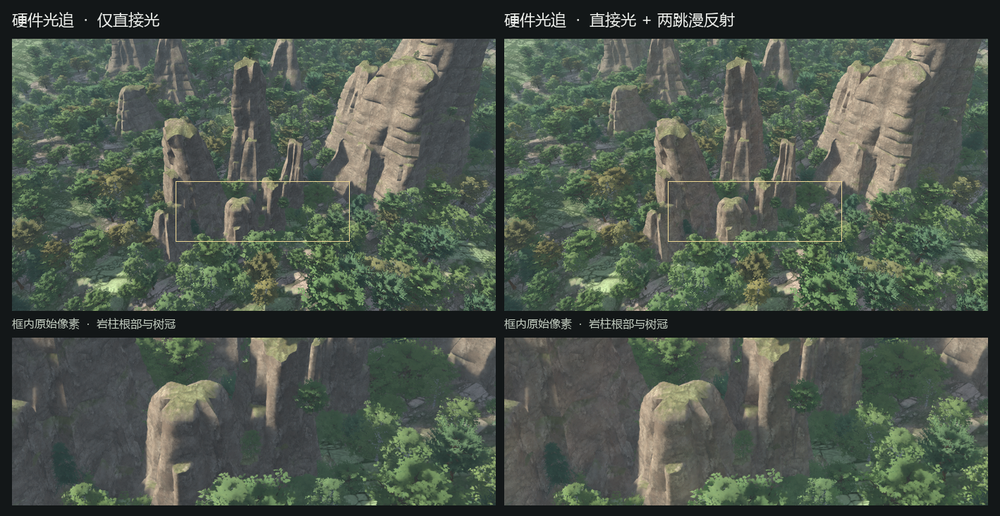
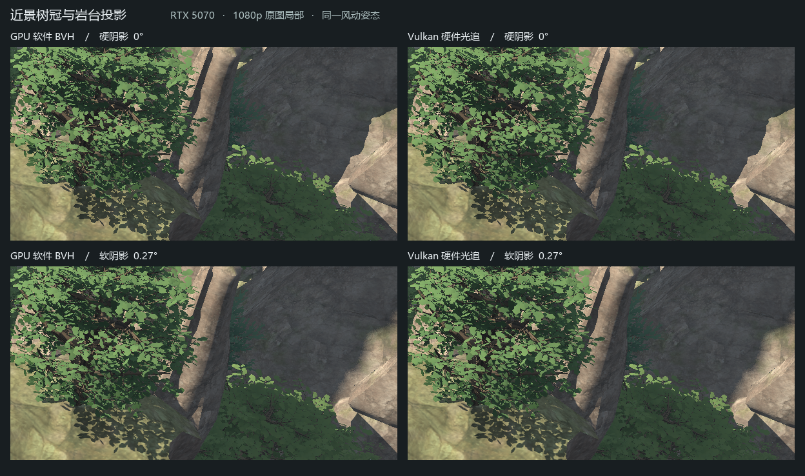

# 程序化植被实验方案

本文保留历次资产和光栅实验的数据。当前版本的混合子簇构建、末尾光栅、轮廓与性能对照见 [Nanite 体素专题](nanite-voxel-pipeline.md)。

## 虚幻引擎参考

Epic 的 Procedural Vegetation Editor 先生成树冠和枝条的骨架，再沿骨架生成树干、分发叶片和导出渲染数据。Nanite Assemblies 利用重复枝叶零件减小几何体积，零件的变换可以绑定主骨架。植被骨骼风动有独立的屏幕尺寸阈值。 [Epic Procedural Vegetation Editor](https://dev.epicgames.com/documentation/unreal-engine/procedural-vegetation-editor-in-unreal-engine?application_version=5.9) · [Epic Nanite Assemblies](https://dev.epicgames.com/documentation/unreal-engine/nanite-assemblies)

Fortnite 的树冠也曾随距离变稀，严重时会突然变光秃。叶片简化成单三角后，继续减面只能删掉一些叶片。`Preserve Area` 在构建时外扩留下的开边界，把损失的面积补到剩余叶片上。 [Epic 的 Fortnite Nanite 技术文章](https://www.unrealengine.com/tech-blog/bringing-nanite-to-fortnite-battle-royale-in-chapter-4#preserve-area)

较新的 Nanite Foliage 在构建时对各级简化区域比较三角与体素误差。体素误差更小的簇可以变成 voxel cluster，每簇最多包含 128 个 4×4×4 brick。运行时还是按投影误差选簇，体素分桶后使用专用光栅着色器，并保存法线分布。小到无法分辨的植被可停止蒙皮更新。 [Epic Nanite Foliage](https://dev.epicgames.com/documentation/en-us/unreal-engine/nanite-foliage#nanite-voxels) · [Epic 对切换粒度的说明](https://forums.unrealengine.com/t/nanite-foliage-dynamic-wind-plugin-question/2852275)

## Render Lab 的实验范围

用固定随机种子生成针叶树、阔叶树和草簇。枝条与草茎各有几何及分层骨骼，顶点绑定一到两个相邻节点。森林预设的 2,665 棵树与 12,580 簇草共享 11 个几何原型。每棵树有独立的枝干和树冠部件，枝干使用三角 LOD，树冠与草簇启用混合简化。

## 本次树木资产与开销

云杉的针叶小枝从下垂主枝两侧长出，树梢保留直立嫩枝。松树从更高的树干位置抽枝，针束朝外上方生长。桦树的短枝下垂，尖叶交替着生，白色树皮有横纹。橡树保留粗壮分叉，末端小枝长出具有起伏边缘的阔叶。细节通过不透明三角几何生成，运行时共享四种整树原型。枝条分发和几何化的细叶参考了 Epic 的植被制作流程。 [树形和分叉](../src/experiments/vegetation/generate/tree.rs) · [叶片和针束](../src/experiments/vegetation/generate/tree/shoots.rs) · [Epic Nanite Foliage](https://dev.epicgames.com/documentation/en-us/unreal-engine/nanite-foliage)

每个原型生成时，把叶片面积累积到一个 16³ 网格，从五个上半球方向估算天空可见度，插值回叶顶点。网格随后释放。三角简化保留顶点属性，体素粗级从一条真实命中射线插值同一属性。风动时着色沿用静息姿态的树冠遮蔽。体素简化的最小误差取单元格宽，较大的孤立块需要更远才有资格进入屏幕误差预算。 [树冠遮蔽](../src/experiments/vegetation/generate/exposure.rs) · [材质](../shaders/vegetation_material.comp)

对照固定相机、树木位置、光源和时间，关闭风动与后处理，使用默认的自动 LOD。录像单独开启风与 TAA。 [近景](../captures/trees-compare-near.png) · [总览](../captures/trees-compare-overview.png) · [远景](../captures/trees-compare-far.png) · [风动录像](../captures/trees-wind-taa.mp4)

森林俯视机位使用 RTX 5070、816 × 559、MAILBOX、TAA、默认风，预热 60 帧后统计 40 帧。GPU 时间取设备首末时间戳，内存取 RHI 记录的设备本地分配。 [测量数据](../captures/forest-tree-asset-cost.csv) · [2,665 棵树的森林俯视图](../captures/trees-scale-after.png)

| 指标 | 旧资产 | 新资产 |
| --- | ---: | ---: |
| GPU 中位数 | 4.281 ms | 4.757 ms |
| GPU P95 | 4.608 ms | 4.938 ms |
| 光栅阶段耗时之和 P95 | 0.801 ms | 1.293 ms |
| 设备本地分配 | 157.7 MiB | 311.8 MiB |
| 潜在簇数 | 1,762,643 | 5,440,199 |

全局候选、选中和 Hi-Z 工作列表按潜在簇数预留容量。细枝与针束增加了原型簇数，实例化森林后，工作列表的容量也随之增加。此表测量森林的常规光栅与 TAA 路径。

## 实现与运行

~~~powershell
cargo run --release --locked -- --experiment vegetation
cargo run --release --locked -- --experiment vegetation --command "vegetation view paths"
cargo run --release --locked -- --experiment vegetation-scale
cargo run --release --locked -- --experiment vegetation-scale --benchmark 40
~~~

- `vegetation camera overview/near/far/forest` 切换总览、枝叶近景、远景和森林俯视。
- `vegetation auto` 按混合 DAG 的屏幕误差选簇。`vegetation pixels 1.45` 设置自动模式的像素预算。`vegetation triangles` 使用独立的全三角对照数据。`vegetation voxels` 放宽混合 DAG 的屏幕误差预算，便于观察体素粗级。
- `vegetation view paths` 显示可见表示。橙色为三角路径，青色为体素路径。`vegetation view beauty` 恢复材质着色。
- `vegetation wind 0` 停止风动，`vegetation wind 2` 用于检查最强风时的包围范围。`vegetation time 0` 可在暂停时设置确定的姿态。

## 混合 DAG

混合路径以存档的叶层 meshlet 为输入，每层重新对实际生成的簇分组。少量簇可以混合归约，大层分别处理连接的三角簇和空间相近的体素兄弟。直接子簇里的三角提供相交格，已选体素子簇提供占用格及构建辅助格，二者汇入同一张父网格。原始叶层三角决定短射线的命中材质、UV、骨骼和法线。全三角组比较两种表示的误差，含体素的组按格数与父簇容量继续聚合，接受首个合格格长。同层独立组并行，三角简化锁定共享边界顶点，下一层可跨旧存档的分组边界。[逐层分组](../src/experiments/clusters/bvh/voxels/grouping.rs) [输入与属性采样](../src/experiments/clusters/bvh/voxels/children.rs) · [误差与预算](../src/experiments/clusters/bvh/voxels.rs)

胜出的体素簇沿用被替换三角簇的细组链接。每个原型只有一套组表、簇表和 BVH。构建过程修正误差和误差球的单调性，保证父节点的屏幕误差界可用于提前剔除。GPU 先做实例视锥测试，再遍历 BVH。每个簇用所属组和细组的投影误差判断是否落入当前 LOD 切面。在过渡带，粗细簇按实例和屏幕像素生成互补掩码，两次 Hi-Z 剔除与可见性 ID 会处理同一张簇表。`Plant clusters in transition` 统计处于过渡的候选簇。[DAG 与 BVH 打包](../src/experiments/clusters/bvh.rs)

每个体素簇最多容纳 128 块 4×4×4 的稀疏砖。直接子簇的实际三角数与砖数决定父簇数预算。砖原点可以移到剩余占用格的最小坐标，较大的组按砖位置拆成多个兄弟父簇，共用 LOD 误差。每簇按实际外露面检查命中页容量。网格位于原型的静息模型空间，每块砖只跟随一根骨骼。同骨骼相邻格的内部面在构建时去掉。32 字节砖头存原点、格宽、64 位占据掩码、有效包围盒、属性起点及骨骼。每个有暴露面的单元另存 24 字节，包括代表性射线命中的 UV、最多三个带权法线方向及可见性命中映射。方向来自细三角插值法线，按主轴分组，按独立命中射线累计权重。着色时用像素、实例和单元的稳定散列从中取样，再按命中面选择双面叶片的半球。同一相机和姿态下，随机数不会随帧变化。[砖块编码](../src/experiments/clusters/bvh/voxels.rs) · [砖块解码](../shaders/plant_geometry.glsl) · [表面重建](../shaders/surface.glsl)

## 体素计算光栅

`vegetation raster auto` 在设备支持 64 位缓冲原子且场景的体素命中可编码时选择计算路径。每个原型登记一条连续的实例与体素页范围，32 位句柄即可还原着色对象及物理三角号，零留给硬件三角。超出范围或缺少设备能力时自动采用 mesh 路径。`vegetation raster compute` 和 `vegetation raster mesh` 用于独立计时。普通网格和三角簇仍使用 mesh shader。[后端选择与范围](../src/experiments/clusters/gpu.rs) · [Vulkan 设备能力](https://docs.vulkan.org/refpages/latest/refpages/source/VkPhysicalDeviceShaderAtomicInt64Features.html)

1. 主轮和补绘轮追加同一份砖列表，先绘制全部不透明三角，再用三角深度初始化每像素 8 字节的竞争缓冲。每组最多处理八块砖，32 个线程共享投影矩形的像素工作，按间接调度容量分页。[砖工作分配](../shaders/brick_raster.comp)
2. 每个候选像素先检查 LOD 互补掩码，再比较砖的保守最近深度和该像素已经记录的最近深度。通过的像素沿像素中心射线在 4³ 网格中执行 DDA。命中外露面后将反序深度位及命中句柄作为一个 64 位值执行 `atomicMax`。相同浮点深度用句柄裁决，两项随同一次原子写入生效。[公共射线](../shaders/brick_project.glsl) · [DDA 和表面 ID](../shaders/brick_trace.glsl)
3. 当帧用于复测的中间 Hi-Z 只取主轮三角和普通网格深度。末尾一次体素阶段结束后统一解析命中，把深度和 ID 写回附件，再为下一帧生成完整 Hi-Z。每帧槽三个光栅中间缓冲合计每像素 20 字节，1080p 为 39.55 MiB。[结果合并](../shaders/brick_resolve.comp) · [RDG 注册](../src/experiments/clusters/gpu/bricks.rs)

`vegetation raster compare` 在同一帧保存三角背景，把同一份合并砖列表交给两条后端，比较最终像素的覆盖、完整 ID 和深度。参考 mesh 路径直接读取追加列表，小于等于四个候选像素的砖在 mesh shader 内求交，其余砖投影矩形交给片元处理。两者共享像素射线与真实外表面深度，便于与三角 CLAS 对齐。独立计时关闭诊断原子计数和重复绘制。[同列表核验](../shaders/brick_compare.comp) · [测量入口](../examples/forest_overdraw.rs)

UE 5.9 光栅排序、每块 256 桶、两轮 Hi-Z 的确切边界，以及本引擎末尾统一绘制与 UE 的差异见 [源码对照](nanite-voxel-pipeline.md)。

LOD 选择以整个体素簇为单位。为兼容可见性 ID 的六位图元号及硬件三角 CLAS 的大小约束，原型另存每页最多 64 个顶点、64 个三角的命中映射。主视图射线命中后由这张表找到面及对角线两侧的三角号。启用 Mega Geometry 时，GPU 将同一张选簇列表和屏外投影簇展开成对应的页，按当前骨骼产生 CLAS。材质、TAA 运动向量和硬件命中可重建同一表面，软件阴影仍从自适应投影代理建 BVH。[CLAS 分页](../shaders/brick_clas.comp) · [共享运动向量](../shaders/surface_motion.comp) · [光追核验](../src/experiments/restir/studies/mega_tests.rs)

## 体素光栅同列表实测

本节记录 11 月 23 日单桶计算版本的结果。四桶阶段及后续末尾光栅的同机位复测见 [Nanite 体素专题](nanite-voxel-pipeline.md)。当下生成的诊断 CSV 已移除分桶列，保留砖求交时间和初始化、解析、写回附件的时间。

2026-11-23 在 Ryzen 7 9700X、RTX 5070、驱动 621.14 上运行 Release。程序化森林的五个机位用 800×500，岩柱森林的七个机位用 1920×1080。两组固定误差阈值、风姿和相机，关闭后处理。在同帧把主列表与补绘列表分别交给两种光栅，逐像素比较砖是否覆盖原三角、完整命中 ID 和归一化设备深度。共采集 46 帧，包含相机跳到下一机位的第一帧。另在相同机位用硬件查询重放几何以统计原始表面层数。逐机位独立计时每种后端预热 12 帧再取 30 帧，共 720 帧，关闭逐像素计数和参考重绘。[同列表与表面层数 CSV](../captures/forest-karst/voxel-software-visibility.csv) · [分项计时 CSV](../captures/forest-karst/voxel-software-stationary.csv)

提前拒绝率的分母是通过 LOD 掩码的候选砖像素，即 `early_z_rejects + dda_calls`。同一屏幕像素被三块砖覆盖就有三次候选。几何层数的分母是含可见几何的屏幕像素，分子是忽略场景遮挡后重放的三角及砖表面样本之和。硬件片元调用还可能包括边缘的辅助调用，不能直接拿来计数砖内射线。CSV 中 `sample=-1` 标出机位切换帧，这些帧只采集同列表比较。正常计时里的 `trace_ms` 是两轮砖光栅，`bridge_ms` 包括初始化、解码和写回，`bins_ms` 是对照路径的分桶。各阶段耗时在同帧相加再取中位数。[GPU 诊断入口](../examples/forest_overdraw.rs)

| 稳定机位 | 提交砖数 | LOD 后候选砖像素 | 提前深度拒绝 | 实际 DDA | 全场景表面层数 | mesh 砖总耗时 | 计算砖总耗时 |
| --- | ---: | ---: | ---: | ---: | ---: | ---: | ---: |
| 密林 110 米 | 196,412 | 581,646 | 43.0% | 331,367 | 3.73× | 0.542 ms | 0.255 ms |
| 密林 272.5 米 | 347,126 | 863,151 | 30.5% | 599,957 | 2.96× | 0.857 ms | 0.401 ms |
| 密林 410 米 | 300,288 | 490,462 | 24.7% | 369,084 | 1.99× | 0.610 ms | 0.331 ms |
| 岩柱森林固定近景 | 118 | 88 | 100% | 0 | 8.72× | 0.053 ms | 0.267 ms |
| 岩柱森林固定远景 | 37,269 | 128,711 | 74.3% | 33,126 | 5.29× | 0.148 ms | 0.308 ms |

密林 410 米机位两条路径都覆盖原三角的 85,502 个像素，覆盖位置全部一致。三次稳定采样的完整命中 ID 差异中位数为 93 个像素，其中 79 个的深度相差最多一个 D32 浮点步长。46 个诊断帧每帧最多 3 个像素覆盖不同，最大归一化深度差为 0.000006616。岩柱森林返回总览时，补绘列表新增 10,556 个候选砖像素，其中 253 个进入 DDA，最终覆盖差异为零。开启风动的独立 Mega Geometry 测试中，两个风姿和两个 LOD 阈值下所有正重心坐标的内点样本都命中相同的 CLAS 三角及位置。边缘样本仍有光栅与硬件射线的判定差异。[逐像素计数](../captures/forest-karst/voxel-software-visibility.csv) · [风动 CLAS 测试](../src/experiments/restir/studies/mega_tests.rs)

在岩柱森林远景，单看砖投影和求交，mesh 与计算分别用 0.139 和 0.039 ms。1080p 计算路径初始化和交回可见性、深度另花 0.269 ms，两个后端共用的几何仍会多次覆盖同一像素。密林有足够多的砖吸收这笔固定开销，岩柱森林的大部分屏幕仍是三角几何。另在 272 米固定机位输出两张 1080p 着色图。2,073,600 个像素中，1,135 个的 RGB 存在差异，最大通道差达到 8/255 的有 132 个。[着色与局部放大](../captures/forest-karst/voxel-software-comparison.png)

岩柱森林窗口按 mesh、计算、计算、mesh 顺序重启进程，每次复跑相同的推近、返回和拉远路径。每种后端有 744 个有效完成帧。P95 取升序排列的第 `ceil(0.95 × 帧数)` 个样本。计算后端的平均吞吐低约 1.2%，两次进程分别为 24.94 和 24.63 FPS，mesh 两次为 25.04 和 25.13 FPS。两组帧间隔分布重叠。下表的显存峰值来自 RHI 的设备本地分配统计，包含两帧槽、共享池和阴影数据。[逐帧窗口记录](../captures/forest-karst/voxel-software-zoom.csv)

| 1080p 岩柱森林窗口 | mesh | 计算 |
| --- | ---: | ---: |
| 平均完成帧 FPS | 25.08 | 24.79 |
| 完成帧间隔 P95 | 46.47 ms | 44.93 ms |
| 整帧 GPU 中位数 | 35.94 ms | 36.56 ms |
| 整帧 GPU P95 | 42.24 ms | 41.03 ms |
| 砖阶段含分桶、初始化、写回的中位数 | 0.104 ms | 0.289 ms |
| 软件阴影光线中位数 | 15.69 ms | 15.58 ms |
| RHI 设备本地分配峰值 | 2.948 GiB | 2.979 GiB |

从引擎根目录可复跑两个固定机位序列和相同的 420 帧窗口相机路径。前两条的 `compare` 换为 `mesh` 或 `compute` 可取得独立 GPU 时间。省略最后的后端参数会对原始表面层数做硬件查询。窗口测量开启风、原生 TAA、ReSTIR DI、软件 BVH 阴影和 SVGF，两个帧槽向 MAILBOX 交换链呈现。每次取去掉 48 帧预热后的引擎完成帧间隔。[1080p 逐帧 CSV](../captures/forest-karst/voxel-software-zoom.csv) · [相机与计时实现](../examples/forest_shadows/zoom.rs)

~~~powershell
cargo run --release --locked --example forest_overdraw -- forest auto 800x500 compare
cargo run --release --locked --example forest_overdraw -- karst auto 1920x1080 compare
cargo run --release --locked --example forest_shadows -- target/voxel-mesh zoom 1 --size 1920x1080 --raster mesh --gi direct --rays software
cargo run --release --locked --example forest_shadows -- target/voxel-compute zoom 1 --size 1920x1080 --raster compute --gi direct --rays software
~~~

## 岩柱森林的多跳光追

`forest-karst` 的新场景预设同时开启 ReSTIR DI、GI-1.2 两跳漫反射和 KHR 光追。阴影调用 `rayOccluded`，遮挡成立即可结束遍历。反弹调用 `rayClosest`，取得最近命中的距离、法线、UV 和材质槽，在命中处按材质采样贴图并选灯。命中点到光源的阴影复用同一个遮挡查询。每个 8 × 8 像素探针发出 8 条初始射线，有效且能反射的第一次命中有一半概率继续追踪第二跳。缓存跨帧回传第二跳的能量。[共享查询](../shaders/scene_ray_query.glsl) · [帧内射线场景](../src/render/rays/scene.rs) · [探针和缓存](gi12.md)

在默认的自适应代理几何下，`restir rays toggle` 一次切换以上三处求交，并回显所选后端。`restir rays software` 和 `restir rays hardware` 可直接指定后端。直接光与间接光使用相同风姿和三角形。硬件模式共用一棵 TLAS，GI 按实例和图元从原来的顶点、索引和材质表重建命中信息。CPU 静态软件 BVH 和 GPU 变形 BVH 仅在软件模式中使用。主视图的体素砖 DDA 属于可见性光栅。旧控制命令 `restir proxy-rays` 兼容已有实验脚本。[RDG 绑定](../src/experiments/restir/ray_scene.rs) · [硬件命中着色器](../shaders/gi12_hit.rchit)

2026-11-23 在 Ryzen 7 9700X、RTX 5070、驱动 621.14 上使用 Release 重测。岩柱森林有 2,280 棵树，原生 1920×1080，风动、体素砖计算光栅、ReSTIR DI、SVGF 和 TAA 开启。两个帧槽向隐藏 Win32 窗口的 MAILBOX 交换链呈现，计时关闭像素回读和验证层。每种配置跑同一条 420 帧推近、后退、拉远路径两次，第二轮反序。每次去掉 48 帧预热，每种配置计入 744 帧。全部 4,200 帧核对相机步数、主视图簇数、体素簇数、精细投影实例数和两种代理三角形数，逐帧一致。[逐帧 CSV](../captures/forest-karst/default-gi-rt-frames.csv) · [原生回放入口](../examples/forest_shadows/zoom.rs)

| 同路径配置 | GI 全部 pass 中位数 | 直接阴影中位数 | 整帧 GPU 中位数 / P95 | 完成帧 FPS | RHI 本地内存峰值 |
| --- | ---: | ---: | ---: | ---: | ---: |
| 硬件，仅直接光 | — | 0.678 ms | 22.220 / 25.029 ms | 34.17 | 2.406 GiB |
| 硬件，单跳 | 0.796 ms | 0.669 ms | 22.920 / 26.295 ms | 35.73 | 2.482 GiB |
| 硬件，两跳，当前默认 | 1.023 ms | 0.690 ms | 23.740 / 26.970 ms | 34.41 | 2.482 GiB |
| 旧版，硬件阴影、软件最近命中，两跳 | 19.489 ms | 0.676 ms | 43.618 / 67.879 ms | 18.01 | 3.437 GiB |
| 软件，两跳 | 43.331 ms | 15.081 ms | 79.934 / 134.646 ms | 9.81 | 3.086 GiB |

旧版一栏使用改动前保留的 Release 程序，两处漫反射最近命中遍历软件 BVH，直接和次级阴影走硬件。迁移后探针追踪 pass 的中位数从 19.180 ms 降到 0.771 ms。这个 pass 还执行材质采样、命中点选灯、向灯发射阴影射线、写入世界缓存采样。默认配置缓存清理和更新中位数为 0.035 ms，探针积分与历史存储为 0.004 ms，全分辨率插值为 0.178 ms。GI 总耗时逐帧合计后取中位数与 P95，分别为 1.023 和 1.374 ms。硬件两跳的整帧 GPU 中位数比硬件仅直接光多 1.520 ms。

默认配置的投影几何准备为 0.258 ms。BLAS 构建或更新中位数 / P95 为 1.357 / 7.650 ms，TLAS 为 0.020 / 0.052 ms。向前推近时，精细投影集合变化，BLAS 中位数升到 5.012 ms，每帧完整构建数中位数为 6。停在近景后完整构建数中位数回到 0，仍有 17 次更新。显存统计含加速结构、构建暂存、GI 缓存、两个帧槽和分配池。与硬件仅直接光相比，当前默认的设备本地分配峰值多 77.5 MiB。

整帧 GPU 取首末时间戳跨度，P95 取升序第 `ceil(0.95 × 样本数)` 项。完成帧 FPS 用两轮引擎完成间隔的均值换算，含 CPU 提交与呈现等待。仅直接光的两轮分别为 31.50 和 37.34 FPS，默认两跳为 34.26 和 34.57 FPS。CSV 的 `mode` 值 `direct`、`single`、`default`、`hybrid`、`software` 对应表中五行。

从引擎根目录运行下列命令可复测当前默认、关间接光、切软件三组。单跳对照用 `--gi single`。

~~~powershell
cargo run --release --locked --example forest_shadows -- target/forest-gi-hw zoom 1 --size 1920x1080 --raster compute
cargo run --release --locked --example forest_shadows -- target/forest-gi-direct zoom 1 --size 1920x1080 --raster compute --gi direct
cargo run --release --locked --example forest_shadows -- target/forest-gi-sw zoom 1 --size 1920x1080 --raster compute --rays software
~~~

同一总览机位以 1920×1080 渲染，保持光源、风动时钟、随机序列、曝光和 TAA 设置一致，各自从空历史预热 48 帧，再捕获画面。开启硬件两跳后，岩柱背光面及树冠附近的间接照明提高了全图平均显示亮度 4.41 个码值。保持两跳仅切换遍历后端，硬件与软件成片的平均 RGB 绝对差为 0.0168/255。2,073,600 个像素中有 55 个的最大通道差超过 8/255。图中下排为上排标记区域的原始像素。

启用 Vulkan 同步验证层另跑一圈默认光照，420 帧均成功呈现。GPU 回归还在同一进程来回切换两种后端，用已知纹理值验证重心 UV、按面与按实例选材质，以及第二跳辐亮度的延迟回传。[软硬件切换](../src/experiments/restir/studies.rs) · [命中和回传测试](../src/experiments/restir/diffuse_gi/tests.rs)

## 岩柱森林的硬件代理阴影

`forest-karst` 默认用 KHR 硬件光追和两跳间接光。`vegetation shadows adaptive` 按相机距离选择近景源三角形和远景简化几何。保持该模式时，`restir rays hardware` 和 `restir rays software` 可以在同一几何和骨骼风动下切换射线后端。`vegetation shadows mega` 在硬件模式下改用主视图选簇及屏幕外补充簇。[植被投影几何](../src/experiments/clusters/gpu/proxy.rs) · [射线场景](../src/render/rays/scene.rs) · [Mega Geometry](forest-mega.md)

硬件路径按植被批次和普通网格构建三角形 BLAS。风调色板更新顶点，同一原型、同一三角形数的植被批次可按原拓扑更新已有 BLAS。普通静态网格可复用已有构建结果。TLAS 将两者放进同一射线场景，供直接阴影、漫反射和次级阴影读取。下表专门测量关掉间接光时，单独切换直接阴影后端的影响。[RDG 装配](../src/experiments/restir/graph.rs) · [加速结构与遍历](../src/rhi/ray.rs)

2026-11-23，在 Ryzen 7 9700X、RTX 5070、驱动 621.14 上运行 Release。2,280 棵树，1920×1080 原生分辨率，计算光栅体素砖、风动、ReSTIR DI、SVGF、TAA，两个帧槽向 Win32 MAILBOX 交换链呈现。按软件、硬件、硬件、软件的顺序重启进程。每次回放同一条 420 帧的推近、返回、拉远路径，去掉前 48 帧预热，每种后端有 744 帧计入性能。含预热的 840 对帧逐帧核对了主视图簇数、体素簇数、精细投影实例数及两档三角形数，全部相同。计时关闭回读和验证层。FPS 按引擎完成帧间隔的均值换算，P95 取升序第 `ceil(0.95 × 样本数)` 项。[完整逐帧 CSV](../captures/forest-karst/proxy-rt-frames.csv) · [原生窗口基准](../examples/forest_shadows/zoom.rs)

| 全程指标 | GPU 软件 BVH | Vulkan 硬件光追 |
| --- | ---: | ---: |
| 阴影查询中位数 / P95 | 14.676 / 20.443 ms | 0.654 / 0.754 ms |
| 投影几何准备中位数 | 0.468 ms | 0.257 ms |
| 软件 BVH 包围盒与更新中位数 | 0.364 ms | — |
| 三角形 BLAS 构建或更新中位数 / P95 | — | 1.261 / 7.415 ms |
| TLAS 构建或更新中位数 | — | 0.020 ms |
| 整帧 GPU 中位数 / P95 | 35.727 / 39.942 ms | 22.067 / 25.210 ms |
| 平均完成帧 FPS | 28.25 | 46.05 |
| 完成帧间隔 P95 | 39.588 ms | 25.127 ms |
| RHI 设备本地分配峰值，含两个帧槽、AS 和池 | 2.994 GiB | 2.422 GiB |

拉近途中，一些植被批次改变三角形数，触发完整构建。这个阶段每帧完整构建数的中位数为 6，BLAS 总时间的中位数 / P95 为 4.831 / 8.108 ms。抵达近景后，261 个精细投影实例贡献 1,467,877 个精细三角形，另有 889,032 个粗代理三角形。此时每帧完整构建数的中位数为零，更新数为 17，硬件查询为 0.741 ms，软件查询为 18.157 ms。在远端停留时，942,416 个粗代理三角形的查询分别为 0.642 和 14.885 ms。构建数包含 BLAS 和 TLAS，耗时按各自的 RDG pass 统计。整帧 GPU 取首末时间戳跨度。

另在总览、近景和远景固定同一风动姿态，分别比较硬阴影与场景原有的 0.27° 太阳角半径。画面对照使用确定性的光源采样和每个软太阳 16 条分层射线，关闭 TAA 与降噪。六组画面合计 12,441,600 个像素，其中 2,122 个像素至少一个 RGB 通道有差异。单张差异最多的是远景硬阴影，共 652 个像素，其中 138 个像素的最大通道差达到 8/255。下图将近景岩台上的投影按原图像素裁切。[六组逐像素统计](../captures/forest-karst/proxy-rt-images.csv) · [参考帧生成](../examples/forest_shadows/proxy_images.rs)

~~~powershell
cargo run --locked --release --example forest_shadows -- target/forest-sw zoom 1 --size 1920x1080 --raster compute --rays software --gi direct
cargo run --locked --release --example forest_shadows -- target/forest-hw zoom 1 --size 1920x1080 --raster compute --rays hardware --gi direct
cargo run --locked --release --example forest_shadows -- target/forest-reference proxy-images
~~~

## 岩柱森林的树冠受光

`forest-karst` 在山谷、碎石坡和岩架上布置共享树种原型。岩壁由侵蚀后的岩柱和侧壁几何组成，岩壁与林地分别采样扫描反照率。太阳提供暖侧光，冷色补光实体将 78% 的强度分配给半球天空，其余部分按方向追踪阴影。默认开启 ReSTIR DI、GI-1.2 两跳、KHR 硬件光追和 TAA。[场景生成](../src/experiments/vegetation/karst.rs) · [材质](../shaders/karst_material.glsl) · [贴图许可](../assets/README.md)

叶片着色法线向局部天空可见度增大的方向弯曲，保留细叶本身的朝向差异。ReSTIR 候选权重和可见光照对薄叶使用同一套双面反射与透射近似，方向光与有角半径的太阳都可照亮背光叶片。冠内对天空补光的衰减来自静息姿态的遮蔽烘焙。参考用的树木仍有四种几何原型，岩缝深处的环境遮蔽也受半球近似限制。[树冠烘焙](../src/experiments/vegetation/generate/exposure.rs) · [薄叶响应](../shaders/leaf_light.glsl) · [阴影与透射](../shaders/restir_visibility.glsl)

从引擎根目录复拍总览。控制台 `vegetation camera karst-grove` 切换到谷内机位。两张图均停风并预热 18 帧。原森林的近景对照使用 `gi12-forest` 的 Mega Geometry 直接光配置、`vegetation camera near`、同一组灯和 800×500 分辨率，停风、关闭后处理并预热 12 帧。以截图左上角为原点，云杉冠内 `x=[400,480), y=[160,300)` 的显示亮度中位数从 5.1 变为 41.3。亮度按 8 位截图 RGB 的 0.2126、0.7152、0.0722 权重计算。[总览](../captures/forest-karst/overlook.png) · [谷内](../captures/forest-karst/grove.png) · [同机位改前与改后](../captures/forest-karst/meadow-comparison.png)

~~~powershell
cargo run --release --locked -- --experiment forest-karst --command "vegetation wind 0" --command "restir gi direct" --command "restir rays software" --size 1600x660 --warmup 18 --capture captures/forest-karst/overlook.png
~~~

场景存档保留原网格、三角 DAG、骨架、权重和初始体素尺寸。旧存档中的整部件体素格会迁移为初始尺寸，混合数据按原型重建并缓存。

## 山谷阴影缓冲与镜头移动

`forest-karst` 的近景阴影使用变形后的精细枝叶，远景使用简化投影几何。相机前后移动时，进入精细范围的植物数量会变，合并后的三角形表和软件 BVH 也会改变长度。旧版本按精确尺寸申请 Vulkan 缓冲，批次增减还会移动后续图资源的槽位。现在每个帧槽按网格和用途找回缓冲，按容量增长，描述符只暴露本帧有效区间。细节选择、风动画和阴影射线沿用原来的计算。[投影批次](../src/experiments/clusters/gpu/proxy.rs) · [变形与 BVH](../src/render/rays.rs) · [帧槽分配策略](../src/rhi/slot.rs)

在 RTX 5070 上用 Release 构建复测同一条路径。分辨率 1616 × 878，真实 Win32 交换链、MAILBOX、双帧槽、TAA、默认风和软件 BVH 阴影。每圈 420 帧，先预热 48 帧，然后依次在总览停留、向前 72 步、近景停留、原路后退、总览停留、继续后退和远景停留。仿真固定步长 1/60 秒。计时运行关闭画面回读，帧间隔按相邻引擎完成时间计算，包含 RHI 准备和等待，范围到引擎交付一帧为止。表内 P95 取升序第 `ceil(0.95 × 样本数)` 个样本，吞吐取平均间隔的倒数。

| 第一圈阶段 | 平均吞吐，帧/秒，改前 → 改后 | 完成帧间隔 P95，ms | RHI 准备 P95，ms | 整帧 GPU 中位数，ms |
| --- | ---: | ---: | ---: | ---: |
| 总览静止 | 39.17 → 39.21 | 27.08 → 26.64 | 0.32 → 0.32 | 25.91 → 25.85 |
| 拉近 72 帧 | 7.70 → 38.51 | 285.06 → 31.25 | 273.75 → 7.16 | 25.20 → 25.59 |
| 近景静止 | 37.01 → 36.85 | 29.24 → 28.74 | 0.36 → 0.35 | 27.54 → 27.62 |
| 拉远 72 帧 | 7.23 → 37.48 | 297.47 → 32.00 | 294.43 → 0.92 | 26.49 → 26.69 |

同一进程第二圈拉近和拉远的帧间隔 P95 分别为 31.11 和 31.60 ms。第一圈改前、改后的设备本地总分配峰值为 2.420 和 2.635 GiB。第一圈回到总览后仍各占 1.464 和 2.441 GiB，后者保留了两个帧槽的容量，供下一次接近树冠时复用。显存含软件 BVH、工作缓冲、资产、历史及两个帧槽，口径为 RHI 显式 Vulkan 分配。时序图下半幅画的是每次提交后的存量，增长时新旧缓冲短暂并存的峰值另见 CSV 的 `peak_device_local_bytes`。[逐帧时序图](../captures/forest-karst/shadow-zoom.png) · [逐帧 CSV](../captures/forest-karst/shadow-zoom.csv)

CSV 的 `before` 是改前的耗时对照，`before-vk-counts` 是对旧版单独插桩的同路径复跑，`after` 含修复后的两圈。旧插桩统计 Vulkan 分配和缓冲销毁释放，改后按连续两次 RHI 提交的累计分配、释放计数求差。第一圈拉近时每帧申请量中位数从 240.54 降至 5.34 MiB，拉远从 246.37 降至 0 MiB。

第一圈 420 帧逐帧核对了主视图簇数、精细投影实例数、精细和简化投影三角形数，四项一致。另一次开启画面回读，比较总览、拉近、近景、拉远和返回时的五张全分辨率图像。每帧共 1,418,848 个像素，其中任一 RGB 通道相差超过 2/255 的像素分别为 432、78、95、130、492 个。停止风动的 1440 × 720 谷内机位另有 149 个像素超过该阈值。图像核对与性能采样分别运行。[近景第 203 帧改前](../captures/forest-karst/shadow-zoom-near-before.png) · [同帧改后](../captures/forest-karst/shadow-zoom-near-after.png)

从引擎根目录可用同一路径复测当前版本，最后一个参数指定循环次数。[复测程序](../examples/forest_shadows/zoom.rs)

~~~powershell
cargo run --release --locked --example forest_shadows -- target/forest-shadow-zoom zoom 2 --gi direct --rays software
~~~

双帧槽窗口回归让两个同名、不同所有者的工作缓冲换序、消失、重新出现，再扩容和缩短有效范围。测试检查每个帧槽的设备地址、描述符范围和 GPU 写回值，预算回归另外检查申请失败时已经提交的帧仍然可取回。[窗口与显存预算回归](../src/rhi/present/tests.rs)

## 森林缓冲子分配与用途统计

对照版本均已具备上节的阴影缓冲容量复用。两版在同一块 RTX 5070 上依次运行，使用 Release、1616 × 878、MAILBOX、双帧槽、TAA、默认风和软件 BVH，同一条 420 帧往返路径各跑两圈。计时运行只导出逐帧总量。表中为第一组对照，第二组交换两版的运行顺序。每组 840 帧的主视图簇数、精细投影实例数以及两种投影三角形数逐帧一致。CSV 的 `trial` 为对照组号，`build` 为分配器版本。[两组逐帧对照](../captures/forest-karst/buffer-pool-zoom.csv)

| 指标 | 逐缓冲独立分配 | 中小缓冲子分配 |
| --- | ---: | ---: |
| 两圈驱动分配 / 释放次数 | 828 / 573 | 161 / 86 |
| 两圈驱动累计申请量，MiB | 5,769.09 | 5,335.59 |
| 第一圈拉近，驱动分配次数 | 303 | 59 |
| 第一圈拉近，每帧驱动申请量中位数，MiB | 5.34 | 0 |
| 第一圈拉近 / 拉远，RHI 准备 P95，ms | 7.23 / 0.79 | 3.85 / 0.37 |
| 第二圈拉近 / 拉远，RHI 准备 P95，ms | 3.86 / 0.86 | 1.89 / 0.37 |
| 第一圈拉近 / 拉远，引擎完成帧间隔 P95，ms | 30.93 / 31.85 | 31.70 / 31.90 |
| 两圈整帧 GPU 中位数，ms | 26.31 | 26.39 |
| 两圈设备本地总分配峰值，GiB | 2.6355 | 2.6601 |
| 第一圈返回总览时设备本地存量，GiB | 2.4407 | 2.4882 |

交换运行顺序后，两圈驱动分配、释放次数与第一组一致。首圈拉近的 RHI 准备 P95 为 7.22 → 3.87 ms，引擎完成帧间隔 P95 为 31.52 → 31.03 ms。第二组设备本地峰值为 2.6355 → 2.6914 GiB。两组数据都能观察到 RHI 准备时间下降，完成帧间隔的变化方向随运行而变。

设备本地峰值包括驱动分配的整个块、两个帧槽、图像、软件 BVH、资产和历史。累计申请量把后续已释放的块也计入。两个版本都在首圈静止总览阶段达到零驱动分配。采用子分配后，两圈各 72 帧的拉远阶段也均产生零次驱动分配与释放。另在 1440 × 720 的 `karst-grove` 机位停风、开启 TAA 并预热 18 帧，与子分配前的同机位截图比较。1,036,800 个像素中，165 个像素的任一 RGB 通道差值超过 2/255。

另用同一路径单跑一圈，记录逐用途活动，每个阶段末尾保存完整快照。首圈拉近的物理绑定申请中，变形射线三角形表占 1,664 MiB，精细投影顶点占 1,038.25 MiB，精细投影面占 164.09 MiB，变形阴影 BVH 占 96 MiB。复跑逐帧核对了用途账本与全局驱动计数。[按用途逐帧记录](../captures/forest-karst/buffer-pool-purposes.jsonl) · [统计字段与控制台命令](render-pipeline.md#按资源用途查显存)

返回总览的第 336 次提交中，两个帧槽的变形射线三角形表各保留 384 MiB，有效数据各为 115.04 MiB，合计闲置 537.92 MiB。此场景的橡树树冠网格 `#19` 的精细投影顶点在两个槽各保留 96 MiB，此时有效长度均为零。所有设备本地绑定的闲置容量合计 1,000.35 MiB。此时另外有 48.70 MiB 的设备本地块内空间可以直接分给其他缓冲。持续使用的工作缓冲仍按自身高水位保留容量。[山谷生成](../src/experiments/vegetation/karst.rs) · [树种与网格](../src/experiments/vegetation.rs)

## 岩柱森林的原生 1080p 性能

本节记录使用体素外壳三角形的历史基线。稀疏砖块的性能见下文同路径对照。

2026-11-23，在 Ryzen 7 9700X、RTX 5070、驱动 621.14 上以 Release 运行 `forest-karst`。场景有 2,280 棵树，每棵树的枝干和树冠分别实例化，谷底与岩柱走普通网格路径。使用场景的太阳和天空补光、ReSTIR DI、自适应软件 BVH 阴影、SVGF、默认风动和原生 TAA。回放将最多两帧送入真实 Win32 Vulkan MAILBOX 交换链，每帧核对分辨率、提交序号和呈现同步。计时期间关闭颜色回读。独立隐藏窗口记录引擎完成帧的吞吐量。GPUI 工作台、HUD 合成和显示器的实际显示帧率需要单独测量。[相机路径](../examples/forest_shadows/zoom.rs) · [预设](../src/experiments/restir/studies.rs)

原生 1920×1080 的默认配置独立启动两次，每次跑两圈，每圈 420 帧，去掉前 48 帧，共统计 1,488 帧。FPS 取有效帧数除以这些帧的完成间隔之和，GPU 整帧取设备首末时间戳。1616×878 使用同一构建与路径，两圈 744 个有效样本，测得 37.61 FPS、GPU 中位数 26.79 ms、帧间隔 P95 30.12 ms。[逐帧 CSV](../captures/forest-karst/native-1080p-frames.csv) · [沿路径的 GPU 与帧间隔曲线](../captures/forest-karst/native-1080p-profile.png)

| 1080p 相机阶段 | 平均 FPS | 帧间隔 P95 | 整帧 GPU 中位数 | 软件阴影射线中位数 | 光栅阶段中位数 |
| --- | ---: | ---: | ---: | ---: | ---: |
| 全程 | 29.22 | 40.01 ms | 34.36 ms | 14.63 ms | 3.13 ms |
| 初始总览 | 30.66 | 35.42 ms | 33.97 ms | 14.05 ms | 3.20 ms |
| 向前 | 29.36 | 41.25 ms | 33.60 ms | 14.65 ms | 2.17 ms |
| 固定近景 | 28.13 | 36.57 ms | 36.14 ms | 18.47 ms | 0.97 ms |
| 从近景后退 | 28.62 | 41.69 ms | 34.60 ms | 16.29 ms | 2.19 ms |
| 回到总览 | 29.98 | 35.67 ms | 34.07 ms | 14.13 ms | 3.18 ms |
| 继续后退 | 29.90 | 36.39 ms | 33.86 ms | 14.65 ms | 3.85 ms |
| 固定远景 | 28.50 | 38.99 ms | 34.62 ms | 15.00 ms | 4.30 ms |

全程的软件阴影射线时间之和占各帧 GPU 时间之和的 44.5%。近景有 261 个精细投影实例，约 146.8 万个精细投影三角和 88.9 万个粗代理三角。远景的粗代理约 94.2 万个三角。近景的投影几何变形与收集、包围盒计算与 BVH 更新分别为 1.30 和 0.95 ms，表中阴影射线时间单独计量。材质着色全程中位数为 3.92 ms，SVGF 为 3.07 ms，含 TAA 的后处理为 0.55 ms。跨队列阶段的时间可能重叠。[软件 BVH](../src/render/rays.rs) · [阴影射线](../shaders/restir_visibility.glsl)

场景提取、RDG 构建、RDG 编译与 RHI 录制中位数为 0.010、0.120、0.244、0.206 ms。设备本地显存中位数 2.75 GiB，所有帧槽的分配高水位 2.94 GiB，含软件 BVH、投影三角表、历史与池内保留容量。每 0.5 秒采样一次，默认两次运行共有 102 个落在有效帧时段内的设备样本。整卡 GPU 利用率中位数 95%，整卡显存用量中位数 4,036 MiB，峰值 4,054 MiB，进程工作集中位数 557 MiB。[整卡采样](../captures/forest-karst/native-1080p-device.csv)

### 体素在这条路径上承担多少工作

默认植被误差目标为 1.45 像素。树种原型一共采用 66 处体素替换。统计主视图两次 Hi-Z 后交给绘制的植被簇，固定近景每帧中位数为 40 个体素簇，占植被簇的 0.024%，初始总览为 5,713 个、0.82%，固定远景为 16,094 个、1.62%。分母含树干和树冠。该计数衡量绘制工作量中的簇数，屏幕覆盖率与像素重复绘制次数需要单独计量。[簇计数位置](../shaders/occlusion.comp) · [体素数据编码](../src/experiments/clusters/bvh/voxels.rs)

在独立诊断构建中，照常计算混合 DAG 的误差，仅在 `Packed::build` 中清空选中的体素替换，使同一组的粗三角继续绘制。相机、像素阈值、风、投影三角数逐帧一致。在相同误差下，默认混合与全三角对照的固定远景光栅中位数分别为 4.30 和 4.46 ms。整条路径分别为 29.22 和 29.83 FPS，全三角对照两次独立运行的结果为 28.73 和 31.02 FPS。本次能辨别的局部收益集中在远景光栅，整帧加速尚未得到验证。[混合 DAG 的替换位置](../src/experiments/clusters/bvh.rs)

逐帧 CSV 中，`native-a/b` 为默认 1080p，`base` 为 1616×878，`cut-tri-a/b` 为保留同一组误差的诊断对照。`mixed055` 和 `tri055` 分别使用 0.55 像素的混合模式及引擎自带的 `vegetation triangles` 模式，测得 28.75 和 30.36 FPS。内置纯三角模式采用另一套投影面积损失估计，即使像素阈值相同，所选的簇仍会变化。[误差计算](../src/experiments/clusters/bvh.rs) · [模式对应的屏幕阈值](../src/experiments/clusters/gpu.rs)

## 稀疏砖块与旧体素外壳的同路径对照

2026-11-23 在 Ryzen 7 9700X、RTX 5070、驱动 621.14 上用 Release 对照旧体素外壳和新稀疏砖。岩柱森林共有 2,280 棵树。两版都采用默认 1.45 像素误差、风、原生 TAA、ReSTIR DI、软件 BVH 阴影和 SVGF，以最多两个在途帧向 1920×1080 的 Win32 Vulkan MAILBOX 交换链呈现。运行顺序为外壳、砖块、砖块、外壳。每次重启进程后连续跑两圈相同的 420 帧路径，每圈去掉 48 帧预热，每版合计 1,488 个有效帧。呈现测试关闭回读，FPS 按引擎完成帧间隔计算，P95 取第 `ceil(0.95 × 样本数)` 个值。逐帧表保留预热行，外壳版单独砖块光栅及分桶耗时留空。[逐帧性能 CSV](../captures/forest-karst/voxel-brick-performance.csv) · [可复跑的相机路径](../examples/forest_shadows/zoom.rs)

| 指标 | 体素外壳 | 稀疏砖块 |
| --- | ---: | ---: |
| 全程平均 FPS | 29.57 | 28.87 |
| 完成帧间隔 P95 | 39.41 ms | 40.18 ms |
| 整帧 GPU 中位数 | 34.12 ms | 34.56 ms |
| 全部可见性光栅中位数 | 3.11 ms | 3.25 ms |
| 软件阴影射线中位数 | 14.20 ms | 14.44 ms |
| 固定近景平均 FPS | 28.13 | 28.46 |
| 固定远景平均 FPS | 28.90 | 27.77 |
| 固定远景可见性光栅中位数 | 4.32 ms | 4.58 ms |
| RHI 设备本地分配峰值，含两个帧槽、阴影结构与缓存 | 2.937 GiB | 2.939 GiB |

体素替换从原型上的 66 处变为 74 处。这组历史数据使用 mesh shader 砖光栅，在固定近景每帧中位数提交 22 个逻辑体素簇、460 块砖，到固定远景增至 3,956 个逻辑体素簇、86,709 块砖。主绘制与补绘的砖块光栅合计在全程的中位数为 0.118 ms，另有 0.013 ms 分桶，远景砖块光栅为 0.252 ms。旧版计数使用更小的簇，比较两版的簇数时应同时看覆盖及耗时。两个独立进程分别测得外壳 29.20、29.96 FPS，砖块 28.64、29.09 FPS。此配置的全程吞吐下降约 2.4%。后续的计算与 mesh 对照分别测量重复覆盖、实际追踪次数和总成本。[体素光栅同列表实测](#体素光栅同列表实测)

另在程序化森林 `vegetation_sweep` 上比较叶片轮廓。相机从 110 米拉远到 410 米，固定随机种子，800×500，121 帧，关闭风和后处理。参考图强制全细节三角。每帧按实际可见树冠、草叶建立二值掩码，树干正常挡住后方枝叶。下表对每帧的比率取平均，漏叶与多覆盖的分母均为该帧参考枝叶像素数。翻转误差取相邻两帧的实验掩码与参考掩码各自的变化，统计变化不一致的像素占整幅画面的比例。这项指标衡量相机移动时的覆盖变化。[逐帧覆盖 CSV](../captures/forest-karst/voxel-brick-coverage.csv) · [同机位着色与覆盖误差图](../captures/forest-karst/voxel-brick-comparison.png)

| 与全细节三角对照 | 体素外壳 | 稀疏砖块 |
| --- | ---: | ---: |
| 枝叶掩码交并比 IoU | 74.67% | 74.86% |
| 漏掉的参考枝叶 | 9.39% | 7.13% |
| 填入参考空隙的像素 | 21.50% | 24.23% |
| 相邻帧覆盖翻转误差 | 17.75% | 17.91% |

新路径保住了更多远景叶片，也填上了更多枝叶之间的孔隙。当前每个已占格按实体处理，着色用最多三个方向近似原始叶片法线。模型空间格宽、构建候选预算以及这三项法线编码均是本引擎的选择。Epic 公布了绑定 DAG 的 4³ 稀疏砖、误差选择、深度分桶和逐像素采样法线分布的原则。[Epic Nanite Voxels](https://dev.epicgames.com/documentation/en-us/unreal-engine/nanite-foliage#nanite-voxels)

从引擎根目录复跑以下命令。第一条的 `zoom.csv` 包含整帧、阴影、体素光栅及可见砖数。当前实现生成的文件采用末尾光栅的口径。后两条产生同一帧序列的自动和参考二值掩码。

~~~powershell
cargo run --locked --release --example forest_shadows -- target/karst-bricks zoom 2 --size 1920x1080 --gi direct --rays software
cargo run --locked --release --example vegetation_sweep -- auto-mask target/forest-bricks
cargo run --locked --release --example vegetation_sweep -- reference-mask target/forest-bricks
~~~

## 初版混合 DAG 的基准与验证

森林基准在 RTX 5070 上使用 800×500 无窗口路径。相机保持森林俯视的朝向和目标，从 110 米拉远至 410 米，每帧 2.5 米，共 121 帧。关闭风与 TAA。用 `vegetation triangles` 和 `lod 0` 渲染同一条路径作为全细节参考。覆盖掩码取树冠和草叶的实际可见像素，枝干保留深度遮挡。下表保存整部件体素与初版混合 DAG 的历史对照。性能统计取每版三次独立运行的 363 帧，不包含截图和掩码导出。

| 指标 | 上版 | 混合 DAG |
| --- | ---: | ---: |
| 与全细节参考的平均掩码 IoU | 68.8% | 78.2% |
| 平均漏掉的参考像素 | 0.26% | 2.68% |
| 平均多覆盖的像素，占参考面积 | 46.0% | 25.4% |
| 参考中未翻转、实验中翻转的像素数 P95 | 27,796 | 23,775 |
| Vulkan GPU 时间 P50 | 3.20 ms | 3.39 ms |
| Vulkan GPU 时间 P95 | 3.53 ms | 3.83 ms |
| 全局 cluster 列表容量 | 2,113,114 | 1,762,643 |
| 帧统计的设备本地内存 | 125.89 MiB | 91.43 MiB |

旧版整部件体素填满了许多叶片间的空隙。新版减少了这种过度覆盖，仍有局部漏叶，路径上最差一帧漏掉约 4.1% 的参考像素。相邻帧的覆盖指标扣除了全细节参考因移动相机发生的翻转。设备本地内存的降幅同时来自统一工作列表和无风时跳过骨骼调色板分配。

下列命令输出逐帧 CSV。掩码模式还输出 `.bits`，每帧 50,000 字节，从视口左上角逐行排列，每字节最低位对应第一个像素。

~~~powershell
cargo run --release --locked --example vegetation_sweep -- auto target/vegetation-sweep
cargo run --release --locked --example vegetation_sweep -- auto-mask target/vegetation-sweep
cargo run --release --locked --example vegetation_sweep -- reference-mask target/vegetation-sweep
cargo run --release --locked --example vegetation_sweep -- wind
~~~

窗口路径使用 MAILBOX。`vegetation view paths` 显示三角簇与体素簇。`lodview on` 可以检查选中的簇等级。
