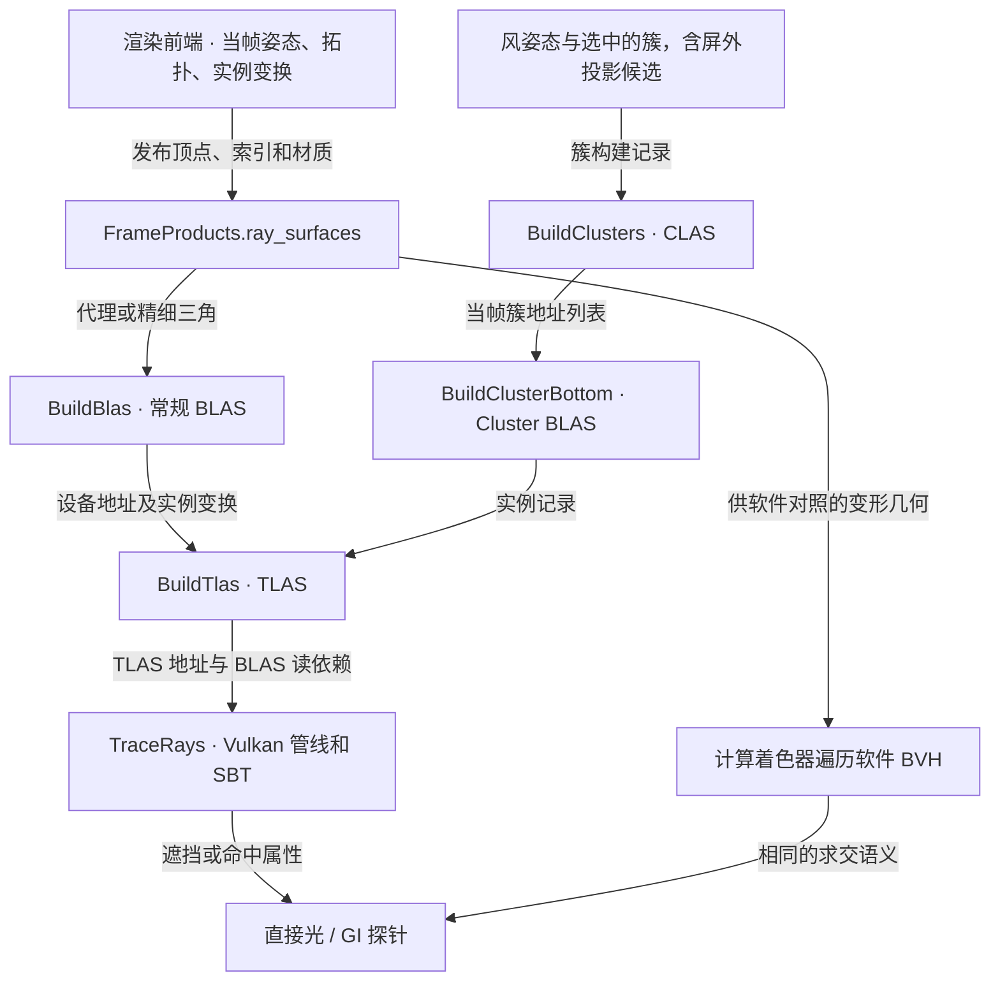

# 光线追踪 RHI 的能力和边界

当前后端可以用硬件主射线生成图像，也可以让可见性渲染调用硬件阴影和两跳漫反射。程序支持常规三角 BLAS、实例 TLAS 和 NVIDIA 三角簇 CLAS。若下一项研究需要在任意计算着色器中作硬件求交、自定义程序化图元或按材质选不同的命中组，还需要扩充 RHI 接口。Vulkan 将加速结构、光追管线和内联 ray query 分成独立能力。[Vulkan 光追指南](https://docs.vulkan.org/guide/latest/extensions/ray_tracing.html)

## 一条森林阴影射线经过的模块

1. **前端选择几何和查询语义。** 普通网格、GPU 蒙皮和流水发布当帧的表面流。森林可选择自适应投影代理，或用风动和 LOD 过渡后的簇页替换相应代理。原生场景按 TLAS 实例顺序保留命中着色需要的地址与材质槽。遮挡只需要“有没有命中”，GI 最近命中还需要重心坐标、法线、UV 和材质。独立 `rt` 预览从 raygen 发出主射线、阴影和一次镜面反射。[几何装配](../src/render/rays.rs) · [森林射线场景](../src/render/rays/scene.rs) · [森林着色接口](../shaders/scene_ray_query.glsl)
2. **RDG 声明构建和使用顺序。** 构建 pass 分开声明几何输入、BLAS 和 TLAS。追踪 pass 同时声明 TLAS 和它引用的 BLAS，编译时核对完整集合。拓扑版本引用必须是有效缓冲；TLAS 引用 Cluster BLAS 时，追踪程序必须支持簇。地址表还要声明其间接访问的资源。这些声明决定屏障、跨队列等待及瞬时内存何时可复用。[RDG 操作和资源](../src/rdg.rs) · [图编译校验](../src/rdg/validate.rs)
3. **RHI 选择跳过、更新或重建。** 常规 BLAS 在帧槽内比较形状和常驻源标识。相同顶点及拓扑可以跳过构建，拓扑稳定且顶点变化时可执行 UPDATE。新拓扑走 BUILD。TLAS 检查实例记录和子结构变更。CLAS 另有按簇的版本表及设备地址池，Cluster BLAS 再聚合当帧选中的地址。加速结构本体、临时 scratch 和实例输入分别占用内存，帧槽等待时间线退役后复用。[常规加速结构](../src/rhi/ray.rs) · [簇加速结构](../src/rhi/clusters.rs) · [物理帧槽](../src/rhi/slot.rs)
4. **录制和命中着色。** RHI 创建管线、取得着色组句柄，按设备的句柄对齐和基址对齐分别构造 SBT 步长和区域。录制器绑定管线与资源堆，把 TLAS 地址附在 push data 中，最后派发二维 `vkCmdTraceRaysKHR`。森林使用 `traceRayEXT` 实现最近命中与遮挡。多跳由 raygen 发射后续射线并结合缓存实现，当前管线的递归深度为 1。[管线](../src/rhi/pipeline.rs) · [SBT 与派发](../src/rhi/ray.rs) · [命令录制](../src/rhi/record.rs)

## 能力矩阵

| 能力 | 当前接口与可验证的边界 |
| --- | --- |
| 设备发现 | 分别查询 KHR 加速结构和 RT pipeline 特性，两者可用才启用原生 RT，再查询可选的 NV cluster 特性。普通森林代理可用 KHR；选择 Mega 需要额外的 NV 特性。森林基于预设和设置选择后端，`auto` 在普通代理配置下选择软件，岩柱森林显式选择硬件。 |
| 常规几何与实例 | 一个常规 BLAS 对应一份三角几何，位置为 RGB32F，顶点步长 32 B，索引为 uint32。TLAS 包含 3×4 变换和 24 位自定义索引；当前实例掩码固定为 0xff，SBT 记录偏移为 0。AABB、自定义 intersection shader、多几何 BLAS 和实例级掩码有待接入。 |
| 簇构建 | 支持设备端间接构建三角 CLAS 和 Cluster BLAS。构建时绑定具备簇支持的管线，追踪时检查管线与被引用几何是否匹配。当前覆盖两种构建操作，模板实例化、移动和整理簇内存仍是扩展方向。[NV 簇扩展](https://docs.vulkan.org/refpages/latest/refpages/source/VK_NV_cluster_acceleration_structure.html) · [簇构建命令](https://docs.vulkan.org/refpages/latest/refpages/source/vkCmdBuildClusterAccelerationStructureIndirectNV.html) |
| 程序与 SBT | 一条 raygen、一条 miss、一个三角命中组。支持常规 closest-hit、簇覆盖 any-hit，以及簇 any-hit 与 closest-hit 组合。callable 区为空。普通三角几何标为 opaque，按材质选择透明测试或多命中组需要扩展几何与 SBT 描述。[Vulkan 着色组](https://docs.vulkan.org/refpages/latest/refpages/source/VkRayTracingShaderGroupCreateInfoKHR.html) |
| 求交与派发 | 原生管线支持直接二维派发，检查每轴大小与总射线调用数。软件 BVH 是运行在 GPU 上的同场对照。`scene_ray_query.glsl` 的硬件分支调用 `traceRayEXT`；`VK_KHR_ray_query`、compute 内联求交及间接 trace 派发均未接入。[设备派发限制](https://docs.vulkan.org/refpages/latest/refpages/source/vkCmdTraceRaysKHR.html) |
| 生命周期与测量 | 常规 AS 按驱动报告的 BUILD/UPDATE 需求分配并对齐 scratch，缓存拥有者为帧槽。分配器能分别统计 AS 与 scratch；GPU 每个 pass 有时间戳，窗口还记录整帧跨度。静态 BLAS 压实、AS 序列化和跨帧槽共享只读 BLAS 尚无通用接口。 |

## 改进顺序与验收方式

| 顺序 | 应该改什么 | 怎么判断收益 |
| --- | --- | --- |
| 1 | 将设备能力显式交给渲染前端，区分常规管线、内联 ray query 和簇遍历。把阴影/最近命中的需求与 `Auto/Hardware/Software` 选择策略放在同一处。 | 对同一份代理几何，测试只有软件、只有 KHR 管线和额外支持簇三种能力组合。显式要求不可用能力时，在构帧前说明原因。内联路径先和现有阴影 pass 对照像素与耗时。 |
| 2 | 将 BLAS 的拓扑、姿态版本与帧槽分离。静态 BLAS 可由多槽只读共享；动态结果保留按版本退役的存储。分别评估共享 scratch、按需重建与静态压实。 | 在同一条森林推近路径分别记录 BUILD/UPDATE 次数、BLAS P95、RHI 准备 P95 和 AS/scratch 峰值。在两个在途帧和切换 LOD 时核验风动阴影。 |
| 3 | 用显式射线管线描述和一组可选 hit group 组织 SBT。优先支持一个场景内同时追踪不透明树干和需要 alpha 测试的叶片，再考虑 AABB 和 callable。 | 让两个实例选不同命中记录，检查遮挡与最近命中的一致性；只有包含簇的管线启用簇遍历。 |
| 4 | 给 RDG 和帧遥测保留各队列可对齐的 pass 起止时间，区分帧槽退役等待、设备帧跨度和实际队列重叠。优先试验将只依赖姿态的 BLAS 准备与主视图光栅重叠。 | 固定设备、相机、可见簇和画质，比较单队列和多队列的整帧 P50/P95、完成帧率、时间线交集；分别报告推近和固定远景。 |

## 已有验证

常规 KHR 测试检查主射线命中、屏外反射和静态结构复用。森林代理对照覆盖硬件和软件可见性，GI 测试核对重心 UV 取色和延迟第二跳。Mega 测试核对主视图三角 ID、风动与 LOD 覆盖、屏外树的投影以及簇缓存失效。设备限制的单元测试用合成属性覆盖 NV 缺失、单轴超限与总量超限；单设备实机通过不能代替跨厂商验证。[常规 RT](../src/experiments/lighting/tests.rs) · [GI 命中](../src/experiments/restir/diffuse_gi/tests.rs) · [Mega Geometry](../src/experiments/restir/studies/mega_tests.rs) · [开发验证命令](../CONTRIBUTING.md)
