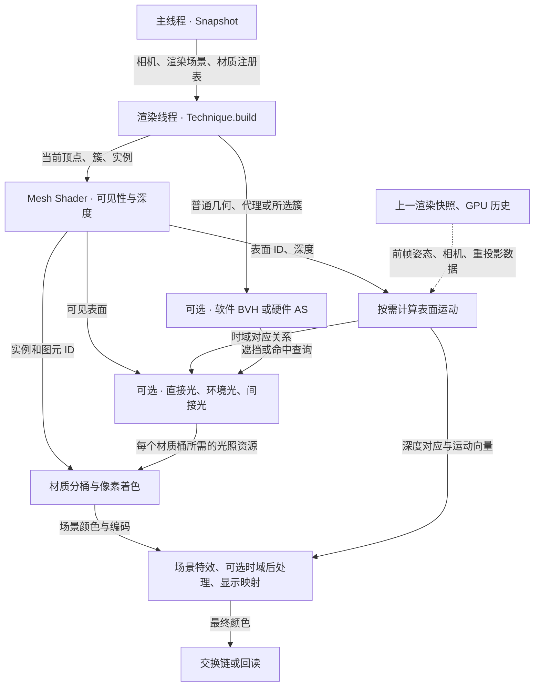

# 从场景快照到屏幕上的一个像素

本文沿一帧中资源的写入和读取解释渲染内核。常规场景以可见性缓冲为主路径。独立光追预览和射线调试视图可直接产生颜色，森林的硬件阴影则只替换遮挡查询，继续使用可见性缓冲和原材质着色。[引擎总览](architecture.md) · [模块所有权](module-map.md) · [射线输入与预览](../src/render/rays.rs)

图中实线表示本帧的数据传递，虚线表示跨帧引用。渲染线程将各项工作声明为 RDG pass，编译完成的 `FramePlan` 携带 RDG 指令与输出标识，经有界通道交给 RHI 线程。图里的每个节点可能展开为多个 pass，实际提交顺序由依赖和物理队列决定。[线程交接](../src/engine.rs) · [公共帧构建器](../src/render.rs)

## 设置可见性像素的身份

普通网格将资产局部空间的顶点、法线、UV、面和可选关节流打包成可共享输入。同一网格的刚体实例复用几何，分别提供模型矩阵。蒙皮实例提供调色板，compute shader 按最多四个关节及其权重写出世界空间顶点，后续表面记录使用单位模型矩阵。普通非发光表面把当前几何同时登记为射线输入，使光栅和遮挡查询能使用同一姿态。[几何准备](../src/render/geometry.rs) · [GPU 蒙皮](../shaders/skin.comp)

混合森林的一帧按以下依赖绘制。

1. GPU 对实例做视锥测试。启用簇级阴影时，候选区域还包含可能向接收面投影的屏外实例。入选实例将根节点写入共享 BVH 节点列表。每层间接派发消费该层的工作量，并把子节点写到列表另一段。叶节点引用一个完整 cluster group，组内的簇进入另一张全局候选列表。
2. GPU 检查组和细组的投影误差，求出当前视图的 LOD 切面。树冠和草可同时选中三角簇与稀疏体素簇。过渡带使用实例和屏幕像素的稳定散列为粗细簇分配互补覆盖。
3. 主绘制先将通过历史 Hi-Z 的三角簇与普通网格写入深度和可见性附件。计算光栅从这张深度图初始化每像素的 64 位竞争值，投影植被砖块，先排除已被挡住的像素，再用 DDA 查找最近外露面。当帧 Hi-Z 直接读竞争值中的深度，疑似遮挡的三角与砖块随后补绘。最终合并只执行一次，导出完整的 ID 和深度，供材质、运动向量和下一帧的 Hi-Z 使用。Mega Geometry 消费两次相机遮挡测试之前的选簇列表。可选择 mesh 光栅对照。[两阶段选簇和绘制](../src/experiments/clusters/gpu.rs) · [计算光栅](../shaders/brick_raster.comp) · [硬件阴影](forest-mega.md)

普通几何和所选簇都写入同一张 `R32G32_UINT` 可见性图及 `D32_SFLOAT` 深度图。第一字是本帧着色对象槽加一，零代表背景。普通网格的第二字是三角形编号。三角簇将簇号与六位图元号打包在第二字，体素命中使用外露面的页号与页内三角号。材质和运动向量由这组 ID 重建位置。三角面插值 UV 和法线，体素从对应单元取 UV 与带权法线分布。帧内对象槽、几何页号和 ECS 实体 ID 各有独立的索引空间。[普通 Mesh Shader](../shaders/plain.mesh) · [簇 Mesh Shader](../shaders/cluster.mesh) · [表面重建规则](../shaders/surface.glsl)

## 从表面身份到光照和颜色

| 消费者 | 读取什么 | 产生什么 |
| --- | --- | --- |
| 材质分类 | 可见性 ID 和对象的材质程序号 | 统计每个程序覆盖的像素，分配区间并生成间接派发参数，再把像素坐标散布到共享列表。背景色在分类阶段写入。 |
| 材质程序 | 自己的像素区间、对象与几何地址表、材质数据和纹理图集 | 每个注册程序对应一个间接 compute pass。PBR、卡通和自定义着色可出现在同一画面。场景保存程序标识，打开时解析为本次注册表的桶号。 |
| 照明生产者 | 可见表面、场景灯光、环境贴图及按需声明的运动或射线资源 | 向消费照明的材质桶附加直接光、环境光或间接漫反射数据。IBL 与 ReSTIR 同场时能分别提供环境光和直接光。 |
| 场景颜色处理 | 已着色像素、深度、可见性 ID | 组合场景可继续绘制河面反射、大气与卡通描边。原生线性 HDR 路径在时域后处理后做显示映射，BGRA8 路径保留已选择的颜色编码。 |

对象与着色材质分开存储。共享材质行可由多个实例引用，普通网格和簇表面可复用同一批变换及材质槽。材质 pass 声明对整张输出缓冲的读写，RDG 目前会为这些 pass 建立写入顺序，即使它们的像素列表互不相交。[材质注册](../src/render/materials.rs) · [场景表](../src/render/tables.rs) · [分桶及间接派发](../src/render/visibility.rs) · [照明组合](../src/experiments/light_stack.rs)

RDG 为一帧生成一份射线场景，ReSTIR 阴影和 GI-1.2 探针共用它。着色器调用 `rayOccluded` 测试给定距离内的遮挡，或调用 `rayClosest` 取得最近命中的距离、世界法线、UV 和材质槽。软件后端遍历静态 BVH 和 GPU 更新的变形 BVH。KHR 后端从当帧变形顶点和索引构建或更新 BLAS、装入 TLAS，并按实例 ID 和图元 ID 取回命中属性。NV 簇几何可把同帧风动三角簇和体素外表面写成 CLAS，汇成 Cluster BLAS 后加入 TLAS。选灯、材质求值、缓存和降噪在两种后端间共用。[射线场景](../src/render/rays/scene.rs) · [两种查询](../shaders/scene_ray_query.glsl) · [硬件命中属性](../shaders/gi12_hit.rchit) · [森林逐帧对照](procedural-vegetation.md#岩柱森林的多跳光追)

## 运动、历史与后处理共用的约定

`post::Sequence` 由渲染线程维护，保存上一个被渲染线程接收的场景和相机。主线程模拟可以前进而本次快照因队列已满被丢弃，只有渲染线程处理的快照推进这个序列。输出尺寸、技术对象、设置版本或镜头切变会使历史失效。建图失败也会丢弃上一视图。渲染可按消费者请求只发布表面对应关系，此时 ReSTIR 或降噪器即使在 `post off` 下也可使用运动，单用这一路径时投影抖动为零。[帧序列](../src/render/post.rs) · [时域消费者](../src/experiments/restir.rs)

运动 pass 从**最终可见表面**恢复对应点。静态表面使用前一相机，刚体使用前一模型矩阵乘以当前矩阵的逆，蒙皮使用同一三角形在上一姿态的三个顶点并按当前重心坐标插值。风动三角簇与体素簇均用上帧调色板重建表面。天空使用观察方向。输出向量等于“上帧位置减本帧位置”，按去抖动的**输入渲染像素**计量。记录同时含预期的上帧深度、两帧实例／表示标签及反应性标志，历史不可用的样本可被消费者拒绝。[运动源登记](../src/render/motion.rs) · [逐像素重投影](../shaders/surface_motion.comp)

TAA 读取颜色、深度和运动，在历史有效的像素做邻域约束与累积。DLSS Quality 前端按各维输出尺寸的三分之二向上取整选择输入尺寸，DLAA 使用原生尺寸。NGX 适配器把颜色与二维运动打包为 SDK 可读图像，追加显式 SDK 操作并交回输出颜色。两种后端共享颜色编码与运动约定。NGX 功能依赖设备、SDK 和运行时，RHI 线程串行处理该设备上的 NGX 调用。[TAA 后端](../src/render/post/taa.rs) · [NGX 适配](../src/render/post/ngx.rs) · [环境与调试命令](viewport-post.md)

## RDG 如何编译，RHI 如何执行

1. **声明。** 每个 pass 列出图内资源、访问方式和可选显式前驱。设备地址表携带目标资源引用，使 shader 间接读取可见于依赖分析。构建设备地址值的表单独标记，实际 AS 输入由构建操作声明。硬件射线读取聚合 Cluster BLAS 时也声明底层 CLAS 的读取。
2. **编译。** 编译器按声明记录每项资源的最后写者与读者集合，推导写后读、读后写和写后写关系，检查未初始化读取、重复访问、AS 输入与依赖环。就绪 pass 优先沿用上一逻辑队列。图像还推导采样、复制和存储用途及布局转换，同一访问已覆盖的读取可以复用同步。跟踪粒度为整项资源。[图与编译器](../src/rdg.rs) · [资源契约校验](../src/rdg/validate.rs)
3. **绑定和录制。** RHI 在 Vulkan 1.4 设备上建立每帧槽的描述符堆，用 `VK_EXT_descriptor_heap` 写缓冲区及图像描述符，按需填充几何设备地址表。扩容时，在帧槽退役后重置该槽所有命令池，再释放旧堆地址。这样即使新图删减了 pass，旧录制也会解除对驱动保留区的绑定。每个 pass 有独立命令池、主命令缓冲和时间查询池，Rayon 可并行录制常规 pass。每个步骤把普通缓冲与 AS 所需的 stage/access 掩码合为一个内存屏障，图像保留各自的布局转换，再成批调用同步命令。交换链和 SDK 内部资源另有专门的同步。[资源准备](../src/rhi/mod.rs) · [屏障与命令录制](../src/rhi/record.rs) · [Vulkan 描述符堆保留区的生命周期](https://docs.vulkan.org/refpages/latest/refpages/source/vkCmdBindResourceHeapEXT.html)
4. **提交。** 设备从同一支持图形与计算的队列族最多取三条物理队列。逻辑 Graphics、Compute、Transfer 在硬件队列不足时共享队列。相邻且属于同一物理队列的命令缓冲合为一次提交，每条物理队列有独立的时间线信号量。跨队列依赖按来源取最大待等时间线值，合并消费阶段，跳过已覆盖的等待。同一历史键从上一帧各队列的访问点衔接到本帧。[设备选择](../src/rhi/device.rs) · [提交与时间线](../src/rhi/queues.rs)
5. **呈现与退役。** 渲染前端用 `FrameGraph::set_output` 选择输出缓冲，窗口用 `present` 登记呈现目标。编译时为指定的缓冲添加呈现操作，录制时对同一目标额外登记回读。独立诊断可以在任意位置读取自己的资源。GPU 将最终 BGRA 缓冲拷入取得的交换链图像并转换至呈现布局。优先 MAILBOX，回退 FIFO，WSI 获取与呈现使用二值信号量。窗口最多允许两个已提交的帧槽，时间线达到退役值后可复用该槽。无窗口截图或测试同步退役并取得像素。桌面 GPUI HUD 由窗口合成器叠加，场景录制读取后处理输出。[输出选择](../src/engine.rs) · [交换链](../src/rhi/present.rs) · [HUD 与录制边界](viewport-post.md)

硬件追踪有两层校验。图编译时核对拓扑版本的缓冲引用、TLAS 中实际使用的 BLAS 集合以及程序对簇几何的支持；提交准备时用设备属性检查簇能力、二维派发各轴上限和总 invocation 上限。前者可以在无 GPU 的单元测试中定位非法图，后者在准备帧槽和创建管线前报告本机限制。[图校验](../src/rdg/validate.rs) · [设备限制](../src/rhi/ray.rs) · [光追能力与扩展方向](ray-tracing-rhi.md)

控制台 `timeline capture.json` 导出当前完成帧的 Chrome Trace JSON。Perfetto 的每一行对应一个物理队列，方块是 pass 的 GPU 时间戳区间。点击方块可见 pass 编号、RDG 前驱、资源屏障、提交 signal 和等待的队列/值。依赖跨帧或阶段等待与生产者的时间范围重叠时，导出器在消费提交上标记等待。设备缺少跨队列公共时钟时仍能测量单 pass 耗时。设置 `RENDER_LAB_GPU_QUEUES=1` 可用同一条相机路径测量单队列。[导出器](../src/rhi/timeline.rs) · [岩柱森林对照](forest-architecture-benchmark.md)

## 如何读一帧的报告

| 需要定位的问题 | 对应证据 |
| --- | --- |
| 相机移动是否再次上传整份几何 | 对照 `resident_upload_bytes`、`scene_table_upload_bytes` 与 `dynamic_upload_bytes`。不可变资产可跨帧槽共享，场景行表按该帧槽上次退役的版本补写。动态输入另记。 |
| 两条依赖边是否真的触发两次同步调用 | 先看 pass 的 parents 和 resource barriers，再看实际 `barrier_calls`、图像屏障、物理队列数和 timeline waits。逻辑边、资源同步需求、Vulkan 调用分别计数。 |
| GPU 工作是否重叠，CPU 是否并行录制 | 支持公共时间域时看 `gpu_span_ms`，每个 pass 的 GPU 时间用于定位阶段开销。CPU 另看 `recording_workers` 与 `overlapping_recordings`。窗口帧间隔还包括取得交换链图像和 CPU 管线等待。 |
| 某个实验的工作集为何随视角改变 | 对照所选簇、三角形和 AS 构建计数，再看本帧有效工作量、帧槽保留容量及全后端显存账本。三者分别反映本帧需要处理的数据、下次可复用的空间和当前物理分配。 |

性能基准及测试设备、分辨率和相机条件分别记录在实验专题中。[统计字段定义](../src/rhi/frame.rs) · [帧槽和 GPU 时间戳](../src/rhi/mod.rs) · [增量表上传](../src/rdg/rows.rs) · [森林相机与阴影实测](forest-mega.md)

## 帧产物、临时缓冲和显存预算

`Technique::build` 返回 `FrameGraph`。光栅路径在 `FrameProducts` 发布可见性、深度、按需生成的运动和完成变形的射线表面。独立光追可只发布颜色。编译会核对输出容量并生成 `FramePlan`，其中的通用 RDG 命令计划只描述资源、pass 和访问。窗口、离屏截图和录制使用明确选定的输出。[帧产物](../src/render/frame_graph.rs) · [像素与回读回归](../tests/frame_exports.rs)

RHI 为新建的 `VkBuffer` 和 `VkImage` 查询驱动的尺寸、对齐、兼容内存类型和独立分配要求。普通工作缓冲、历史和资产缓冲的绑定尺寸在 8 MiB 以内时，按 Vulkan 内存类型从已提交的大块中查找对齐区间。找不到时，小于等于 128 KiB 的绑定新开 2 MiB 块，其余新开 16 MiB 块。每个块只有线性缓冲，支持设备地址。可映射的主机一致块一次映射，CPU 只访问自身缓冲对应的区间。图像、原生加速结构及其专用缓冲、描述符堆、SBT、大缓冲和驱动要求或偏好独立分配的资源使用专属内存。新块受预算限制或分配失败时，会尝试按实际绑定大小独立申请。[分配器](../src/rhi/allocator.rs) · [设备绑定](../src/rhi/device.rs) · [Vulkan 独立分配要求](https://docs.vulkan.org/refpages/latest/refpages/source/VkMemoryDedicatedRequirements.html)

时间线退役并释放最后一个所有者后，缓冲析构会销毁 Vulkan 对象，把区间归还到原块。相邻空闲区间立即合并，整块空闲时解除映射并释放设备内存。同一块可以容纳两帧各自独占的区间，仍在途的区间继续归原帧使用。预算和驱动分配峰值按整块计费。各类别按绑定所占的驱动要求字节数计量，块里尚未绑定的空间单列在 `pool_free`。各类别加上这项与真实提交量相等。[对齐、回收与预算回归](../src/rhi/allocator.rs) · [双帧槽回归](../src/rhi/present/tests.rs)

RHI 根据本设备上的物理队列映射和已有 pass 依赖，追踪每个临时缓冲在各队列上的最后一次访问。尺寸和放置偏好相同、第一次访问为纯写的临时缓冲，只有在旧资源的全部使用能排在新资源首次写入之前时才共用分配。同队列用内存屏障交接，跨队列用已有顺序上的时间线等待覆盖交接，并把作用域拓宽至新访问。尚有并行读者、需 CPU 回读、含初始数据、通过地址表寻址的资源及历史缓冲各自保有存储。两个在途帧槽各自保有本槽的可写缓冲。[复用规划](../src/rhi/transient.rs) · [队列提交](../src/rhi/queues.rs) · [Vulkan 同步规范](https://docs.vulkan.org/spec/latest/chapters/synchronization.html)

每个帧槽等自己的队列时间线退役后才重新绑定。资源插入或移除时，槽按资源名、可选所有者和同名出现次序找回上次的物理对象，再核对存储类型、用途及尺寸。可用性仍由本帧 RDG 的初始化与读写声明决定。共享不可变资产按 CPU 数据块身份和 Vulkan 用途查找。时域历史另按历史键、字节数和渲染尺寸查找，跨帧读写通过时间线同步。[槽与资源身份](../src/rhi/slot.rs) · [绑定与缓存](../src/rhi/mod.rs)

数量随镜头变化的 GPU 工作缓冲通过 `scratch_buffer` 声明。森林的近、远投影顶点与索引使用网格资产 ID，合并三角形和 BVH 使用各自的用途名。缓冲在设备本地内存中按容量分档增长，例如 128、192、256 MiB。当容量充足时只更新描述符的有效字节数，着色器的 `.length()`、派发数量和射线遍历都服从当前几何。此类分配独占本帧槽，下一帧的首次读取仍需要本帧写入。生产者暂时消失时，槽会缓存它的分配，在超过 120 次本槽准备后回收。持续使用的缓冲保留已经达到的容量。设备范围、显存预算或内存分配失败会限制扩容，必要时按实际需要申请并尝试兼容的可映射内存。[阴影几何](../src/experiments/clusters/gpu/proxy.rs) · [逻辑长度与容量](../src/rhi/slot.rs) · [森林镜头复测](procedural-vegetation.md#山谷阴影缓冲与镜头移动)

从仓库根目录运行窗口 benchmark，在 JSON 的 `memory.managed` 读取本次提交时的设备本地与非本地存量。`transient` 为帧内工作集，`history` 为时域历史，`asset` 为不可变常驻输入，`acceleration` 为加速结构及其专用数据，`build_scratch` 为构建临时空间，`infrastructure` 含描述符堆与射线着色器绑定表。`class_peaks` 是各类独立高水位，`peak_device_local_bytes` 是某个时刻的真实总峰值。前者的各项可能在不同时间达到峰值。`profile.transient_reuse_bytes` 是本帧复用的逻辑缓冲字节数；Vulkan 分配取整的实际大小由显存账本记录。[显存账本](../src/rhi/memory.rs) · [帧报告](../src/rhi/frame.rs)

预算默认不限，可用 `Backend::set_device_local_budget(Some(bytes))` 指定，或在启动前设置 `RENDER_LAB_GPU_BUDGET_MIB`。分配器按实际堆属性计费，有兼容的非本地内存时，允许映射缓冲回落到该堆。预算不足时，后端释放已经退役的临时缓冲和无人使用的常驻资产，保留在途帧及活动时域历史，并重新尝试一次。必须放入设备本地内存的资源仍超过预算时返回错误。统计和上限涵盖此后端显式分配的 Vulkan 内存，交换链图像、驱动内存和 NGX 内部分配由各自的所有者管理。原有 `memory.device_local_bytes` 仍表示单帧图资源和该槽描述符堆的占用，便于复查历史实验。

`memory.managed.activity` 从后端创建起累计全部堆上成功的分配次数、分配字节、释放次数和释放字节。两次连续提交的差值给出这一帧的物理内存活动。与同帧 `profile.rhi_prepare_ms` 以及设备时间戳 `profile.gpu_span_ms` 一起看，可以区分驱动准备资源造成的停顿和 GPU 绘制开销。[显存计数](../src/rhi/memory.rs) · [双帧槽复测程序](../examples/forest_shadows/zoom.rs)

### 按资源用途查显存

控制台 `memory idle` 按闲置容量显示前六项，`memory alloc` 按本次提交的绑定申请量排序，`memory driver` 按真正向 Vulkan 申请的字节排序。可附名称片段或所有者编号，例如 `memory idle Detailed shadow vertices`、`memory idle #19`。统计来自最近完成的一帧，其提交快照在两帧并行时仍能独立查询。窗口 benchmark 的 JSON 在 `memory.managed.purposes` 提供完整列表。[控制台命令](../src/console/memory.rs) · [用途账本](../src/rhi/purposes.rs)

| 字段 | 口径 |
| --- | --- |
| `name / class / owner / slot / heap_index` | 物理资源的 RDG 用途、类别、所有者、帧槽和实际内存堆。共享资产和历史的槽为空。别名和跨槽共享的同一个物理绑定只归属一次。`device_local` 标明堆的位置。 |
| `used_bytes / capacity_bytes / unused_bytes` | 缓冲的声明有效长度、保留容量和二者之差。已填充的常驻资产和历史保留其有效范围，实际 shader 访问量随工作负载决定。暂时移出 RDG 的投影工作缓冲在缓存期间有效长度为零。图像容量按驱动要求的大小记录。这里的闲置空间仍归缓冲所有，块内可供其他缓冲申请的空间另计入 `pool_free`。 |
| `last_growth_submission` | 此用途在本堆、本槽保留的总容量，相对上一份提交快照上升的最近一次提交序号。缩短描述符范围只改变有效字节。 |
| `bindings / frame_bindings` | 此用途申请及归还的物理绑定区间次数、字节。前者自后端启动累计，后者是本次提交增量，字节含驱动要求的对齐空间。 |
| `driver / frame_driver` | 实际 Vulkan 内存分配和释放。整块的申请与释放均归首次开块的用途，复用块内空间的用途只增加自身绑定活动。后端全局的 `suballocations` 专门累计块内区间的申请和归还。 |

森林路径可在引擎根目录运行 `cargo run --release --locked --example forest_shadows -- target/forest-memory zoom 1 purposes --gi direct --rays software`。逐帧 CSV 保留总量，`memory-purposes.jsonl` 在普通帧输出有分配活动的用途，在每个镜头阶段末尾输出完整快照。测时去掉 `purposes` 参数。[森林实测](procedural-vegetation.md#森林缓冲子分配与用途统计)
