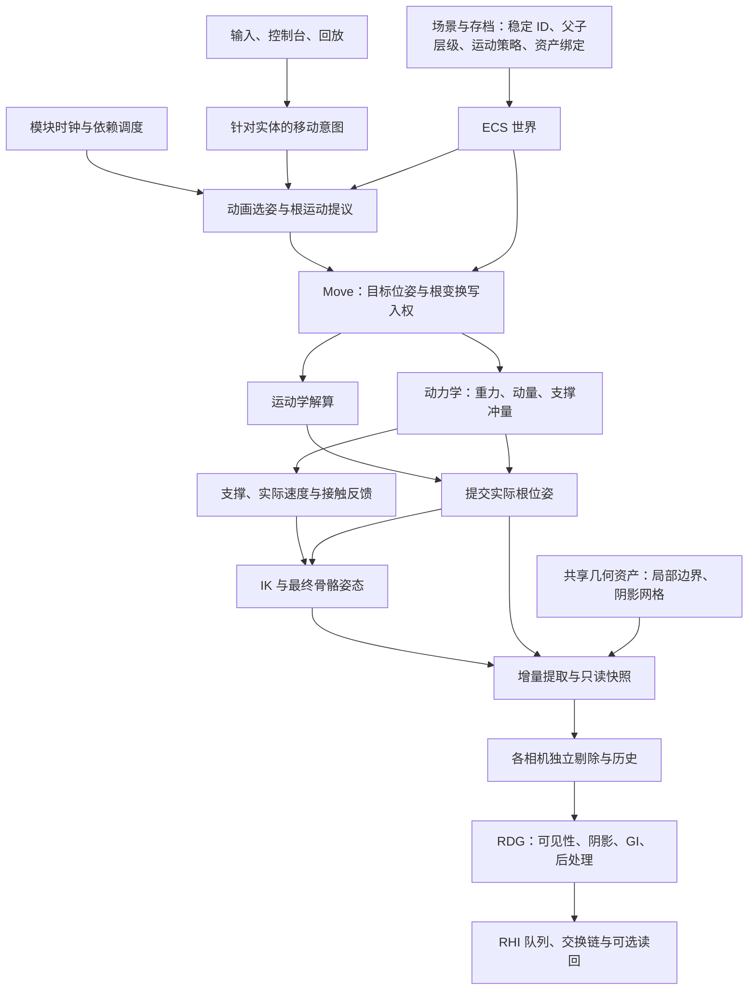

# 世界、运动与模块时钟

## 设计依据

Epic 在 2026 年 6 月给出的 UE6 方向是把 UE5 和 UEFN 汇合，用 Verse 与 Scene Graph 构建玩法，利用事务语义支持回滚和重算。11 月 20 日的更新修订了迁移预期：Epic 计划从 UE6 Early Access 起采用新玩法框架，取消早期版本保留旧 Actor 框架与 Blueprints 的安排。截至 2026 年 11 月 27 日，这仍是开发路线。我们采用其中与本项目直接相关的两个原则：实体通过可组合能力获得行为，模拟状态在明确的提交点发布。本引擎用本地 Rust ECS 和固定子步事务实现这两条原则。[UE6 方向](https://www.unrealengine.com/news/the-road-to-ue-6) · [11 月修订](https://www.unrealengine.com/news/an-update-on-blueprints-and-the-path-to-ue6)

已经可用的 UEFN Scene Graph 通过父子实体、组件与可复用资产组装场景。Mass 的 processor 按所需数据选取实体，适合批量计算。在本引擎中，层级负责变换与存档，稳定 ID 负责交叉引用，系统访问声明决定能够并行处理的集合。动画、可动性和资产绑定因此可以独立存在。[Scene Graph](https://dev.epicgames.com/documentation/fortnite/getting-started-in-scene-graph-in-fortnite) · [MassEntity](https://dev.epicgames.com/documentation/unreal-engine/overview-of-mass-entity-in-unreal-engine?lang=en-US)

Mover 将控制输入交给模拟 tick，物理驱动的示例用支撑约束执行提议的移动。Unreal 将 tick 先后关系、频率和碰撞参与方式分别表达。本项目保留同一子步内的因果关系，把频率设在共同消费这条反馈链的时钟域上。Unreal 的 Nanite fallback mesh 说明同一源几何可以有按用途选择的表示；本项目进一步区分可见材质命中与仅用于遮挡的代理。[Mover](https://dev.epicgames.com/documentation/unreal-engine/comparing-mover-and-character-movement-component-in-unreal-engine?lang=en-US) · [Tick groups](https://dev.epicgames.com/documentation/en-us/unreal-engine/actor-ticking-in-unreal-engine) · [碰撞参与](https://dev.epicgames.com/documentation/unreal-engine/collision-response-reference-in-unreal-engine) · [Nanite fallback](https://dev.epicgames.com/documentation/unreal-engine/nanite-technical-details)

UEFN 的变换组件可单独指定变换参考原点，缺省使用实体父级。本轮普通线性物体按父坐标表达速度、加速度和变换；阴影代理使用源网格局部坐标。共享代理通过资产 ID 引用，父子层级不承担资产所有权。Verse 还区分可回滚与不可回滚的操作。对应到本引擎，模拟先在任务上下文积累变更，再提交世界，交换链呈现与文件输出在快照发布后进行。这里的事务覆盖本地调度器管理的写入。Epic 也在 UE5.9 预览版的 UAF 中把分层、Pose Search、Warping 和 Control Rig 继续接到同一套求值流程。我们用可替换的根运动提议作为同类边界，银狼可以更换选姿器并沿用现有动力学与 IK。[Scene Graph 变换](https://dev.epicgames.com/documentation/en-us/fortnite/transforms-in-scene-graph-in-unreal-editor-for-fortnite) · [Verse effect 参考](https://dev.epicgames.com/documentation/fortnite/verse-api/versedotorg/scenegraph/entity/addcomponents?lang=en-US) · [UAF 版本说明](https://dev.epicgames.com/documentation/unreal-engine/unreal-engine-5-9-release-notes)

### 从 UE6 方向落实到代码的三条边界

| Epic 已公开的设计 | 本引擎的对应决策 | 仍待解决的问题 |
| --- | --- | --- |
| UE6 的玩法模型面向 Scene Graph 上的实体与组件。UEFN 已公开的组件生命周期把加入场景、开始模拟、结束模拟和移出场景分开。 | 装配器先在候选世界恢复引用与类型、选出运动和渲染提供者、绑定系统，再一次替换活动世界。渲染线程可继续消费旧快照。 | 更大规模的场景成员动态替换需要按子树批量发布结构变化，并测量重绑成本。[组件生命周期](https://dev.epicgames.com/documentation/en-us/fortnite/verse-api/versedotorg/scenegraph/component) |
| UEFN 组件可接收物理之前和之后的 tick。Mover 把输入与模拟结果分开。 | 角色的一步里，动画提议、动力学和接触 IK 彼此声明依赖，分享同一时钟。独立模块拥有自己的时钟，物理独占模拟角色的最终平移。 | 网络预测要另外记录带步号的输入、可恢复的物理和动画状态，并验证重放。当前提供本地子步失败回滚和存档恢复。[Mover](https://dev.epicgames.com/documentation/unreal-engine/comparing-mover-and-character-movement-component-in-unreal-engine?lang=en-US) |
| Epic 公布了事务式 Verse、新数据模型与模块化的方向。 | ECS、只读提取快照和 RDG 分别描述世界状态、提交给视图的数据和 GPU 工作。非持久的 Vulkan 句柄、线程及 GPU 缓存由运行时持有。 | UE6 的公开路线未具体规定渲染线程数量、Rust ECS 的组织、时钟频率或 BVH 的布局。这里的实现选择可由引擎自己的负载验证。[UE6 路线](https://www.unrealengine.com/news/the-road-to-ue-6) · [11 月更新](https://www.unrealengine.com/news/an-update-on-blueprints-and-the-path-to-ue6) |

## 实施前的架构图

## 推演与取舍

1. **输入、动画和物理同改一个角色。** 在原接触实验里，动画先把预期根写进实体，动力学随后读回这个中间值并覆盖它。新边界传递独立的根运动提议，同一子步只发布一次求解后的根。IK 消费本步实际支撑。静止根仍允许骨骼播放；运动学对象能移动；受力物体的位移由积分器产生。编辑器的放置操作仍允许修改静止对象。
2. **异频模拟碰到同一个物体。** 角色意图采样、运动、物理和接触 IK 共享角色时钟，避免慢一拍的触点。风与独立特效由各自时钟调度。频率配置与运行中累积的不足一步时间分开管理，记录补步上限和超时丢弃。渲染消费采纳的快照，RHI 消费计划，GPU 根据真实依赖工作，呈现仍遵循交换链。
3. **同一资产出现在多机位、多种光线中。** 预计算 AABB 使用视觉源网格的局部空间。实例变换负责平移、旋转与缩放。刚体可用保守边界，变形对象使用已有姿态或簇界。专用投影网格可替代阴影遮挡几何。GI 需要的 UV、法线、材质与命中三角形继续来自视觉几何。旧快照应能一直使用原先的资产版本。
4. **旧场景、失败和压力。** 缺少新组件的存档沿用原先模块的默认行为。角色平移的写入者必须唯一，子步失败保留回滚；已发布的绘制列表、GPU skin、独立视图历史、图裁剪以及显式单/多队列对照仍在渲染侧使用。网络复制、分布式事务和通用刚体接触求解各有单独的正确性条件，不计入这轮实现。

## 模块怎样协作

| 边界 | 代码中的约定 |
| --- | --- |
| 输入 → Move | 控制器按稳定实体 ID 发布方向。普通物体可以直接设置父空间目标速度。角色控制器还能将方向交给匹配器和轨迹预测。[控制器和根运动请求](../src/movement.rs) |
| 动画 → 动力学 → IK | 动画发布期望的局部根变换。动态角色保留动画提出的朝向，平移由本子步的重力、动量及支撑求解决定。运动学角色使用目标变换。静止根保留原位姿，骨骼仍可更新。接触 IK 最后读取实际根与支撑。[角色阶段](../src/experiments/motion/silver/contact/stage.rs) · [动力学](../src/experiments/motion/silver/contact/dynamics.rs) |
| 模块 → 调度器 | 普通运动和银狼接触链各有一个 60 Hz 固定时钟，单帧最多追赶 8 步。独立动画、风和特效可以单独改频。系统申报前驱以及组件和实体读写集。旧场景按模块默认策略恢复，具有委派关系的求解器在装配时接管动画根；两个独立提供者认领同一根会报出实体与组件。[模块注册](../src/experiments/assembly.rs) · [时钟、事件与存档](architecture.md#模拟模块的更新频率) |
| 实体 → 场景提取 | 可动性为静止或可动，物理参与为关闭、只查询或模拟。静止物体可由已注册的支撑几何参与查询，动态物体必须可移动。只查询是参与策略，具体可查询的形状由物理模块提供。普通动态物体使用父坐标下的线性质点，银狼和支撑装置使用自己的接触求解器。当前普通质点没有角动量、通用碰撞形状和刚体堆叠求解。[实体策略](../src/scene/motion_policy.rs) · [普通运动](../src/movement/linear.rs) |
| 资产 → 剔除与射线 | 创建资产实体后用 `World::set_geometry_assets` 写入视觉网格 ID、可选的局部 AABB 和投影网格 ID；用 `World::bind_geometry_assets` 将多个普通刚体实例绑定到它。可见性剔除使用变换后的保守边界。ReSTIR 阴影使用遮挡表示，GI 用视觉几何取 UV 和材质。蒙皮和风动对象继续走各自的变形路径。[资产与后端对照](rendering.md#绑定预计算包围盒与阴影代理) |

## 在引擎里复现

从仓库根运行 `cargo run --release --locked -- --experiment movement`。左侧物体固定，中间物体水平移动，右侧物体在重力下落下。三个物体共享视觉网格。控制台输入 `object` 列出显式配置过策略的 ID，再用 `object 3` 这类命令查看单个物体的运动策略、动力学状态、包围盒及代理。使用 `object 3 movable off` 和 `object 3 velocity 0.25 0 0` 可让左侧物体沿父坐标 X 轴移动。输入 `tick movement 30` 将普通运动改成 30 Hz。用 `save target/movement.scene.json` 和 `load target/movement.scene.json` 可复验场景与时钟恢复。[实验入口](../src/experiments/movement_lab.rs) · [对象命令](../src/console/object.rs)

普通银狼与接触银狼可以在同一世界分别使用 `silver-motion` 和 `character` 时钟。独立角色在移动后挂接物理求解器时，从当前根位姿和已发布的父空间速度接续。已知转速的踏板将有符号角速度传给支撑查询，低频下一步跨过整圈仍能计算起跳速度。[角色成员与接触回归](../src/experiments/motion/silver/contact/tests.rs)

银狼使用 `--experiment silver-contact-duo`。输入 `tick character 120` 可把两个角色和共享支撑装置的反馈链一起切到 120 Hz。使用 `--experiment restir` 可检查大厅里球体的刚体资产绑定。时钟表、增量提取和 GPU 验证各覆盖不同的边界。[调度回归](../tests/simulation_schedule.rs) · [运动回归](../tests/movement_runtime.rs) · [资产回归](../tests/geometry_assets.rs)

## 已测结果

- 500 名银狼、177,042 个实体、3,000 个蒙皮实例。16 个 worker，每个样本含六个固定子步和一次提取。在重构前后各跑两轮，模拟 P95 从 26.76–37.59 ms 变为 27.02–32.96 ms，提取 P95 从 7.68–9.54 ms 变为 8.34–8.80 ms。两个区间分别重叠。完成混合角色与转台修复后，同条件复跑一轮，模拟 P50/P95 为 25.12/28.95 ms，提取 P50/P95 为 7.51/8.22 ms。每帧读 500 个姿态块和 10,500 个脏关节局部变换，检查 159,500 个调色板关节。相对基线尚未测出稳定的 CPU 加速。[条件及四轮原始统计](animation-physics.md)
- 在 RTX 5070 上用相同机位放大投影代理，软件 BVH、KHR 管线和内联查询各改变 4,730 个直接光像素，两份主可见性 ID 逐字节相同。单独替换共享资产访问 1 个实体、更新 0 个实例；给一个实例重绑时更新 1 个实例。[GPU 对照](rendering.md#绑定预计算包围盒与阴影代理) · [提取断言](../tests/geometry_assets.rs)
